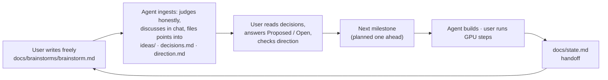

# Rin: working guide

Loaded automatically every session. Everything needed to continue lives on disk: no session depends on an earlier chat.

## The project in one line
Raw video in → the frames worth labelling, labelled by teacher models and checked by a person → small student models, with numbers proving the selection helped. That loop is the **holy grail** ([docs/ideas/holy_grail.md](docs/ideas/holy_grail.md)); everything else comes after it.

## How we iterate

This is the only place the working loop is described; other docs link here.

**Session start:**
1. Read this file, then [docs/state.md](docs/state.md), then run `git status`.
2. If `docs/brainstorms/brainstorm.md` has text, ingest it first:
   - discuss it;
   - file each point under `docs/`;
   - add a dated `processed_*.md` (where each point went) and a `raw_*.md` (the user's text) to `docs/brainstorms/`;
   - empty the inbox.
3. Confirm the next step with the user before coding.

**Session end:**
1. Rewrite `docs/state.md`: done, next, waiting on the user.
2. Update the decisions, ideas and milestone file the work touched.
3. Compact: delete what no longer holds.

**Inbox vs chat:** the inbox is for big things: new intent, new ideas, changes of direction. Day-to-day milestone work (questions, feedback, small calls) happens in chat as usual, and follows the same loop on a smaller scale.

**Chat is not storage:** conclusions go to disk in the same session, into the milestone file, `decisions.md` or `state.md`. **Over-documenting is also a failure:** one fact lives in one place, and every other doc links to it.

## Where things live
| Path | What |
|---|---|
| [docs/README.md](docs/README.md) | Map of the docs and reading order |
| [docs/state.md](docs/state.md) | **Handoff:** where we are, what's next, what waits on the user |
| [docs/brainstorms/brainstorm.md](docs/brainstorms/brainstorm.md) | **The user's inbox** |
| `docs/` (rest) | direction, decisions, ideas, milestones, models, data, lessons: see [docs/README.md](docs/README.md) |
| `scripts/` | Small runnable helpers (e.g. `pull_meva.sh`) |
| `vendors/` | Git submodules: the user's engines plus upstream repos (see "Vendors") |
| `rin_v1/` | Old repo, read-only reference, gitignored (see "Using rin_v1") |
| `workspace/` | Everything heavy and local, gitignored: `media/`, `checkpoints/`, and from M1 `store/` ([docs/data.md](docs/data.md)) |

The root stays at these folders, plus `src/`, `tests/` and `pyproject.toml` from M1 (the standard Python layout). Anything else goes inside one of them.

## Roles
- **User (executive + manager):** writes intent and feedback into the inbox, answers decisions, owns direction, the data model and the API. An electrical engineer, not a software engineer, who wants to learn: explain software choices in plain terms (what it does, why, what breaks without it), and teach through worked drafts.
- **Agent (execution):** turns brainstorms into ideas and decisions; drafts the usage code; builds servants, the store, jobs and environments; plans milestones. Brings large decisions to the user with one recommendation, not a survey.

## Vendors
- **The user's own engines** (`sam3_engine`, `gemma_emb_engine`): the user maintains them. When a servant needs something they lack, the agent asks for a **feature request in chat**: what, why, and the call the agent wants to make. The request goes in `docs/state.md` under "Waiting on the user" until it ships. Meanwhile the agent does not patch around it.
- **Upstream repos** (`boxmot`): never modify. Work around them in the servant, and record the workaround in [docs/models/README.md](docs/models/README.md).

## Using rin_v1
`rin_v1/` is a source of **facts**, not code to port (D-18).
- **When:** at the start of each milestone, read the parts of v1 that the milestone touches: the salvage table in [docs/lessons/rin_v1.md](docs/lessons/rin_v1.md), plus the matching `rin_v1/docs/notes/` and v1 source.
- **What to take:** gotchas, working settings and label lists go to [docs/models/](docs/models/README.md) or the milestone file. A pure helper may be copied only with the user's OK, and gets rewritten to the new rules (fail loudly, current data model).
- **Never:** import from `rin_v1`, or copy its structure (pillars, contracts, Master/Recorder/Servant classes, staging).

## Rules
- **No sycophancy, no pedantry.** Give the honest view, including "this won't work".
- **Ask, don't guess.** If a request is ambiguous, ask one short question with a recommended answer.
- **Diagrams.** Rin is a flow-based design: use mermaid diagrams in docs wherever a flow, a loop or a structure is involved.
- **Flag debt.** Name every shortcut and its later cost, and record it in the milestone file.
- **Fail loudly.** No bare `except`, no silent fallbacks, no defaults that hide a missing input.
- **No unmeasured claims.** No speed or accuracy numbers in docs unless measured here.
- **Current truth only.** Rewrite docs in place. No changelogs, "superseded by" notes or ticked-off lists. Git keeps history.
- **No bloat.** No copied model cards (link them, record only what they leave out), no empty placeholder files, no plans more than one milestone ahead.
- **Relative links** in docs.
- **The user runs git** (add, commit, push). The agent may read with status/diff/log.
- **The user runs GPU work.** The agent hands it over as numbered copy-paste steps, each saying what pass and fail look like and what to send back on failure. The agent may run CPU-only checks itself.
- **Hardware:** one RTX 4070 Ti SUPER (16 GB), WSL2.
