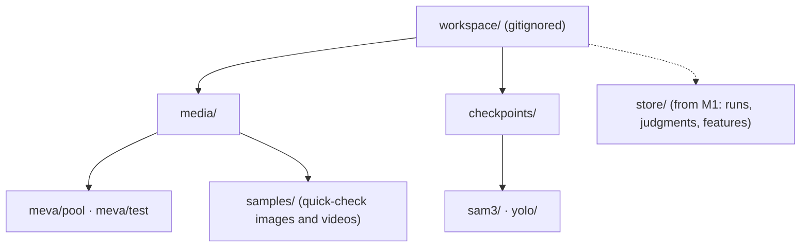
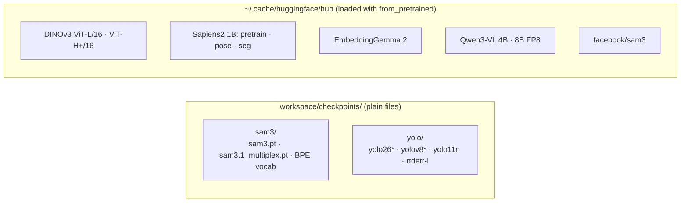

# Data

Everything heavy and local lives in `workspace/` (gitignored, D-21).

## MEVA slice (holy grail pool and test)

To re-download: `bash dev/scripts/pull_meva.sh` (needs only curl; skips files already on disk).

| Set | Path | Content |
|---|---|---|
| Pool | `workspace/media/meva/pool/` | School site, cameras G299 and G330, 2018-03-07 09:55–10:55: 24 clips of 5 min, 4.2 GB |
| Test | `workspace/media/meva/test/` | Same cameras on 2018-03-09, 10:10–10:25: 6 clips (15 min per camera), 1.1 GB |

- **Format:** H.264 in `.avi`, 1920×1080, 30 fps, about 9,000 frames per clip (checked with ffprobe on one pool clip).
- **Why this slice:** one site and two fixed cameras over a continuous hour is what raw CCTV looks like. The test set comes from a different day, so it shares no near-duplicate frames with the pool (D-13).
- **Source:** the public S3 bucket `mevadata-public-01` ([AWS Open Data](https://registry.opendata.aws/mevadata/)), folder `drops-123-r13/`. Paper: [arXiv 2012.00914](https://arxiv.org/abs/2012.00914).
- **Activity annotations** (37 types, for the actions work later) are not downloaded yet. Kitware publishes them separately.
- **Licence:** CC BY 4.0. Attribution required: *"Multiview Extended Video with Activities" (MEVA) dataset by Kitware Inc. and the Intelligence Advanced Research Projects Activity (IARPA)*, licensed under CC BY 4.0.

## Samples

`workspace/media/samples/`: small media for quick checks and demos (smoke tests of a servant, not experiments).

| Kind | Files |
|---|---|
| Images (11) | `aquatic`, `crowd`, `dishes`, `girl`, `groceries`, `human`, `kitchen`, `merchandise`, `merchandise2`, `trash`, `wildlife` (`.jpg`) |
| Videos (8) | `01_dog`, `02_cups`, `03_blocks`, `04_coffee` (720p, 29.97 fps, about 10 s); `05_juggle` (720p, 24 fps, 10 s); `30s_vid` (720p, 30 fps, 35 s); `demo_skeleton` (1080p, 30 fps, 2.6 s); `vestTrainingVideo` (1799×908, 29.33 fps, 49 s) |

## Weights

- **Local files** are for libraries that take a file path (the SAM3 engine, Ultralytics).
- **Everything that loads with `from_pretrained`** stays in the HF cache: don't copy it into `workspace/`.
- v1's tuned `botsort_best.yaml` was left behind on purpose, because its tuning was broken (v1 CR-29). Sapiens 1 checkpoints stay in `dev/rin_v1`, unused.
