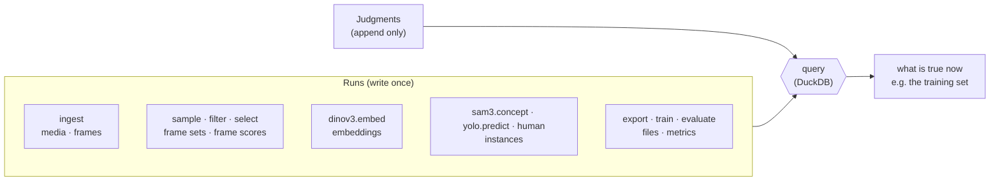
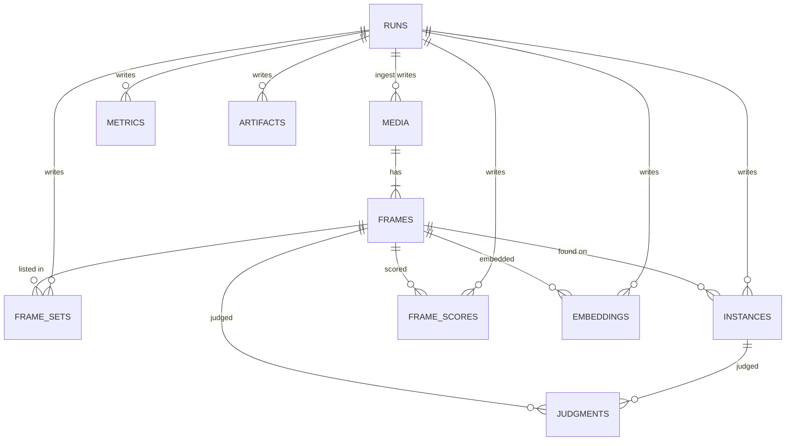

# Data model

> **Agreed with the user in M0 (2026-11-24).** The core's data model, implied by the usage draft, [usage.md](usage.md). The user owns it: changes need the user's OK. Its design calls are D-22 … D-30 in [decisions.md](decisions.md).

## 1. The idea in three sentences

Every step that produces data is a **run**: ingesting files, sampling frames, filtering, embedding, selecting, labelling, exporting, training, evaluating, and even a person drawing boxes. A run writes its records once, into its own folder, and never changes them. A person's opinion of those records is a **judgment**, stored on its own, and "what is true now" is a query over runs and judgments (D-02).



## 2. The tables

Each table below is what you query. On disk it is the union of that table's Parquet files across all run folders (§4).



### runs: one row per run

| Column | Type | Meaning |
|---|---|---|
| `run_id` | str | Sortable and readable: `20261124-101503-sam3.concept-k3f9` (time, step, 4 random characters). No counters (D-23) |
| `step` | str | Which function made it: `core.ingest`, `curate.select`, `sam3.concept`, `yolo.train`, `human.annotate`, … |
| `model` | str or null | `facebook/sam3`, `yolo26s`; null for rules (filters, selection) |
| `checkpoint` | str or null | File path, or HF repo plus revision |
| `checkpoint_sha256` | str or null | So "which weights?" has an exact answer even if a file is replaced |
| `config` | JSON | Every argument the step ran with, including the ones left at their default, so nothing is hidden |
| `inputs` | list[str] | The `run_id`s this run read |
| `tags` | JSON | Free labels set by the caller, e.g. `{"method": "kcenter", "n": 250, "seed": 0}`. Used to group results (usage §C4) |
| `code` | JSON | Git commit of Rin (`rin`), whether `src/` had uncommitted changes (`src_dirty`; then the run folder keeps them as `src.diff`, hash in `src_diff_sha256`), library versions a job reports, and the vendor engine's commit (from the first vendor servant, M3) |
| `who` | str | Who started it: the user, or the person who clicked or drew the boxes for `sam3.click` and `human.*` runs. Not `by`: that is a reserved word in SQL |
| `started_at`, `finished_at` | timestamp | |

### media: one row per file (written by `core.ingest`)

| Column | Type | Meaning |
|---|---|---|
| `media_id` | str | `m` + the first 16 hex characters of the file's SHA-256: the same file always gets the same id, so a rebuilt store keeps a person's judgments attached. A path already ingested, or the same content under another path, is refused, loudly |
| `path` | str | Relative to `workspace/` (the store's parent), e.g. `media/meva/pool/….avi`. Media outside the workspace is refused, so store and media move together |
| `kind` | `video` or `image` | An image is a media with exactly one frame (D-24) |
| `width`, `height` | int | Pixels. Needed to turn stored [0, 1] geometry back into pixels (D-10) |
| `n_frames` | int | Counted by decoding, not estimated from duration × fps |
| `site`, `camera` | str or null | From the optional `describe` function the user passes to ingest (for MEVA it reads the filename: `school`, `G299`); null without one |
| `started_at` | timestamp or null | Wall-clock time of frame 0. Frame time = `started_at + pts`: what a later robotics or analysis project needs |
| `split` | str | `pool`, `val`, `test`, `sample`. Set per file, so a recording can never be split by frame (D-13). Selection only reads `pool` media; `val` picks a student's checkpoint (D-31) |

### frames: one row per frame in the file (written by `core.ingest`)

| Column | Type | Meaning |
|---|---|---|
| `media_id`, `frame_idx` | str, int | **The join key** for everything frame-level (D-09) |
| `pts` | float | Seconds since frame 0, from the decoded frames' own timestamps (sorted into display order: AVI with B-frames attaches them scrambled). Stored, never used to join |

The MEVA pool hour is 216,189 rows (measured in M1). That is small for Parquet.

### frame_sets: an ordered or unordered list of frames

| Column | Type | Meaning |
|---|---|---|
| `run_id` | str | The run that produced this list |
| `media_id`, `frame_idx` | | A frame |
| `rank` | int or null | Order of preference, for selection and mining. Budget N = the frames with `rank < N` (D-28) |

Written by sampling, filtering, de-duplication, selection, mining and set operations (union, minus). Every frame list a model ever sees is a frame set with an id, so "which frames did SAM3 see?" always has an answer.

### instances: one thing found on one frame

| Column | Type | Meaning |
|---|---|---|
| `run_id`, `instance_idx` | str, int | The key. `instance_idx` counts within the run, so ids never need remapping |
| `media_id`, `frame_idx` | | Where |
| `class` | str | Plain text, e.g. `person` (D-25) |
| `score` | float or null | The model's confidence; null for a person's box |
| `x0`, `y0`, `x1`, `y1` | float | Box corners in [0, 1] (D-10, D-25) |
| `mask_rle` | str or null | COCO compressed RLE, at the media's full resolution |
| `keypoints` | list of `{name, x, y, score}` or null | Matched by name, never by position (D-11) |
| `track_id` | int or null | Same object across frames, unique within the run. No holy grail step uses it; it is here so tracking needs no new table |

Written by `sam3.concept`, `sam3.click`, `yolo.predict`, `human.annotate`, later Sapiens2. The area of a box is a query (`(x1-x0)*(y1-y0)`), not a column.

### frame_scores: a number about a whole frame

| Column | Type | Meaning |
|---|---|---|
| `run_id`, `media_id`, `frame_idx` | | |
| `name` | str | `motion`, `blur`, `dark`, `bright`; later `uncertainty` |
| `value` | float | |

Long format (one row per score), so a new score needs no new column.

### embeddings: an index row per vector; the vectors live in an array file

| Column | Type | Meaning |
|---|---|---|
| `run_id`, `row` | str, int | `row` is the row in `runs/<run_id>/embeddings.npy` (float16, N × D) |
| `media_id`, `frame_idx` | | |
| `instance_idx` | int or null | Null for a whole-frame vector; set for a per-box vector (D-14, holy grail §4) |
| `kind` | str | `cls`, `mean_patch`, `box_pooled` |

### metrics, artifacts

| Table | Columns | Example |
|---|---|---|
| `metrics` | `run_id`, `name`, `class` (or null), `value` | an evaluate run: `mAP50-95` for `person` |
| `artifacts` | `run_id`, `name`, `path` | a train run: `weights` → `runs/<id>/files/best.pt`; an export run: `data_yaml` → `runs/<id>/files/data.yaml` |

### judgments: a person's or a rule's verdict

**Not built.** The holy grail's test set doesn't need it: the checked labels are one `human.annotate` run, started from SAM3's boxes, and a frame is complete when it is in that run's frame set (D-33). This table is the design for when a step must judge a run *without replacing it* (e.g. accepting or rejecting a teacher's boxes on training frames); it is built then, not before.

| Column | Type | Meaning |
|---|---|---|
| `judgment_id` | str | |
| `target` | `instance`, `frame` or `span` | |
| `run_id` | str or null | The labels being judged. Null means the frame itself is bad (corrupt, wrong camera), whoever labelled it |
| `instance_idx` | int or null | For `instance` |
| `media_id`, `frame_idx` | | For `frame` and `instance`; the start for `span` |
| `frame_end` | int or null | For `span` only (actions later; no holy grail step uses it) |
| `verdict` | `accept` or `reject` | |
| `reason` | str or null | "missed 2 people on the left" |
| `who`, `judged_at` | str, timestamp | Not `by` and `at`: both are reserved words in SQL |

What the verdicts mean (D-27):
- **frame, accept**: *every* object of the class on this frame is labelled, and the labels are right. This is the claim a test set needs. Accepting each box is not enough, because a person SAM3 missed is not a box anyone can reject.
- **frame, reject**: don't use this run's labels on this frame.
- **instance, reject**: drop this one box.
- **instance, accept**: keep this box even if its score is below the gate. This is the first fix for a missed person: SAM3 often found them, with a low score, and D-26 kept the box.
- **A person the model never found** comes in as a new run, `human.annotate` (drawn by hand in the viewer, D-16), with the person in `who`.
- **Latest wins**: when one target has several judgments, the one with the latest `judged_at` counts. Nothing is deleted.

## 3. Who writes what, who reads what

Every table is written by at least one cell of [usage.md](usage.md) and read by at least one later cell. A table nobody reads is bloat; a read nobody writes is a bug.

| Table | Written by (usage cell) | Read by (usage cell) |
|---|---|---|
| runs | every cell | C4 results, everything (provenance) |
| media, frames | A1 ingest | A2 sample, every servant (paths, sizes), export |
| frame_sets | A2 sample, A3 keep, A5 dedupe, B1 test sample, C1 select, C2 union, D minus, D mine | every step that takes frames |
| frame_scores | A3 score | A3 keep |
| embeddings | A4 embed | A5 dedupe, C1 select |
| instances | B2 & C2 `sam3.concept`, B3 `human.annotate`, D `yolo.predict` | B3 check, B4 export, C3 dataset, D mine |
| judgments | not built (D-33) | |
| artifacts | B4 & C3 export, C3 train | C3 train, C3 evaluate, D predict |
| metrics | C3 evaluate | C4 results |

## 4. On disk

```
workspace/store/
  runs/
    20261124-101503-sam3.concept-k3f9/
      run.json              # the runs row: provenance
      instances.parquet     # whichever tables this run writes
      files/                # exports, weights (artifacts)
    20261124-093000-core.ingest-p2x1/
      run.json  media.parquet  frames.parquet
  tmp/                      # runs being written; renamed into runs/ when complete
  judgments/
    20261124-160212-nic.parquet   # one file per judging session, never edited
  frames/                   # cache of decoded frame images (D-29): the only part safe to delete
    <media_id>/<frame_idx>.jpg
```

- **A run is visible only when it is complete.** A job writes into a temporary folder and renames it into `runs/` as its last act. A crashed job leaves no half-run behind (D-23). Files and folders are pushed to disk (`fsync`) before the rename, so a hard crash can't leave an empty `run.json`.
- **The store is not derived data.** From M3 it holds a person's checks, clicks and drawn boxes, which nothing can rebuild. Back it up; never delete it to start over.
- **Tables are DuckDB views** over `runs/*/<table>.parquet`. Adding a run adds files; no existing file is ever rewritten. This is why v1's 2.35 s rewrite of one big JSON catalog can't happen here.
- **The frame cache** holds JPEGs of the frames a servant needs, written the first time they are needed. It is derived data: delete it and it rebuilds. JPEG re-compresses frames that H.264 already compressed; every model sees the same pixels, so the experiment stays fair, but it is a shortcut (debt in [usage.md §Debt](usage.md#debt-this-draft-takes-on)).

## 5. What v1 had that this drops

| v1 | Here | Why |
|---|---|---|
| Category table, supercategories, alignment dicts | `class` is plain text; the servant maps its prompts to it | One string column; nothing to keep in sync (D-25) |
| Image records and video records; image annotations and frame detections | One media table; an image is a one-frame media; one instances table | Half the record types, same information (D-24) |
| Tracks as nested lists of observations | `track_id` on instances | Flat rows query well; nested lists caused shared-object bugs (v1 CR-32) |
| Branches, commits, staging, id counters | Immutable runs plus judgments | D-02 |
| Float timestamps as join keys | `frame_idx` joins, `pts` is stored | D-09 |
