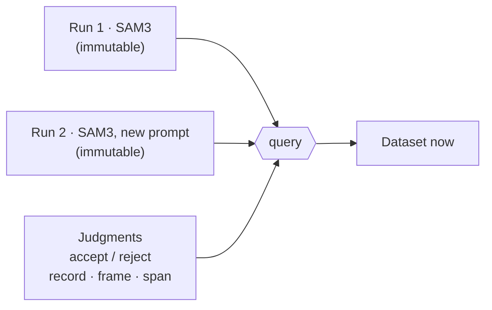

# Decisions

> Current truth only: rewrite an entry when it changes, delete it when it no longer holds. IDs stay stable once code cites them; gaps are fine.
> **Agreed** = the user said yes. **Proposed** = the agent recommends it and is waiting for a yes or no. **Open** = needs the user's call.

## Agreed

**D-01 · Standardise the data, not the models.** The core is the data model, the store and provenance. Servants are thin, separate adapters with no shared base class and no common request type. A model's special abilities stay in its own servant's arguments. *Why:* v1's three-pillar contracts were about 60% of the SDK and the source of most bugs ([lessons/rin_v1.md](lessons/rin_v1.md)).

**D-02 · Runs are immutable; judgments are separate; "what is true now" is a query.** Every servant call writes a new run (records plus model, checkpoint, config, inputs), and nothing is edited in place. Accept and reject go into a judgments table, per record, frame or time span. The training dataset is a query over runs and judgments. *Why:* this removes v1's branches, commit, fork, id remapping and shared nested objects, which together caused v1 CR-12, CR-32 and Studio debts A1–A5 and A8. Provenance comes for free.

**D-03 · Naming: Master and Servants**, as defined in [direction §3](direction.md#3-naming-master-and-servants).

**D-04 · The holy grail is the first goal.** Everything is built around it; actions, tracking and analysis come after ([direction §4](direction.md#4-scope-and-order)).

**D-05 · Actions are window classification.** We accept that action timing is only as precise as the window stride, and do not attempt VLM temporal localisation ([ideas/vlm_window_actions.md](ideas/vlm_window_actions.md)).

**D-06 · Mask2Former is parked.** Stuff classes (sky, road) come from YOLO semantic segmentation. Revisit for an in-house DINOv3-backbone model.

**D-15 · The toolkit is a Python library first.** Master and Servants are driven from notebooks and a small command line. No HTTP API or web app of our own until a concrete need forces one: the viewer can't do something review needs, or another machine or program must call Rin.

**D-16 · FiftyOne serves as a disposable viewer, and is where a person draws boxes.** It reads a throwaway export (`viewer.show`) and is never the data model; what a person draws there comes back as a run (`human.annotate`). No `sam3.click` for now: clicks serve fine-grained instances and masks, and Rin labels boxes (the user, 2026-11-26).

**D-17 · Holy grail setup:**
- class "person" first;
- student YOLO, with RF-DETR as the fallback if YOLO hits a dead end;
- selection embeds frames with DINOv3; EmbeddingGemma 2 is tried only if whole-frame DINOv3 doesn't beat random ([usage A4](usage.md#a4--embed));
- success means curated selection reaches random selection's test mAP with half the labels or fewer.

**D-18 · Everything is written fresh; v1 is read, never copied.** v1's engines are shaped around its pillar contracts (`setup`, `categories`, `ground_*`, HTTP apps), and the user's vendor engines (`sam3_engine`, `gemma_emb_engine`) already are the clean API. v1 stays a source of *facts*: gotchas, working settings, label lists, and the cases its tests checked ([lessons §Worth reading](lessons/rin_v1.md#worth-reading-v1-code-with-facts-in-it)). *Why:* the user puts modular organisation first; copied code brings v1's shape with it.

**D-19 · Milestones are planned one ahead.** Only the next milestone gets a detailed file; later ones stay one line each and are reshaped by what we learn. *Why:* v1's plans ballooned before the first loop ran.

**D-07 · Servants run as batch jobs, not daemons.** A job runs in its model's environment, reads a spec and cached frames from disk, writes its raw outputs (arrays, plain files) into the run's temporary folder and exits, which frees the VRAM. The caller in the core environment opened that folder, and afterwards builds the tables, checks them against the schema and files the run (D-23); the job never imports Rin, so model environments don't inherit the core's package versions. No ports, no PM2, no VRAM governor. A long-lived process only for an interactive need (e.g. SAM3 clicks, VLM chat), and only when that need arrives. *Why:* v1's stale SAM3 prompts (CR-25) and governor races came from long-lived services.

**D-08 · Records are stored as Parquet and queried with DuckDB; features go in plain array files.** *Why:* v1's JSON catalog took 2.35 s per commit at 250k records, and SQL replaces its five hand-written indexes.

**D-09 · The frame index is the join key; pts is stored beside it.** Frames are decoded with the container's real per-frame timestamps (v1 ADR 5; the node10 cameras run at 14.25 and 14.33 fps). *Why:* v1 matched float timestamps within a tolerance and silently lost frames (CR-30).

**D-10 · Geometry is normalised to [0, 1] in the store.** Pixels only at the edges (servant input and output, exporters, viewers). Media records carry width and height. *From v1 ADR 4.*

**D-11 · Keypoints are matched by name, never by position.** *From v1 ADR 16:* Goliath is not ordered like COCO (its wrists are points 62 and 41).

**D-12 · Exporters write each training framework's own format** (YOLO, COCO, RF-DETR, MOT). No generic dataloader. *From v1 ADR 2.*

**D-13 · Splits are made by recording, never by frame.** The holy grail's test set comes from a different day than its pool, and a person checks its labels. *Why:* frames of one video are near-duplicates, so splitting by frame leaks. And a test set labelled by SAM3 alone measures agreement with SAM3, not accuracy.

**D-14 · Feature storage is selective.** By default, store CLS vectors and per-box pooled vectors. Compute patch grids on demand, or cache them only for selected frames. *Why:* patch grids take megabytes per frame, so hours of video would take tens of GB.

**D-20 · `uv` manages every environment.** The core and each servant get their own `uv` venv; the user's engines are installed with `pip install -e vendors/<engine>`. System FFmpeg replaces what conda provided. *Why:* one fast tool with lockfiles, instead of conda plus pip.

**D-21 · One gitignored `workspace/` holds everything heavy and local:** `media/`, `checkpoints/` and, from M1, `store/`. The root stays small: `CLAUDE.md`, `dev/` (notes, research, scripts, tests, and the gitignored `rin_v1/`), `docs/` (the repo's real docs, from M1), `src/`, `vendors/`, `workspace/`, plus `pyproject.toml`. *Why:* the user's v1 habit; it keeps the root tidy, and keeps notes about building Rin apart from docs for someone using it.

**D-22 · Everything that produces data is a run, and every step has one shape:** `module.verb(m, inputs, **own_args) -> Run`. That includes ingest, sampling, filters, selection, set operations, exports, training, evaluation and a person's drawn boxes (`human.annotate`). The Master only holds the store, judgments and queries. A servant is a caller in the core environment (real signature, checks arguments, no model imports) plus a job in the model's environment. *Why:* one provenance mechanism for everything, and a typo fails before the GPU starts.

**D-23 · One folder per run, write once; no counters.** A job writes into a temporary folder and renames it into `store/runs/` as its last act, so a crashed job leaves nothing. Tables are DuckDB views over the runs' Parquet files; no file is ever rewritten. `run_id` is time + step + 4 random characters; records are keyed `(run_id, index)`. Judgments go in one new file per judging session. *Why:* v1's id counters, remapping and whole-catalog rewrites (CR-12, 2.35 s per commit) can't happen.

**D-24 · An image is a media with one frame.** One media table, one frames table, one instances table. *Why:* halves v1's record types with no loss.

**D-25 · Classes are plain strings; boxes are four [0, 1] columns.** No category table or alignment dicts: a servant maps its prompts to class names in its own arguments. Boxes are `x0, y0, x1, y1`; masks are COCO RLE; keypoints a list of `{name, x, y, score}`. *Why:* the simplest thing that queries well in SQL.

**D-26 · Measure once, decide cheaply.** Expensive steps store everything they produce above a low floor (SAM3's `score_floor`, every filter score). Thresholds and quality gates are applied later, in a cheap step or the dataset query, and saved in that run's config. *Why:* changing a gate never re-runs the teacher or re-decodes video.

**D-27 · What a judgment means.** Targets: an instance, a run's labels on a frame, or a span. A frame *accept* means every object of the class on that frame is labelled correctly. An instance *accept* keeps a box even below the score gate. Missing objects are fixed cheapest first: accept SAM3's low-score box; else a person clicks and SAM3 draws (`sam3.click`); else a person draws (`human.annotate`). Added boxes are runs with the person in `who`. The latest judgment on a target wins; nothing is deleted. *Why:* a missed person isn't a box anyone can reject, and a test set needs complete frames.

**D-28 · Selections are ranked; budgets are prefixes.** Each selection writes up to `n_max` frames in order; budget N takes the first N. SAM3 labels the union of all selections once. *Why:* nested budgets give smoother curves and cut SAM3 time, the most expensive step.

**D-29 · Frame images are decoded once into a cache in the store** (`store/frames/<media_id>/<frame_idx>.jpg`), the first time a servant needs them. Derived data: safe to delete. *Why:* no servant environment needs its own video decoding. *Cost:* JPEG is a second lossy compression; identical for every model, so comparisons stay fair.

**D-30 · The test set is a random sample of the test footage (D-32), never curated, and a person checks every frame.** Empty frames stay in. *Why:* a curated test set rewards the method that curated it; empty frames are where false positives show up.

**D-31 · Students pick their checkpoint on a fixed val split: whole recordings from a different hour of the pool day**, same cameras. Ingested as `split="val"`, so selection never sees them. Labelled by SAM3 and not checked by a person: val only chooses `best.pt`, it never scores anything. Every method, seed and budget uses the same val set and trains on all N of its frames. Which hour: chosen in M4. *Why:* Ultralytics needs a val set to pick a checkpoint. Using the test set would leak it into training; carving val out of the N selected frames splits by frame (D-13) and shrinks every budget; clips from the pool's own hour sit seconds from pool clips (same people, same places), so val would flatter whichever checkpoint memorised them (audit 2026-11-26).

**D-32 · The test set comes from several days, none of them the pool day.** Random frames (D-30) from five 15-minute windows of G299 and G330: 2018-03-09 10:10, 03-11 11:15, 03-12 10:00, 03-13 15:55, 03-15 14:55 (the clips are listed in `dev/scripts/pull_meva.sh`). Equal windows, so a random draw over all of them is even in expectation. Still 300 frames, checked by a person, never the pool day (D-13). *Why:* the first window alone was one event, a seated assembly of 30–60 people, unlike the pool hour; a test set that is one event measures that event ([m3_sam3_test_day](../research/m3_sam3_test_day/README.md)).

## Proposed

**D-33 · The checked test labels are one `human.annotate` run, started from SAM3's boxes.** The viewer copies SAM3's boxes above a gate (0.5 from the pilot) into the field the person edits, and shows its 0.3–0.5 boxes as a read-only hint layer. The person deletes wrong boxes, fixes loose ones, draws missing ones, and tags each frame `done`. `human.annotate` files the result as a run (`who` = the person, the SAM3 run among its `inputs`). **A frame is complete when it is in that run's frame set.** No accept/reject judgments for the test set; the `judgments` table and `m.dataset`'s judgment rules wait until a step needs to judge a run without replacing it. *Why:* it answers the open question below with one run that holds the checked truth, instead of assembling it from SAM3's run, judgments and added-box runs; the pilot shows correcting SAM3 at 0.5 means deleting about 1 box in 7 and adding about 1 person in 15 ([m3_pilot](../research/m3_pilot/README.md)). *Cost:* each checked box no longer points at the SAM3 box it came from (recoverable by overlap); D-27's judgment path and the `judgments` table go unused for now.

## Open

**Which judgment makes a fixed frame count as complete** ([data_model judgments](data_model.md#judgments-a-persons-or-a-rules-verdict), [usage B3–B4](usage.md#b3--a-person-checks-it)). The agent's recommendation: D-33 above.
- **Lower priority, the user's thought:** a person's corrections of a model's boxes could later serve as human-feedback data (an RLHF-style loop). Under D-33 both runs are kept, SAM3's and the corrected one, so the pairs can be rebuilt by overlap. Not a goal now.
