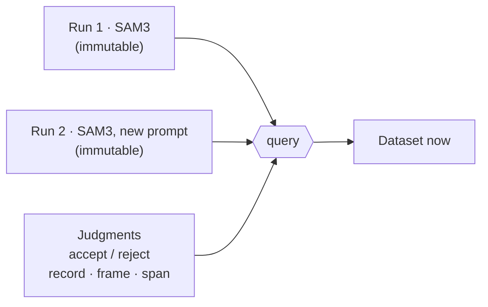

# Decisions

> Current truth only: rewrite an entry when it changes, delete it when it no longer holds. IDs stay stable once code cites them; gaps are fine.
> **Agreed** = the user said yes. **Proposed** = the agent recommends it and is waiting for a yes or no. **Open** = needs the user's call.

## Agreed

**D-01 · Standardise the data, not the models.** The core is the data model, the store and provenance. Servants are thin, separate adapters with no shared base class and no common request type. A model's special abilities stay in its own servant's arguments. *Why:* v1's three-pillar contracts were about 60% of the SDK and the source of most bugs ([lessons/rin_v1.md](lessons/rin_v1.md)).

**D-02 · Runs are immutable; judgments are separate; "what is true now" is a query.** Every servant call writes a new run (records plus model, checkpoint, config, inputs), and nothing is edited in place. Accept and reject go into a judgments table, per record, frame or time span. The training dataset is a query over runs and judgments. *Why:* this removes v1's branches, commit, fork, id remapping and shared nested objects, which together caused v1 CR-12, CR-32 and Studio debts A1–A5 and A8. Provenance comes for free.

**D-03 · Naming: Master and Servants**, as defined in [direction §3](direction.md#3-naming-master-and-servants).

**D-04 · The holy grail is the first goal.** Everything is built around it; actions, tracking and analysis come after ([direction §4](direction.md#4-scope-and-order)).

**D-05 · Actions are window classification.** We accept that action timing is only as precise as the window stride, and do not attempt VLM temporal localisation ([ideas/vlm_window_actions.md](ideas/vlm_window_actions.md)).

**D-06 · Mask2Former is parked.** Stuff classes (sky, road) come from YOLO semantic segmentation. Revisit for an in-house DINOv3-backbone model.

**D-15 · The toolkit is a Python library first.** Master and Servants are driven from notebooks and a small command line. No HTTP API or web app of our own until a concrete need forces one: the viewer can't do something review needs, or another machine or program must call Rin.

**D-16 · FiftyOne serves as a disposable viewer, and is where a person draws boxes.** It reads a throwaway export (`viewer.show`) and is never the data model; what a person draws there comes back as a run (`human.annotate`). No `sam3.click` for now: clicks serve fine-grained instances and masks, and Rin labels boxes (the user, 2026-11-26).

**D-17 · Holy grail setup:**
- class "person" first;
- student YOLO, with RF-DETR as the fallback if YOLO hits a dead end;
- selection embeds frames with DINOv3; EmbeddingGemma 2 is tried only if whole-frame DINOv3 doesn't beat random ([usage A4](usage.md#a4--embed));
- success means curated selection reaches random selection's test mAP with half the labels or fewer.

**D-18 · Everything is written fresh; v1 is read, never copied.** v1's engines are shaped around its pillar contracts (`setup`, `categories`, `ground_*`, HTTP apps), and the user's vendor engines (`sam3_engine`, `gemma_emb_engine`) already are the clean API. v1 stays a source of *facts*: gotchas, working settings, label lists, and the cases its tests checked ([lessons §Worth reading](lessons/rin_v1.md#worth-reading-v1-code-with-facts-in-it)). *Why:* the user puts modular organisation first; copied code brings v1's shape with it.

**D-19 · Milestones are planned one ahead.** Only the next milestone gets a detailed file; later ones stay one line each and are reshaped by what we learn. *Why:* v1's plans ballooned before the first loop ran.

**D-07 · Servants run as batch jobs, not daemons.** A job runs in its model's environment, reads a spec and cached frames from disk, writes its raw outputs (arrays, plain files) into the run's temporary folder and exits, which frees the VRAM. The caller in the core environment opened that folder, and afterwards builds the tables, checks them against the schema and files the run (D-23); the job never imports Rin, so model environments don't inherit the core's package versions. No ports, no PM2, no VRAM governor. A long-lived process only for an interactive need (e.g. SAM3 clicks, VLM chat), and only when that need arrives. *Why:* v1's stale SAM3 prompts (CR-25) and governor races came from long-lived services.

**D-08 · Records are stored as Parquet and queried with DuckDB; features go in plain array files.** *Why:* v1's JSON catalog took 2.35 s per commit at 250k records, and SQL replaces its five hand-written indexes.

**D-09 · The frame index is the join key; pts is stored beside it.** Frames are decoded with the container's real per-frame timestamps (v1 ADR 5; the node10 cameras run at 14.25 and 14.33 fps). *Why:* v1 matched float timestamps within a tolerance and silently lost frames (CR-30).

**D-10 · Geometry is normalised to [0, 1] in the store.** Pixels only at the edges (servant input and output, exporters, viewers). Media records carry width and height. *From v1 ADR 4.*

**D-11 · Keypoints are matched by name, never by position.** *From v1 ADR 16:* Goliath is not ordered like COCO (its wrists are points 62 and 41).

**D-12 · Exporters write each training framework's own format** (YOLO, COCO, RF-DETR, MOT). No generic dataloader. *From v1 ADR 2.*

**D-13 · Splits are made by recording, never by frame.** The holy grail's test set comes from a different day than its pool, and a person checks its labels. *Why:* frames of one video are near-duplicates, so splitting by frame leaks. And a test set labelled by SAM3 alone measures agreement with SAM3, not accuracy.

**D-14 · Feature storage is selective.** By default, store CLS vectors and per-box pooled vectors. Compute patch grids on demand, or cache them only for selected frames. *Why:* patch grids take megabytes per frame, so hours of video would take tens of GB.

**D-20 · `uv` manages every environment.** The core and each servant get their own `uv` venv; the user's engines are installed with `pip install -e vendors/<engine>`. System FFmpeg replaces what conda provided. *Why:* one fast tool with lockfiles, instead of conda plus pip.

**D-21 · One gitignored `workspace/` holds everything heavy and local:** `media/`, `checkpoints/` and, from M1, `store/`. The root stays small: `CLAUDE.md`, `dev/` (notes, research, scripts, tests, and the gitignored `rin_v1/`), `docs/` (the repo's real docs, from M1), `src/`, `vendors/`, `workspace/`, plus `pyproject.toml`. *Why:* the user's v1 habit; it keeps the root tidy, and keeps notes about building Rin apart from docs for someone using it.

**D-22 · Everything that produces data is a run, and every step has one shape:** `module.verb(m, inputs, **own_args) -> Run`. That includes ingest, sampling, filters, selection, set operations, exports, training, evaluation and a person's drawn boxes (`human.annotate`). The Master only holds the store, judgments and queries. A servant is a caller in the core environment (real signature, checks arguments, no model imports) plus a job in the model's environment. *Why:* one provenance mechanism for everything, and a typo fails before the GPU starts.

**D-23 · One folder per run, write once; no counters.** A job writes into a temporary folder and renames it into `store/runs/` as its last act, so a crashed job leaves nothing. Tables are DuckDB views over the runs' Parquet files; no file is ever rewritten. `run_id` is time + step + 4 random characters; records are keyed `(run_id, index)`. Judgments go in one new file per judging session. *Why:* v1's id counters, remapping and whole-catalog rewrites (CR-12, 2.35 s per commit) can't happen.

**D-24 · An image is a media with one frame.** One media table, one frames table, one instances table. *Why:* halves v1's record types with no loss.

**D-25 · Classes are plain strings; boxes are four [0, 1] columns.** No category table or alignment dicts: a servant maps its prompts to class names in its own arguments. Boxes are `x0, y0, x1, y1`; masks are COCO RLE; keypoints a list of `{name, x, y, score}`. *Why:* the simplest thing that queries well in SQL.

**D-26 · Measure once, decide cheaply.** Expensive steps store everything they produce above a low floor (SAM3's `score_floor`, every filter score). Thresholds and quality gates are applied later, in a cheap step or the dataset query, and saved in that run's config. *Why:* changing a gate never re-runs the teacher or re-decodes video.

**D-27 · A complete frame, and what a judgment would mean.** A frame is *complete* when every object of the class on it has a correct box; a test set needs complete frames, because a missed person isn't a box anyone can reject. For the test set, completeness is a person's `done` tag on the frame of a `human.annotate` run (D-33); missing people are added from SAM3's low-score hints or drawn by hand, with the person in `who`. Judgments (accept or reject a run's box or frame without replacing the run; the latest wins, nothing is deleted) are the design for when a step needs them ([data_model](data_model.md#judgments-a-persons-or-a-rules-verdict)); none does yet.

**D-28 · Selections are ranked; budgets are prefixes.** Each selection writes up to `n_max` frames in order; budget N takes the first N. *Why:* nested budgets give smoother curves, and one ranked list per method and seed serves every budget.

**D-29 · Frame images are decoded once into a cache in the store** (`store/frames/<media_id>/<frame_idx>.jpg`), the first time a servant needs them. Derived data: safe to delete. *Why:* no servant environment needs its own video decoding. *Cost:* JPEG is a second lossy compression; identical for every model, so comparisons stay fair.

**D-30 · The test set is a random sample of the test footage (D-32), never curated, and a person checks every frame.** Empty frames stay in. *Why:* a curated test set rewards the method that curated it; empty frames are where false positives show up.

**D-31 · Students pick their checkpoint on a fixed val split: whole recordings from a different hour of the pool day**, same cameras. Ingested as `split="val"`, so selection never sees them. Labelled by SAM3 and not checked by a person: val only chooses `best.pt`, it never scores anything. Every method, seed and budget uses the same val set and trains on all N of its frames. **The val clips:** 2018-03-07 11:30–11:40, G299 and G330 (4 clips of 5 min), 35 minutes after the pool ends, plus 17:00–17:10 the same day, an empty gym (4 clips; the pool takes 17:10–17:40 as separate recordings, D-13; an empty room has no people for val to have memorised). Val goes through the same chain as the pool (D-41). The 17:00 clips are there because 11:30 alone gave 308 frames of 45–61 people each and not one empty frame, so `best.pt` paid nothing for boxes on an empty gym (audit 2026-11-27 §1.3). *Why:* Ultralytics needs a val set to pick a checkpoint. Using the test set would leak it into training; carving val out of the N selected frames splits by frame (D-13) and shrinks every budget; clips from the pool's own hour sit seconds from pool clips (same people, same places), so val would flatter whichever checkpoint memorised them (audit 2026-11-26). *Cost:* 11:30 looks like the same event as the pool hour (an assembly, groups standing on the floor), so some people recur; val still picks checkpoints equally for every method, and scores nothing.

**D-32 · The test set comes from several days, none of them the pool day.** Random frames (D-30) from five 15-minute windows of G299 and G330: 2018-03-09 10:10, 03-11 11:15, 03-12 10:00, 03-13 15:55, 03-15 14:55 (the clips are listed in `dev/scripts/pull_meva.sh`). Equal windows, so a random draw over all of them is even in expectation. Still 300 frames, checked by a person, never the pool day (D-13). *Why:* the first window alone was one event, a seated assembly of 30–60 people, unlike the pool hour; a test set that is one event measures that event ([m3_sam3_test_day](../research/m3_sam3_test_day/README.md)).

**D-33 · The checked test labels are one `human.annotate` run, started from SAM3's boxes, with suspect frames flagged.** The viewer copies SAM3's boxes above a gate (0.5 from the pilot) into the field the person edits, shows its 0.3–0.5 boxes as a read-only hint layer, and tags `flagged` the frames where code finds a suspect box (the same spot on many frames of one camera, a near-duplicate; `human.suspects`). The person checks flagged frames first, then looks at every box on sparse frames, fixes, deletes and draws (`person`, or `crowd` per D-34), and tags each frame `done`. `human.annotate` files the frames tagged `done` as a run (`who` = the person, the runs it started from among its `inputs`). **A frame is complete when it is in that run's frame set.** No accept/reject judgments for the test set; the `judgments` table and `m.dataset`'s judgment rules wait until a step needs to judge a run without replacing it. *Why:* one run holds the checked truth, instead of assembling it from SAM3's run, judgments and added-box runs; in the pilot SAM3 at 0.5 found 93% of the people a person boxed blind ([m3_pilot](../research/m3_pilot/README.md)). The flags are there because the first check without them (about 2.8 s per frame) kept 99.4% of SAM3's boxes unchanged, including bags boxed as people on empty frames ([audit](../audits/2026-11-26-m3.md#triage)); with them, the second check caught those errors ([m3_checked_test_set](../research/m3_checked_test_set/README.md)): boxes already drawn get passed by the eye. *Cost:* each checked box no longer points at the SAM3 box it came from (recoverable by overlap); D-27's judgment path and the `judgments` table go unused for now. A person's corrections of a model's boxes could later serve as human-feedback data (the user's thought, an RLHF-style loop): both runs are kept, so the pairs can be rebuilt by overlap.

**D-34 · Ambiguous crowds are ignore regions in the test set, decided before any result.** Where a person can't tell people apart (a dense, occluded cluster where a scarf on a chair and a person look alike), they draw one box of class `crowd` around the cluster instead of guessing each person. When the run is filed, every `person` box with at least half its area inside a `crowd` box is removed and the count printed (a region is scored person by person or ignored, not both). Scoring treats it as COCO's `iscrowd`: a detection inside it is neither rewarded nor punished; clear people, crowded or not, are scored as usual. M5 reports the main verdict on that, and a separate crowd figure (e.g. counts inside crowd regions) so a weakness there stays visible. *Why:* the user can't check dense bleacher crowds person by person (a scarf or a person?), and scoring against guesses adds noise that can swamp the difference between selection methods. Deciding now, before M5, keeps the rule from bending to a result. *When:* drawn while checking (47 crowd boxes on 37 test frames, [m3_checked_test_set](../research/m3_checked_test_set/README.md)). *Cost:* a `crowd` box per ambiguous cluster; no schema change (classes are plain strings, D-25); M5 scores with COCO's evaluation (pycocotools), since Ultralytics' validation doesn't honour `iscrowd` (parked debt).

**D-35 · An audit's deferred findings live in parked debt, not in the report.** At triage, each finding kept for later becomes one parked-debt row (what to do, the trigger, a link to the report section); the report keeps the detail and the triage record. Milestone starts read parked debt only. The process is in [CLAUDE.md](../../CLAUDE.md) ("Audits"). *Why:* "kept" items left in each report's triage were a second deferred list beside parked debt, every milestone start had to reopen every report, and links from old reports rot (the first triage pointed at the deleted `M3.md`). *Cost:* one line per kept finding at triage.

**D-36 · `sam3.concept` stores SAM3's detector box, not the box around the mask** (`box="detector"`, the default; masks are still stored, so the mask box can always be recomputed). *Why:* when SAM3's mask has two pieces, the mask box spans both, often two people and the floor between them, at scores up to 0.94; the detector box sits on one person (16 of 16 looked at), and where the mask is whole the two agree (median IoU 0.92) ([models/README.md](models/README.md)). M4 trains on unchecked SAM3 boxes, so the fault would go straight into training. *Cost:* boxes no longer follow the mask's outline exactly; below 0.5 the two disagree more on small people (0.53–0.69 IoU under 80 px), and which is right there is unmeasured.

**D-37 · SAM3 labels every pool candidate once, not only what a selection picked** (and every val candidate, D-31). Training datasets are subsets taken by query. *Why:* a selection method can change, or a new one be added, without running SAM3 again; round 2's mining (M6) needs SAM3's labels on frames nobody picked; and 9 selections of 1,000 frames from about 4,450 candidates would cover most of them anyway. *Cost:* 1 h 48 min of SAM3 on the 4,761 pool and val candidates (1.36 s per frame, measured in M4: busy frames, about 140 detections each above the 0.1 floor). The user's call, 2026-11-27.

**D-38 · Selection works per camera, on Euclidean distance between raw CLS vectors, with the cameras interleaved.** Each method ranks one camera's candidates at a time; the ranked lists are merged in turns (G299, G330, G299, …), so every budget prefix is half from each camera. Random works the same way: each camera's candidates in random order, merged in turns, so methods differ only in the order within a camera. *Why:* Euclidean distance doesn't change when the camera's mean vector is subtracted, so `curate.center` isn't needed for selection, and cosine on centred vectors, which turns noisy for frames near the camera's mean, is avoided ([audit §3.8](../audits/2026-11-26.md#38-geometric-trap-in-curatecenter-for-m4-selection)). Raw cosine is ruled out by M2: two random frames of one camera sit at 0.95, so it barely separates moments. Per camera, because the two cameras' vectors sit far apart: a joint selection would share the budget between cameras by how spread out each camera's vectors happen to be, not by design. The user's yes, 2026-11-27. Random too, because unstratified random drew 17 G299 to 8 G330 at 25 frames, mixing camera balance into the comparison (audit 2026-11-27 §1.5). *Cost:* the camera balance is imposed, not chosen; whether Euclidean beats cosine is unmeasured until M5's curve.

**D-39 · Training labels are SAM3's boxes scoring 0.5 or more, unchecked, with no size gate; boxes on the same spot all hour are kept; of two near-duplicate boxes (IoU ≥ 0.7) on one frame, the higher-scored one is kept.** *Why:* 0.5 is the knee on the checked test set (wrong boxes halve from 0.45, no checked person lost; above it checked people drop out fast), and the blind pilot's F1 is flat from 0.4 to 0.7. A size gate would drop the 10% of checked people who are 20–40 px tall. In the pool's busy hour the same-spot boxes are people seated all hour, not bags (the user looked, 2026-11-27); dropping them would teach the student that a seated person is background ([m4_training_labels](../research/m4_training_labels/README.md)). *Cost:* the teacher's errors stay in training: about 7% wrong boxes at 0.5 (test days, outside crowds), and boxes over two people, which no rule here catches.

**D-40 · The proof's student is yolo26s from the stock COCO checkpoint, trained at `imgsz` 1280, batch 8, 50 epochs, no early stop, with the optimizer stated: AdamW, `lr0` 0.002, momentum 0.9, no bias warm-up, one optimizer step per 8 batches (64 images)**, the same for every method, seed and budget (D-17's "one size, fixed"). These are the values Ultralytics' `optimizer="auto"` picked for M4's runs; stating them records them, and keeps `auto` from switching optimizer when a run grows past 10,000 iterations. *Why:* 1280 scored 0.69 against 640's 0.54 on val after 10 epochs (640 shrinks a 40 px person to 13 px). The audit (2026-11-27 §1.1) said small budgets were starved, 50 epochs giving 100 frames only about 80 steps; measured in M4 step 6b, more training made students worse at every budget: one step per batch, or small sets repeated to 250 or 1,000 images per epoch, lost mAP, small people and clean empty frames, at 25, 100 and 1,000 frames ([m4_first_curve](../research/m4_first_curve/README.md)). Unchecked labels fine-tune a strong COCO detector best gently. Small, because the student is the edge model; one size, because the question is which frames, not which model, and each extra size repeats all trainings. The user's yes, 2026-11-27; the optimizer stated after 6b, the same day. *Cost:* the verdict holds for this student and this schedule; whether it holds for a larger YOLO or RF-DETR is parked until the verdict exists.

**D-41 · The pool holds quiet footage, and nothing drops quiet frames.** The pool adds the pool day's 17:10–17:40 (an empty gym, now and then 1–3 people crossing) to the busy 09:55–10:55, and the chain has no motion filter: sample 2 fps, DINOv3, dedupe 0.99, which shrinks a quiet stretch to a few frames. The same chain builds val (D-31). *Why:* M4's pool held no empty gym, so no training set showed one and students boxed ghosts on empty test frames; real CCTV is mostly empty. The busy hour has no quiet stretch to keep (the motion filter dropped only 226 of its 14,424 sampled frames), so the quiet frames have to come from footage; and the raw-frame random baseline holds empty frames, so candidates without them would handicap every selection method for a reason that has nothing to do with which frames it picks (audit 2026-11-27 §1.3, §4.2). The user's yes, 2026-11-27. *Cost:* the pool chain, its embeddings and the selections are rebuilt, and SAM3 labels the new candidates; quiet frames carry SAM3's object boxes (bags, coats on the bleachers) as people.

## Proposed

None right now.

## Open

None right now.
