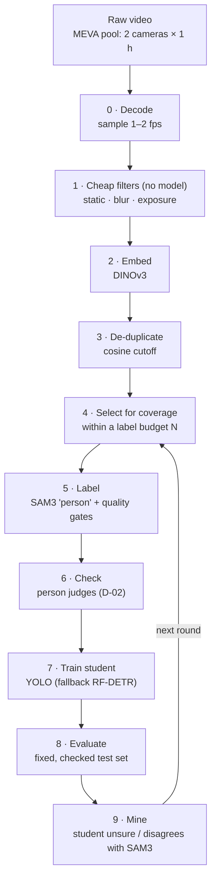
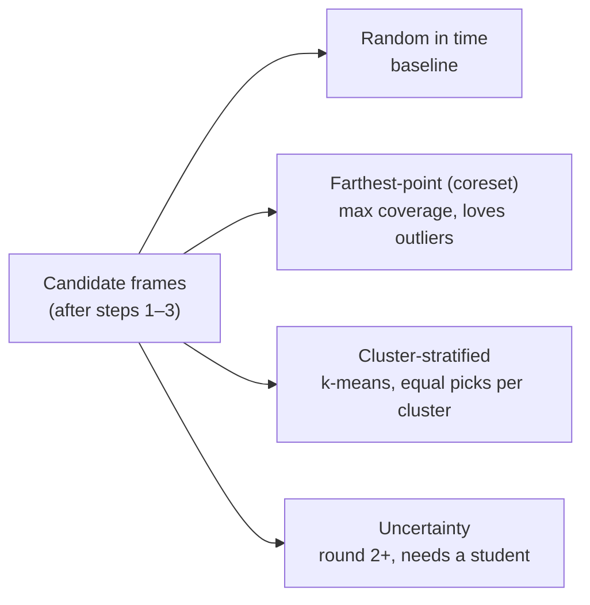
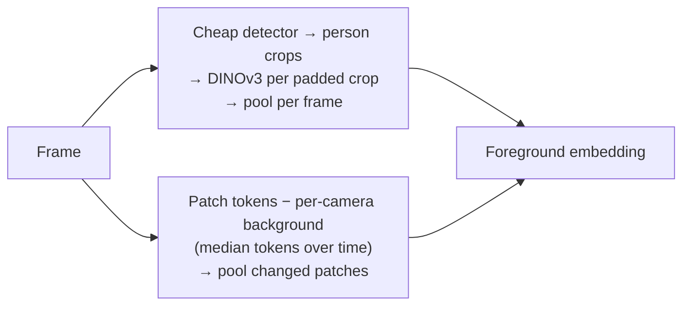

# Holy grail: choosing what to label from raw video, and proving it helped

> Status: **adopted as the first goal** (D-04, D-17). This file holds the idea; the plan is in [../milestones/README.md](../milestones/README.md).

## 1. The problem

Computer vision has no closed loop on real data. Raw footage is endless and mostly redundant, so labelling all of it is impossible, and choosing frames at random spends most of the budget on near-identical scenes. Nobody can tell from the data alone whether a training set is *good*. The holy grail is to automate the choice, and to measure the result instead of trusting it.

## 2. The loop

| Step | What | Notes |
|---|---|---|
| 1 Cheap filters | Frame difference or optical flow below a noise floor; variance of the Laplacian (blur); histogram clipped at either end (exposure) | From v1's sampling notes. On idle CCTV this removes most frames. CPU only |
| 2 Embed | DINOv3 CLS (maybe mean patch) per kept frame | On a fixed camera this may be the wrong signal (§4) |
| 3 De-duplicate | Drop frames too similar to one already kept | |
| 4 Select | Spend budget N for coverage of the embedding space | Methods in §3 |
| 5 Label | SAM3 concept prompt "person" gives boxes and masks | Gates: score floor; drop tiny or frame-filling masks |
| 6 Check | A person accepts or rejects frames and records | Needed above all for the test set |
| 7 Train | YOLO on the exported set (native format, D-12) | RF-DETR if YOLO hits a dead end |
| 8 Evaluate | mAP on the fixed test set | §5 |
| 9 Mine | Frames where the student is unsure or disagrees with SAM3 feed the next round | Makes it a loop, not a one-off |

## 3. Selection methods to compare

- **Random in time:** the baseline.
- **Farthest-point:** repeatedly pick the frame farthest from everything already picked. It maximises coverage but loves outliers: a glitch or a blurred frame is "far" from everything, which is why the step 1 filters come first.
- **Cluster-stratified:** k-means, then an equal number of frames from each cluster, sampled *within* the clusters, because picking only centroids favours the most generic frames.
- **Uncertainty:** frames the current student scores at middling confidence, or where it disagrees with SAM3.

The user's instinct for a "good standard deviation" is what coverage measures; the experiment turns it into a number.

## 4. The main risk: fixed cameras

On a fixed CCTV camera the background never changes, so whole-frame embeddings of two different moments can be almost identical. The variety lives in the **foreground**: who is where, doing what. If whole-frame selection does no better than random, try foreground-aware features:

This is the most likely place the idea fails at first, and the most interesting one to get right. A first negative result means "try §4", not "the idea failed".

## 5. The proof

**Experiment:** for label budgets N (e.g. 100, 250, 500, 1000 frames), train the same YOLO student with each selection method, over 3 seeds, and plot test mAP against N.

**Success (D-17):** curated selection reaches random's mAP with half the labels or fewer.

| Fixed part | Value |
|---|---|
| Class | person |
| Student | YOLO; one size fixed for the whole experiment (fallback RF-DETR) |
| Pool | MEVA school site, cameras G299 and G330, 2018-03-07, one continuous hour ([../data.md](../data.md)) |
| Test set | Same cameras, **another day** (2018-03-09). Its SAM3 labels are checked by a person before any experiment runs, and selection never touches it (D-13) |

## 6. Known risks

- **Pseudo-label noise.** SAM3 misses objects, and a missed person in a training frame teaches the student "background". Remedy: reject whole frames or spans (judgments).
- **Small people.** MEVA cameras are wide and far away, so SAM3 may miss distant people unless frames are tiled. Measure on the test set before blaming selection.
- **Leakage.** Never split by frame (D-13).
- **Cost.** SAM3 time per frame limits the budgets we can afford. Measure it early.

## 7. Later

- Text-targeted mining with EmbeddingGemma 2 ("people carrying boxes"): [search.md](search.md).
- The trained student becomes the cheap screener in step 1, which closes the loop in deployment.
