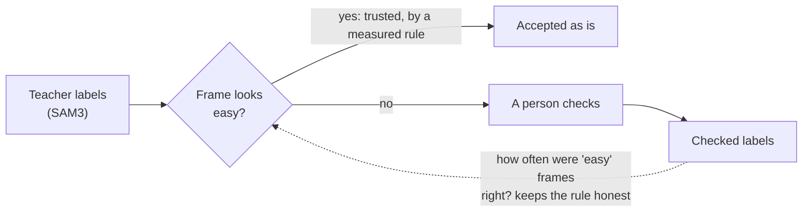

# Review by exception: a person checks only what the teacher is unsure of

**Status:** raw, with a first measurement (the user, 2026-11-26, during M3).

## The idea

Checking every teacher label by hand doesn't scale. Many frames are easy (a few people standing apart, clear boxes) and a teacher gets them right; a person's time is worth most on the hard ones (crowds, people half hidden, objects that look like people). Route each frame: trust the teacher where it has *earned* trust, send the rest to a person.

## How to make it measurable

"Easy" must be a rule learned from checked frames, never a guess:
- **The data:** M3 step 4 (D-33) gives, for each of the 300 test frames, SAM3's boxes and the person's corrected boxes. Comparing them counts the edits a frame needed (boxes deleted, added, moved).
- **The candidate signals,** per frame: number of boxes above the gate; boxes in the uncertain band (0.3–0.5); how much boxes overlap (crowding); the smallest box; whether the frame looks like the rest of its camera.
- **The test:** which rule keeps "frames trusted without a check" almost always edit-free, and how many frames it spares. One trap is already visible in the pilot: frame 1680 has nobody on it, yet SAM3 put 4 boxes above 0.5 there ([m3_pilot](../../research/m3_pilot/README.md)), so "empty" is not automatically easy.
- **Keeping it honest:** a random share of "trusted" frames still goes to a person, so the error rate of trusted frames is always measured, never assumed.

## A cheap AI reviewer in the gap (the user's thought)

Between "trusted" and "a person checks" there may be a middle lane: a cheap vision-language model behind an API looks at the frames or boxes the rule doesn't trust and answers narrow questions, e.g. "is this crop a person?" for each uncertain box, or "is anyone in this frame not boxed?". It would clear the obvious cases (a coat on a bench, a duplicate box) and leave the person only what it can't settle. Same rule as everywhere: its answers are measured against checked frames before they're trusted, and its cost per frame against a person's seconds per box (the pilot: about 7 s per box drawn from scratch). The VLM work for actions ([vlm_window_actions.md](vlm_window_actions.md)) already runs such models locally; an API is the cheaper-to-try option.

## First measurement (M3, 300 test frames)

From SAM3 above 0.5 to the checked test set ([m3_checked_test_set](../../research/m3_checked_test_set/README.md)): 272 of 300 frames needed no edit. Frames with 20 people or fewer: 6 of 215 edited; more than 20: 22 of 85. SAM3's one systematic error is a box around a group; a box much wider than tall finds some of them (10 of 35 such boxes were groups). So the first candidate rule, "trust frames with 20 boxes or fewer", would have spared 215 frames, 6 of them (1 in 36) holding an error; whether adding "and no wide box" catches more of those errors is the next thing to measure. Crowds stay with a person, and even there two passes disagree on about a fifth of the people.

## Where it may not apply

- **The test set:** every test frame is checked (D-13, D-30). Letting the teacher decide which test frames skip the check measures agreement with the teacher.
- **Training labels in the holy grail** are the teacher's, unchecked (usage C2); this idea would add checking there, not remove it. It pays when unchecked labels turn out to hurt the student (M5 shows whether they do).

## When to pick it up

After M3 step 4 (the data exists), as an analysis; as a feature, when labelling footage beyond the test set by hand becomes the bottleneck (M6, the loop).
