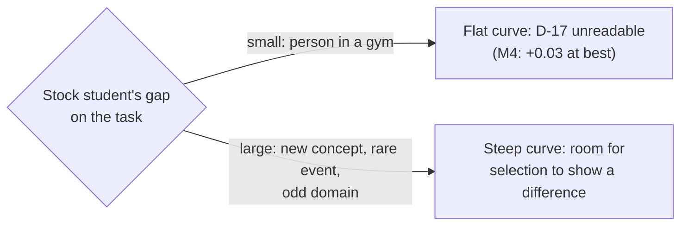

# Where distillation pays: the student's gap, not the scene

**Status:** explored (the user, 2026-11-27, in chat after M4 steps 6b and 6c); the agent's recommendation for M5 below waits on the user's yes.

**The doubt.** Stock yolo26s already detects people in the gym well: 0.629 mAP50-95 and the best mAP50 of any model on the checked test set, while students trained on SAM3's labels gain at most 0.03 ([m4_first_curve](../../research/m4_first_curve/README.md)). Person is COCO's home turf. Tuning on a teacher should pay where the stock student is weak: a specific domain (one particular camera, an odd viewpoint), or a concept COCO doesn't have, which SAM3 can label from a text prompt. So maybe Rin's point isn't to make existing tasks better, but to bring odd, domain-specific tasks up to par.

**Two directions the user sees:**
- **Counting:** common things in volume (people per frame). Stock models already do it; selection can only refine.
- **Rarity:** finding the rare thing in hours of footage. Random rarely hits it; selection by embedding should, and a student that starts from zero on a new concept leaves the whole range for the curve to climb.

**The user's further points:** relabelling a test set as in M3 is fine; crowds were the real labelling pain, a separate problem ([crowd_labelling](crowd_labelling.md)); rarity on a weak domain maybe should have come first.

**Agent's view.**
- **Rarity is the holy grail's own question** (which frames to label); crowds are about what one frame costs to label. Rarity tests selection where it should matter most: random misses rare events, and a concept absent from COCO starts near zero, so the curve has its whole range. A rare concept is also cheap to check: a few boxes per frame, not 60.
- **M1–M4 aren't wasted:** the store, the chains, SAM3, checked test sets, export, training and scoring all carry over. The lesson is narrower: **measure the stock student on the task before building a test set.** If it is already good, there is nothing for selection to prove.
- **The gym closes as a finding:** on a task COCO already does, distillation from SAM3 gains at most 0.03 mAP50-95 and selection can't be read.

**Recommended M5: the proof on a rare concept COCO lacks, in long fixed-camera footage.**
1. **Pick the concept by screening:** absent from COCO (so stock starts near zero); rare in time but present dozens of times in the pool; labelled reasonably by SAM3 (spot-checked); present on test days too; easy for a person to check. MEVA first (other sites, outdoor cameras, other hours); another dataset if no concept fits.
2. **A checked test set** for it, as in M3 but sparse. How to draw test frames when positives are rare (random frames hold few) is a design question for M5.
3. **The curve:** methods × low budgets × 3 seeds, judged on the concept's AP.

**Cost.** D-17's "class person first" changes; a new pool and test footage; a person checks a new test set. Risk: SAM3 may be weak on the chosen concept, which the screening measures before anything is built on it.
