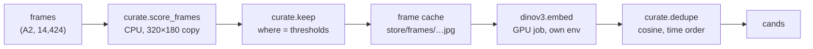

# M2 · Cheap filters + embeddings

> **Scoping, waiting for the user's answers to the open points below** (2026-11-25). Builds usage cells A3–A5 ([usage.md](../../usage.md)): score and filter frames, embed them with DINOv3, de-duplicate. DINOv3 is the first servant, so M2 also builds the servant pattern (D-07, D-22) and the frame cache (D-29).

**Done when:** we know how many pool frames survive each filter and the de-duplication, and the cost per frame of each step; `dinov3.embed` runs as a batch job in its own environment; CPU tests pass; `docs/` describes the new calls and how to install the DINOv3 environment.

## What gets built

| Piece | What | Tables |
|---|---|---|
| Frame reader (`rin.media`) | Decodes a video once, front to back, and hands over only the wanted `frame_idx`. Same decoder as `probe`, so frame k is the frame `probe` numbered k. Never seeks per frame: v1 used decord's `get_batch` (index seeking, its own decoder), which is where B-frame AVIs can hand back the wrong frame | |
| `curate.score_frames` | motion (difference from the previous sampled frame), blur (variance of the Laplacian), dark and bright (share of clipped pixels), on a 320×180 copy | `frame_scores` |
| `curate.keep` | Thresholds as a `where` text over the stored scores, saved in the run's config (D-26) | `frame_sets` |
| Frame cache (D-29) | Full-resolution JPEGs of the frames a servant needs, written by the caller before the job starts | |
| `dinov3.embed` | Caller in the core env plus a job in the DINOv3 env. CLS vector per frame (D-14) | `embeddings` + `embeddings.npy` |
| `curate.dedupe` | Per camera, in time order: drop a frame too similar to the last kept one | `frame_sets` |

## Open points: the user's call

**1. Who writes a servant's run: the caller (recommended) or the job.** D-07 and the usage diagram say the job writes its run. The alternative: the caller opens the run's `tmp/` folder, writes the job spec into it, and starts the job. The job writes only plain arrays (`embeddings.npy`) into that folder. The caller then builds the tables, checks them against the schema, and moves the folder into `runs/`.
- *Why:* the job never imports `rin`. Model environments don't inherit the core's numpy, pyarrow and duckdb version pins, the schema check stays in one place, and a job crash is handled by the same code as any failed run.
- *Cost:* the caller must know the job's output format; for an embedding that is one array file.
- If agreed: D-07's wording and the usage sequence diagram change.

**2. DINOv3 input size: keep the aspect ratio at 448×256 (recommended), not the default 224×224.** The model's preprocessor (checked in the HF cache) squashes every image to 224×224. A 1920×1080 frame shrinks about 5× and is distorted from 16:9. A person 100 px tall becomes about 21 px: barely more than one 16 px patch. On fixed cameras the variety *is* the people ([holy_grail §4](../../ideas/holy_grail.md#4-the-main-risk-fixed-cameras)), so the vector would hardly see what selection needs.
- 448×256 is 28 × 16 = 448 patches against 196, so about 2.3× the compute. M2 measures it.
- The size is an argument of `embed`, saved in the run, so a 224 run can still be compared in M5.

**3. Where a servant's environment lives: one folder per servant, both halves together (recommended).** `src/rin/servants/dinov3/` holds the caller (`__init__.py`), the job (`job.py`), and the job's own `pyproject.toml` and `uv.lock`. The caller runs `uv run --project <that folder> job.py <spec>`.
- *Why:* everything about DINOv3 is in one place, and the root stays as CLAUDE.md requires.
- *Cost:* `job.py` sits inside the `rin` package but must never be imported from the core env (it imports torch). A test checks that the core imports no model framework.

## Agent's calls (within the decisions)

- **Model:** `facebook/dinov3-vitl16-pretrain-lvd1689m` (usage A4, in the HF cache). ViT-H+/16 is cached too; try it only if L's curve disappoints.
- **Vectors:** float16, N × 1024, in `embeddings.npy` (data_model). Register tokens are stripped before any patch averaging ([models/](../../models/README.md#known-gotchas)); the default `cls` doesn't need it.
- **Array shapes in type hints** with `jaxtyping` (the user's suggestion; v1's DINOv3 engine already used it), e.g. `Float[np.ndarray, "n 1024"]`. Annotations only at first; runtime checks where arrays cross into or out of a job.
- **`code` records the vendor or library version** the job ran with (data_model `runs.code`). DINOv3 comes from `transformers`, so that version goes there.
- **1 vs 2 fps (usage A2):** decided from what survives de-duplication at each rate. If 2 fps keeps few more frames than 1 fps after dedupe, 1 fps is enough.

## To measure

| What | How |
|---|---|
| Frames surviving each filter, and all filters together | Histograms of each score; counts at the chosen thresholds |
| Scoring cost | Seconds per frame, CPU |
| DINOv3 cost | Frames per second and peak VRAM, per batch size and input size |
| Frame cache | Disk per frame at full resolution |
| De-duplication | Survivors at cosine 0.90, 0.95, 0.98 |

## The user's check (at the end)

1. Look at the score histograms and at a grid of frames each filter drops, to see that the thresholds remove what they should.
2. Run the DINOv3 install and the embed step (GPU), from numbered steps.

## Debt

Carried from M1:

| Shortcut | Later cost |
|---|---|
| Every run records Rin's git commit, so Rin must run from a git checkout; elsewhere it stops with an error | If Rin is ever installed as a package, the commit needs another source (a version string) |
| Ingest decodes every frame to count it (about 4.3 s per 5-minute clip here) | Grows linearly with footage; reading packets would be faster but can miscount, so only worth changing if ingest time starts to hurt |
| Progress is plain `print` lines | Fine in a notebook; noisy if Rin runs as a long background job |
| The DuckDB views list every run's file by name, rebuilt before each query | The query text grows with the number of runs (M5 makes a few hundred). Switch to DuckDB's own `runs/*/<table>.parquet` pattern when it slows down |
| `who` is always the login user | M3 needs it passed in (`sam3.click`, `human.annotate`) |
| Two `ingest` calls at once can both pass the "already ingested" check | Duplicate media rows. Single user, one notebook: not worth a lock now |
| A truncated MKV isn't caught (MKV states no frame count) | Only if MKV footage arrives; MEVA is AVI |
