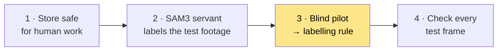

# M3 · Teacher + checked test set

**Done when:** the store is safe to hold a person's work; SAM3 labels the test day; the user checks every test frame and the judgments are stored; SAM3's cost and misses are measured, by box size.

## Step 1 · Make the store safe for human work (done, user checked 2026-11-26)

Content-based `media_id`, `union_by_name` views, `fsync` on runs and cached frames, zero-vector refusals, honest run timing, `src.diff` for uncommitted code; described in [docs/core.md](../../../docs/core.md). The old store is `workspace/store_m2/` (M2's research cites its runs); the fresh one was ingested as pool `20261126-113143-core.ingest-7de8`, test `20261126-113320-core.ingest-91b1`.

## Step 2 · SAM3 servant; label the test footage (done, user checked 2026-11-26)

`sam3.concept` (caller + job on `vendors/sam3_engine`, own `uv` environment), `curate.random`, `curate.union`, the `instances` table with its box check, list input to `core.ingest`, job launch shared in `servants/launch.py`; described in [docs/core.md](../../../docs/core.md). One prompt text per class (agreed). The test set comes from five days (D-32): 300 frames `20261126-130121-curate.random-0187`, labelled by `20261126-130121-sam3.concept-7efc`: 0.78 s per frame, 6.8 GiB; from empty frames to 69 people. Results: [research/m3_sam3_test_day](../../research/m3_sam3_test_day/README.md). The user's reading of the boxes: above 0.5 correct, 0.3–0.5 ambiguous, 0.3 and below mostly nothing.

## Step 3 · Blind pilot, then the labelling rule (next; waiting on the user's go)

| # | Piece | Notes |
|---|---|---|
| 1 | A FiftyOne environment of its own (not the core's: FiftyOne brings a database and many packages) and one export script: chosen frames and, optionally, a run's boxes into a throwaway FiftyOne dataset (D-16) | In-app box drawing is in open-source FiftyOne from 1.13 ([docs](https://docs.voxel51.com/user_guide/annotation.html)); check it on this machine first |
| 2 | The pilot: the first 20 test frames by `rank` (a random 20, all five days), shown **without** SAM3's boxes. The user draws a box on every person, noting the minutes spent | Blind, so the user's eye isn't anchored on SAM3's boxes (audit §3.5) |
| 3 | Read the drawn boxes back into a `human.annotate` run (`who` = the user); FiftyOne's copy is then disposable | Boxes in [0, 1] through the same write-time check |
| 4 | Compare SAM3 with the user's boxes: recall and precision by box height (< 32, 32–64, > 64 px) at score gates 0.3 and 0.5, matched at IoU 0.5; a sheet of every miss and every false box | The measurement M3's "done when" asks for |
| 5 | From the numbers: a written labelling rule for tiny and crowded people, and whether `instances` needs an ignore / crowd flag (the user's call, data model) | |

**Check:** the user draws the 20 frames (pass: every person has a box, saved), then reads the comparison sheet (pass: each listed miss is a real person SAM3 didn't box; each false box is really not a person).

## Step 4 · Check every test frame
First answer the open question in [decisions.md](../decisions.md#open): which judgment makes a frame complete (with its class). Where boxes are drawn is settled in step 3 (FiftyOne, if the check passes). Then the user checks the 300 test frames and the test set is frozen.

## To fix
None yet.
