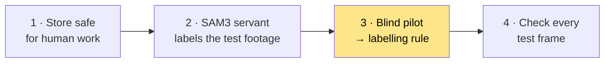

# M3 · Teacher + checked test set

**Done when:** the store is safe to hold a person's work; SAM3 labels the test day; the user checks every test frame and the judgments are stored; SAM3's cost and misses are measured, by box size.

## Step 1 · Make the store safe for human work (done, user checked 2026-11-26)

Content-based `media_id`, `union_by_name` views, `fsync` on runs and cached frames, zero-vector refusals, honest run timing, `src.diff` for uncommitted code; described in [docs/core.md](../../../docs/core.md). The old store is `workspace/store_m2/` (M2's research cites its runs); the fresh one was ingested as pool `20261126-113143-core.ingest-7de8`, test `20261126-113320-core.ingest-91b1`.

## Step 2 · SAM3 servant; label the test footage (done, user checked 2026-11-26)

`sam3.concept` (caller + job on `vendors/sam3_engine`, own `uv` environment), `curate.random`, `curate.union`, the `instances` table with its box check, list input to `core.ingest`, job launch shared in `servants/launch.py`; described in [docs/core.md](../../../docs/core.md). One prompt text per class (agreed). The test set comes from five days (D-32): 300 frames `20261126-130121-curate.random-0187`, labelled by `20261126-130121-sam3.concept-7efc`: 0.78 s per frame, 6.8 GiB; from empty frames to 69 people. Results: [research/m3_sam3_test_day](../../research/m3_sam3_test_day/README.md). The user's reading of the boxes: above 0.5 correct, 0.3–0.5 ambiguous, 0.3 and below mostly nothing.

## Step 3 · Blind pilot, then the labelling rule (pilot done; the rule waits on the user)

| # | Piece | Notes |
|---|---|---|
| 1 | A FiftyOne environment of its own and the viewer: `viewer.show`, `human.annotate` | Built. FiftyOne 1.22.1 with `mongod` from `dev/scripts/fiftyone_mongod.sh` (its `fiftyone-db` knows no Ubuntu past 24.x; parked debt). The label schema needs `component: "radio"` for the class list. Build and read-back checked on the real app's database |
| 2 | The pilot: 20 random test frames, `20261126-132616-curate.random-1ec0` (03-09: 4, 03-11: 2, 03-12: 6, 03-13: 5, 03-15: 3), in FiftyOne dataset `pilot` **without** SAM3's boxes. The user boxes every person and tags each finished frame `done`, noting the minutes | Blind, so the eye isn't anchored on SAM3's boxes (audit §3.5). `done` makes partial work fileable: a finished frame with no box means "nobody here" |
| 3 | Read the drawn boxes back into a `human.annotate` run (`who` = the user); FiftyOne's copy is then disposable | Boxes in [0, 1] through the same write-time check |
| 4 | Compare SAM3 with the user's boxes: recall and precision by box height (< 32, 32–64, > 64 px) at score gates 0.3 and 0.5, matched at IoU 0.5; a sheet of every miss and every false box | The measurement M3's "done when" asks for |
| 5 | From the numbers: a written labelling rule for tiny and crowded people, and whether `instances` needs an ignore / crowd flag (the user's call, data model) | |

**Result** ([research/m3_pilot](../../research/m3_pilot/README.md)): 18 frames, 180 people, 22 minutes (about 7 s per box). SAM3 at > 0.5: recall 0.93, precision 0.85 (IoU 0.3); 11 of its 12 misses are boxes scored 0.1–0.5. Nobody under 32 px was boxed, so no ignore rule is needed for tiny people yet. Two fixes the pilot forced: a drag past the image edge is clipped (FiftyOne allows it); `done` tags let partial work be filed.

**The labelling rule** (for step 4, from the pilot): box every person you can see, around the visible part; when unsure, box it if more likely yes. No ignore regions for now. Checking workflow: proposed D-33.

**Check:** the user looks at [the wrong-box sheet](../../research/m3_pilot/false_at_0.5.jpg) and says which are real people (pass: the verdict's split, about a third objects, a third duplicates, a third people, roughly holds).

## Step 4 · Check every test frame
If D-33 is agreed: `viewer.show` learns to copy a run's boxes above a gate into the editable field and to show a score band as a hint layer; `human.annotate` records the run it started from among its `inputs`. Then the user checks the 300 test frames (2,000 to 5,000 people judging by the pilot; measured as it goes), and the result is the frozen test set.

## To fix
None yet.
