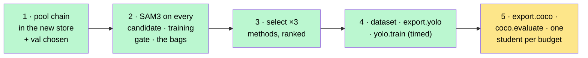

# M4 · Selection + student

> The running milestone ([README](README.md)). Started 2026-11-27.

**Done when:** three ranked selection methods run on the pool's candidates; SAM3 has labelled every candidate; `export.yolo` and `yolo.train` turn a selection and a budget into a student; the test set is scored with COCO's evaluation (crowds ignored, D-34); and one student per budget (random, seed 0, budgets 100 / 250 / 500 / 1000) has a test mAP. That shows whether the curve rises with the budget at all before M5 spends 36 trainings.

**The user's calls at the start (2026-11-27):**
- **Testbed:** the gym stays for M4 and M5. The doubt stays in [parked debt](README.md#parked-debt), triggered by M5's verdict; step 3 gives an early warning.
- **SAM3 labels every candidate once** (D-37), not only the union of the selections.
- **Scoring moves from M5 into M4** (step 5), so M5 is the full grid and the verdict.

## Step 1 · The pool chain in the new store, val chosen (passed 2026-11-27)

**Fixes first** (parked triggers that fired):
- **DINOv3 job:** one image processor per worker thread (a shared one isn't documented as thread-safe); `revision` pinned in the spec and loaded with `local_files_only=True`, so a run never quietly fetches a newer model.
- **`curate.dedupe` and `curate.center` group by site, camera, split and day**, not camera alone: a camera's val clips must not continue its pool stream, and a stream restarts each day. Without camera and start time, each media is its own group, as now.

**Val (D-31):** two 5-minute clips per camera from 03-07 11:30–11:40, ingested as `split="val"`, run through the same chain. 17:00, the first choice, was an empty gym (one person at a table).

**Re-run in `workspace/store`** (the pool ingest `20261126-113143-core.ingest-7de8` exists): sample 2 fps → score → keep `motion >= 0.002` → DINOv3 (pinned) → dedupe at 0.99. Same for val.

**User check:**
1. Pool counts: 14,424 sampled, 14,198 kept, 4,453 candidates (M2's numbers; same files and same rules, so a difference is a bug). Pass: equal. Fail: any difference, explained before going on.
2. Val: the clips chosen, their candidate count, and a contact sheet of val frames. Pass: people in the gym, a scene like the pool's. Fail: an empty or unlike gym; pick another hour.
3. `workspace/store_m2/` deleted (the user's yes): M2's research keeps its run ids as a record.

## Step 2 · SAM3 on every candidate, the training gate, the bags (passed 2026-11-27: D-39)

`sam3.concept` on every pool and val candidate (one GPU run, timed). The training gate is chosen from SAM3's precision and recall against the checked test set, per score gate, outside crowd regions (SAM3 run `20261126-205940-sam3.concept-11ee` against `20261127-094340-human.annotate-64f9`). Choosing it on the test set favours no method: every method gets the same gate. The gate can use `w`, `h`, `area`. `human.suspects` on the pool labels counts same-spot boxes; the user looks at the flagged frames and decides: drop them from training labels, or accept them as teacher noise.

## Step 3 · Three ranked selection methods (passed 2026-11-27)

**`curate.select(m, frames, emb, method=..., n_max=..., seed=..., clusters=None, kind="cls")`** writes a frame set of up to `n_max` frames with `rank` 0, 1, … (D-28), as one run step for every method, so results group by `config.method`.
- **`random`:** a random order over all candidates, the same draw as `curate.random` (D-38: not per camera).
- **`kcenter`:** per stream (one camera, day and split), farthest-point on Euclidean distance: start from a frame drawn by the seed, then repeatedly the frame farthest from everything picked so far.
- **`kmeans_stratified`:** per stream, k-means into `clusters` groups (required for this method, refused for the others; 50 per camera, so the first 100 picks are one per cluster), clusters visited in a seeded random order, one frame per cluster per round, frames drawn at random within a cluster. A cluster that runs out is skipped. k-means is written in numpy (k-means++ start, seeded), not scikit-learn: about 30 lines against a large dependency.
- **Streams in turns** (D-38) for `kcenter` and `kmeans_stratified`: the merged rank takes stream 1's first pick, stream 2's first, stream 1's second, …; a stream that runs out is skipped.

**Measured** for each method at seed 0, on the first 100 / 250 / 500 / 1,000: share per camera; people per frame and box heights (D-39's labels); spread in time (distinct minutes of the hour); coverage, the mean Euclidean distance from every candidate to its nearest picked frame of the same camera (what kcenter optimises, so it shows how much the methods differ in DINOv3's eyes); overlap between methods.

**User check:**
1. Contact sheets of each method's first 50 frames. Pass: kcenter and kmeans look more varied than random (empty floor, crowds, people in new places); fail: indistinguishable, which is noted for M5's testbed decision, not a reason to stop.
2. The numbers above. Pass: they differ between methods in the direction the method promises (kcenter best coverage, random closest to the pool's own averages).

## Step 4 · Dataset, YOLO export, `yolo.train` (passed 2026-11-27: D-40)

**`m.dataset(labels=[...], frames=..., top=None, gate=..., duplicate_iou=None)`** describes a training set; it writes nothing (a query, D-02). Its frames are the first `top` of a ranked frame set; its boxes are the label runs' boxes on those frames that pass `gate`, an SQL condition over `instances` plus derived `w`, `h`, `area` (in [0, 1]); with `duplicate_iou`, of two boxes on one frame overlapping that much, the lower-scored is dropped (D-39: 0.7). **Every frame must have been labelled** by one of the label runs (in its frame set, or its input frame set), else it is refused: an unlabelled frame would export as an empty one, teaching "nobody here".

**`export.yolo(m, ds, classes=[...], val=val_ds, tags=...)`** is a run: under `files/`, `images/{train,val}/` hard links to the frame cache (no copy, and the export survives a deleted cache), `labels/{train,val}/` one `.txt` per frame (`class xc yc w h`, an empty file for a frame with nobody), and `data.yaml` with no `path` key, so Ultralytics resolves the folders beside it and the export can move (v1 wrote an absolute path). Tables: `frame_sets` (every exported frame; train or val by its media's split), `instances` (exactly the boxes exported), `artifacts` (`data_yaml`). A box of a class not in `classes` is refused. Val is a dataset too: `m.dataset(labels=[...], frames=val_candidates, gate=...)` (usage.md's `val=val_labels` becomes `val=val_ds`).

**`yolo.train(m, export_run, model=..., epochs=..., imgsz=..., batch=..., seed=..., tags=...)`**: a servant (caller + job in `src/rin/servants/yolo/`, own `uv` environment with `ultralytics`). Weights `best.pt` and `last.pt` and `results.csv` under `files/`; `artifacts` rows; `metrics` rows from the last val pass (on SAM3's unchecked val labels: they pick the checkpoint, they score nothing). Records the start checkpoint's SHA-256 and library versions.

New tables in the schema: `artifacts` (`name`, `path` relative to the run folder) and `metrics` (`name`, `class`, `value`), as [data_model](../data_model.md#metrics-artifacts) planned.

**Measured:** time per epoch for yolo26s at `imgsz` 640 and 1280 on 1,000 frames (a few epochs each), peak VRAM; the choice of `imgsz` and epochs for step 5 follows.

**User check:**
1. Open an export in the viewer (or the sheet of a few frames with their boxes drawn from the `.txt` files). Pass: boxes sit on people, empty frames have empty files. Fail: shifted or scaled boxes (a pixel-conversion bug).
2. The timing table, and the proposed `imgsz` and epochs for step 5.

## Step 5 · Scoring, one student per budget

Three calls; scoring is two steps because a student's boxes on the test frames are data too (D-22):
- **`export.coco(m, truth, classes=["person"], crowd="crowd")`:** the checked test set as COCO ground truth under `files/annotations.json`: every frame of `truth`'s frame set (empty ones too), boxes in pixels, a `crowd` box as `person` with `iscrowd = 1` (D-34). Each image keeps its `media_id` and `frame_idx`.
- **`yolo.predict(m, trained, frames, conf=0.001, max_det=100, imgsz=1280)`:** the student's boxes on a frame set, as an `instances` run (a GPU job, same environment as training). Confidence 0.001 and 100 boxes per frame are COCO scoring's usual settings: mAP needs the low-confidence tail; no test frame holds more than 60 people.
- **`evaluate.coco(m, predictions, truth_export)`:** pycocotools' box evaluation; `metrics` rows `mAP50-95`, `mAP50`, `mAP75`, `mAP_small`, `mAP_medium`, `mAP_large`, `AR100`, plus false positives per empty frame (at 0.5 confidence; a parked M5 metric, cheap here). A detection inside a crowd region is neither rewarded nor punished. (usage.md's `coco.evaluate(m, student, test_exp)` becomes `yolo.predict` then `evaluate.coco`.)

**Run:** random, seed 0, budgets 100 / 250 / 500 / 1,000 at D-40's settings: four exports, trainings, predictions and evaluations (about 45 min of GPU, estimated). Plus stock yolo26s (no training, its `person` class) as the N = 0 point, also a parked M5 baseline that costs one prediction.

**User check:** the four test mAPs against N. Pass: mAP rises with N (the curve has room for selection to matter). Fail: flat, which means M5's budgets must change before 36 trainings.

## To fix before M4 closes

From [parked debt](README.md#parked-debt), triggers fired by planning M4 (each row's audit link is kept here):

| What | Where | Step |
|---|---|---|
| COCO evaluation, not Ultralytics': `crowd` → `iscrowd = 1`, confidence 0.001, 100 boxes per frame ([audit §3.1](../../audits/2026-11-26-m3.md#31-d-34-crowd-ignore-regions-breaks-the-usagemd-b4c3-yolo-evaluation-design)) | `export.coco`, `coco.evaluate` | 5 |

## Measurements

**Step 1** (2026-11-27, `dinov3` at `ea8dc28`, 896×512, CLS):

| | Pool | Val |
|---|---|---|
| ingest | `20261126-113143-core.ingest-7de8` | `20261127-104452-core.ingest-eea1` (4 clips) |
| sample 2 fps | `20261127-104506-core.sample-b156`: 14,424 | `20261127-105927-core.sample-a220`: 2,404 |
| keep `motion >= 0.002` | `20261127-104644-curate.keep-7b34`: 14,198 | `20261127-105943-curate.keep-6106`: 2,372 |
| embed | `20261127-104644-dinov3.embed-32fd` | `20261127-105943-dinov3.embed-b5d7` |
| dedupe 0.99: candidates | `20261127-105927-curate.dedupe-6b65`: **4,453** (G299 2,341, G330 2,112) | `20261127-110156-curate.dedupe-f05d`: **308** (G299 134, G330 174) |
| time, sample to dedupe | 860 s | 149 s |

The pool's 4,453 candidates are the same frames as M2's (run `20261125-211304-curate.dedupe-818a` in the deleted `store_m2`), compared by file and frame index: none differ. DINOv3 ran at 31 frames/s, as in M2.

**Step 2 · the training gate: `score >= 0.5`, no size gate.** SAM3 run `20261126-205940-sam3.concept-11ee` against two truths, by [dev/research/m4_training_labels/gate.py](../../research/m4_training_labels/gate.py) (IoU ≥ 0.5, unmatched boxes half inside a `crowd` box ignored):

| Gate | Test set: right / wrong | Test set: precision · recall | Blind pilot: precision · recall · F1 |
|---|---|---|---|
| 0.30 | 3,429 / 1,436 | 0.705 · 0.999 | 0.689 · 0.922 · 0.789 |
| 0.40 | 3,429 / 785 | 0.814 · 0.999 | 0.756 · 0.911 · 0.826 |
| 0.45 | 3,429 / 533 | 0.865 · 0.999 | 0.770 · 0.894 · 0.828 |
| **0.50** | **3,429 / 259** | **0.930 · 0.999** | **0.808 · 0.889 · 0.847** |
| 0.55 | 3,218 / 193 | 0.943 · 0.938 | 0.819 · 0.878 · 0.847 |
| 0.60 | 2,998 / 128 | 0.959 · 0.874 | 0.852 · 0.867 · 0.860 |
| 0.70 | 2,528 / 48 | 0.981 · 0.737 | 0.923 · 0.800 · 0.857 |

- **The test set's recall is anchored at 0.5:** its check started from SAM3's boxes above 0.5 (D-33) and added almost none of the 0.3–0.5 hints, so below 0.5 it can't show missed people. The blind pilot (18 frames, 180 people, `20261126-151047-human.annotate-3bd2`) can: lowering the gate from 0.5 to 0.3 finds 6 more people (3%) for 37 more wrong boxes. Above 0.5 the test set is honest: people the checker kept fall out quickly (0.938 at 0.55, 0.874 at 0.6).
- **0.5 is the knee:** from 0.45 to 0.5 the wrong boxes halve and no checked person is lost; the pilot's F1 is flat from 0.4 to 0.7. Choosing on the test set favours no method (one gate for all).
- **No size gate:** 79 of the 259 wrong boxes at 0.5 are under 40 px tall, but so are 340 of the 3,432 checked people (all 20–40 px; none smaller).

**Step 2 · SAM3 on every candidate:** run `20261127-111139-sam3.concept-5477` on `20261127-111139-curate.union-365e` (4,453 pool + 308 val): 675,492 detections above 0.1, 6,491 s (1.36 s per frame, 0.78 on the sparser test frames), peak VRAM 6.6 GiB. Above 0.5 on the pool: 220,436 boxes (G299 110,202 on 2,340 frames, G330 110,234 on 2,112), about 49 per frame.

**Step 2 · the bags question on the pool.** `human.suspects(above=0.5)` on the pool's candidates (6 min; it needed a fix first: its same-spot check built a box-by-box matrix of 90 GiB, now done in chunks with identical results, checked on the test set): 15,355 same-spot boxes (7%) in 45 spots on 4,151 frames, plus 626 near-duplicates. The 30 largest spots, cropped at the start, middle and end of the hour: almost all are **people seated on the bleachers**, one seat occupied all hour by the same or different people; close-ups of the odd ones show people standing at the screen's edge (#4, #8, #27, 2,146 boxes), a person lying on a bench (#26), and one real error of another kind, a box over two seated people (#10, 773 boxes). No bag or coat among them. In the pool's busy hour "same spot" means a seat, not an object, unlike the sparse test windows where it found bags. Crops: [pool_same_spot.jpg](../../research/m4_training_labels/pool_same_spot.jpg) (each row: one spot at the start, middle and end of the hour), [pool_same_spot_zoom.jpg](../../research/m4_training_labels/pool_same_spot_zoom.jpg). The user looked and agreed: no bags or coats; same-spot boxes are kept (D-39).

**Step 3 · what the methods pick** ([dev/research/m4_selection/measure.py](../../research/m4_selection/measure.py); D-39's labels; distances on raw DINOv3 CLS, per camera). Selections, `n_max` 1,000 on `20261127-105927-curate.dedupe-6b65` with `20261127-104644-dinov3.embed-32fd`:

| Method | Seed 0 | Seed 1 | Seed 2 |
|---|---|---|---|
| random | `20261127-132314-curate.select-5da9` | `…-132314-curate.select-8594` | `…-132314-curate.select-4375` |
| kcenter | `20261127-132314-curate.select-8f97` | `…-132326-curate.select-5543` | `…-132338-curate.select-9aab` |
| kmeans_stratified (50 per camera) | `20261127-132349-curate.select-2d06` | `…-132359-curate.select-d369` | `…-132408-curate.select-c75a` |

At seed 0 (all candidates: 49.7 people per frame, p10–p90 38–60; 118 camera-minutes):

| First N | Method | People per frame (p10–p90) | Camera-minutes | Mean distance to nearest pick | Largest distance (radius) |
|---|---|---|---|---|---|
| 100 | random | 50.2 (39–59) | 62 | 3.37 | 8.62 |
| 100 | kcenter | 47.0 (**22**–62) | 54 | 4.10 | **5.71** |
| 100 | kmeans_stratified | 49.0 (37–60) | 66 | 3.35 | 8.54 |
| 250 | random | 49.6 (37–60) | 95 | 2.99 | 8.42 |
| 250 | kcenter | 48.9 (30–61) | 81 | 3.49 | **4.69** |
| 250 | kmeans_stratified | 48.8 (34–60) | 90 | 2.96 | 7.87 |
| 1,000 | random | 49.5 (38–60) | 115 | 2.12 | 6.87 |
| 1,000 | kcenter | 50.0 (38–61) | 109 | 2.16 | **3.36** |
| 1,000 | kmeans_stratified | 49.1 (34–60) | 113 | 2.11 | 7.37 |

Box heights barely differ (median 90–93 px, 3.3–3.8% under 40 px). Frames shared at 1,000: random ∩ kcenter 234, random ∩ kmeans 226, kcenter ∩ kmeans 286; between seeds: random ~230, kmeans 238–277, **kcenter 766–778**.

- **kcenter does what it promises, and loves outliers:** it halves the worst-case distance at every budget, at the cost of a worse mean, and its first 50 ([sheet](../../research/m4_selection/first50_kcenter.jpg)) hold the extremes: an almost empty gym (1–2 people), people right in front of the camera, a cone, a light's flare. Random's first 50 ([sheet](../../research/m4_selection/first50_random.jpg)) are typical 45–60-person frames.
- **kmeans_stratified is close to random** on every number here ([sheet](../../research/m4_selection/first50_kmeans_stratified.jpg)): in this uniform hour, 50 clusters per camera spread picks about as random does. The early warning for M5's testbed decision (the gym may be too uniform for whole-frame vectors to matter), not a reason to stop.
- **The user's look (2026-11-27):** random's first 50 hold no empty or nearly empty frame; kcenter's do; kmeans can't be told from random by eye. Which kind of frame teaches the student more is M5's question.
- **kcenter's seed changes only its first frame,** so its three seeds share about 77% of their frames: its seed spread in M5 is mostly training noise (audit §3.9, now measured).

**Step 4 · export and training.** Export `20261127-150150-export.yolo-55bf` (random seed 0, first 1,000; D-39's rules): train 1,000 frames, 49,462 boxes; val 308 frames, 16,434 boxes; 100 near-duplicate boxes dropped; 8 s. Boxes drawn back from the `.txt` files sit on the people ([export_check.jpg](../../research/m4_selection/export_check.jpg)); in the densest crowds some boxes are doubtful, as they are for a person (the user, accepted as teacher noise, D-39). yolo26s from the stock checkpoint, Ultralytics 8.4.220, 10 epochs, seed 0; val mAP is against SAM3's unchecked val labels (it shows learning, not accuracy):

| Run | imgsz · batch | Time per epoch | Peak VRAM | Val mAP50-95 after epochs 1 / 5 / 10 | Val mAP50 at 10 |
|---|---|---|---|---|---|
| `20261127-150308-yolo.train-640e` | 640 · 16 | 9.8 s | 4.5 GiB | 0.36 / 0.49 / 0.54 | 0.86 |
| `20261127-150503-yolo.train-75f2` | 1280 · 8 | 26.0 s | 9.3 GiB | 0.61 / 0.65 / 0.69 | 0.93 |

Both still rise at epoch 10. A 1-epoch run (`20261127-150221-yolo.train-aab1`, the smoke test) scores 0.002: a 1-epoch schedule, not a fault (epoch 1 of a 10-epoch run scores 0.36).

**Agreed for step 5 and M5 (D-40):** `imgsz=1280, batch=8, epochs=50` at every budget, the same for every method. 1280 because 640 shrinks a 40 px person to 13 px, and it scores 0.15 higher here; 50 epochs because 10 still climbs. Estimated (not measured) cost per training: about 22 min at 1,000 frames down to about 5 min at 100 (an epoch is about 23 ms per training frame plus about 3 s of val); about 45 min for step 5's four students, about 6.5 h for M5's 36.

**Step 5 · the first curve** (random, seed 0, D-40's student; scored by `evaluate.coco` against the checked test set, export `20261127-152506-export.coco-8bc8`; crowds ignored):

| N | Train run | Test mAP50-95 | mAP50 | mAP_small | AR100 | False positives per empty frame (≥ 0.5) | Training |
|---|---|---|---|---|---|---|---|
| 0 (stock yolo26s, 640) | — | 0.418 | 0.667 | 0.008 | 0.49 | 0.00 | — |
| 0 (stock yolo26s, 1280) | — | 0.599 | 0.828 | 0.090 | 0.66 | 0.00 | — |
| 100 | `20261127-152532-yolo.train-4177` | 0.619 | 0.843 | 0.178 | 0.72 | 3.22 | 5.7 min |
| 250 | `20261127-153127-yolo.train-61a5` | 0.646 | 0.850 | 0.275 | 0.73 | 2.95 | 8.7 min |
| 500 | `20261127-154021-yolo.train-fabe` | 0.651 | 0.864 | 0.261 | 0.73 | 1.73 | 12.8 min |
| 1,000 | `20261127-155322-yolo.train-1dac` | 0.661 | 0.882 | 0.277 | 0.73 | 0.30 | 22.5 min |

Evaluations: `…-153124-evaluate.coco-1abc`, `…-154017-…-2a24`, `…-155315-…-53d9`, `…-161556-…-dedd`; stock: `…-152517-…-037b` (640), `…-152529-…-7d92` (1280). Peak VRAM 10.0 GiB. Training time is about 21 ms per frame-epoch plus a fixed part, close to the estimate.

- **The curve rises, but flattens early:** +0.020 from stock to 100 frames, +0.027 to 250, then +0.005 to 500 and +0.010 to 1,000. One seed only; the test frames cluster in time, so differences of 1–2 points aren't readable as real ([parked](README.md#parked-debt)). D-17's bar ("random's mAP with half the labels") is decided where the curve still climbs: below 250 frames. Above 500 every method will sit within noise of every other. **For M5: move the budgets down** (e.g. 25 / 50 / 100 / 250 / 500), which is also cheaper.
- **Students trained on the busy pool see ghosts on empty frames:** stock yolo26s puts no box at ≥ 0.5 on the 110 empty test frames; the 100-frame student puts 3.2 per frame, falling to 0.3 at 1,000. The pool hour has no empty frames (motion filter, busy hour), so a small training set never shows an empty gym, and SAM3's training labels box some objects. A selection that picks the rare near-empty frames (kcenter does, step 3) may win here first; M5 reports this number per method (parked row "one mAP hides where methods differ").
- **Training on the gym helps most with small people:** mAP_small 0.09 → 0.28, AR_small 0.23 → 0.42–0.48.

