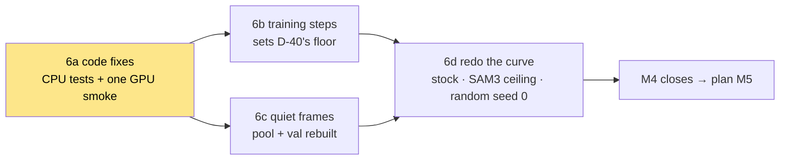

# M4: selection + student (reopened)

> Steps 1–5 are done and written up: [m4_selection](../../research/m4_selection/README.md), [m4_training_labels](../../research/m4_training_labels/README.md), [m4_first_curve](../../research/m4_first_curve/README.md). The outside audit after them ([2026-11-27](../../audits/2026-11-27.md), triage at its end) found faults in the curve's training and scoring, and an empty-frame gap in pool and val. The user's call (2026-11-27): reopen M4 and fix them here, so M5 only runs the experiment on numbers that hold.

**Done when** (unchanged): three ranked selection methods; SAM3 on every candidate; YOLO export and training; COCO scoring of the test set; one student per budget with a test mAP. Now also: every budget trains enough steps (D-40), pool and val hold quiet frames (D-41, D-31), and the stock baseline and SAM3's ceiling are measured correctly.

## Step 6a: code fixes (current)

Each item gets a CPU test that fails before the fix.

| Where | Fix | Audit |
|---|---|---|
| `yolo.predict` | Resolve `classes` against the model's class names, raise on an unknown name, and pass the ids to Ultralytics, so `max_det` counts only those classes. Check `imgsz % 32` as `train` does. Clamp boxes within 1e-6 of [0, 1] and raise beyond it (v1's rule). `model` = the model's name, `checkpoint` = its workspace-relative path, as [data_model.md](../data_model.md) says; the same for `yolo.train` | §1.2, 2.1, 2.7 |
| `yolo.train` | `optimizer`, `lr0` and `nbs` passed explicitly and stored in the run's config (D-40); `epochs` stays a parameter until 6b sets the floor | §1.1, 2.7 |
| `curate.select` | `random` per camera, in turns (D-38); `emb` optional for `random`; refuse frames whose media isn't `split="pool"` | §1.5, 2.3 |
| `export.yolo` | Train frames must be `pool`, val frames `val`; anything else raises | §2.3 |
| `Dataset` duplicate removal | Compare boxes of the same class only | §2.2 |
| `export.coco` | Refuse duplicate class names | §2.7 |
| `dev/tests/test_coco.py` | `to_arrow_table()` for DuckDB's deprecated `fetch_arrow_table()` | §5 |

**Pass:** `uv run pytest` green with the new tests; then one GPU smoke: stock yolo26s on the 300 test frames gives the 60-person frame at least 60 person boxes (M4 gave 44). **Fail:** any test red, or the person count still capped below the frame's people.

## Later steps (detailed when reached)

- **6b · Training steps.** Random seed 0 at N = 25 and 100: today's setting against one step per batch with more epochs. Read v1's explicit settings first (`dev/rin_v1/src/rin/services/ground/yolo/engine.py:324-326`). Sets D-40's step floor and its time cost (each epoch also runs val); then `usage.md` and `holy_grail.md`'s student line follow.
- **6c · Quiet frames.** Pull the 17:00 clips; rebuild the pool chain so dedupe, not the motion filter, thins quiet stretches (D-41); val gains 17:00 frames (D-31); DINOv3 and SAM3 on the new candidates; the nine selections again. The user looks at a sample of quiet candidates.
- **6d · Redo the curve.** Stock yolo26s with the fixed `predict` (the N = 0 point); SAM3 scored on the test set (the teacher's ceiling); random seed 0 at 100 / 250 / 500 / 1,000 under D-40. The three write-ups rewritten in place, including the reading of ghosts on empty frames. Then M4 closes and M5 is planned from parked debt.
