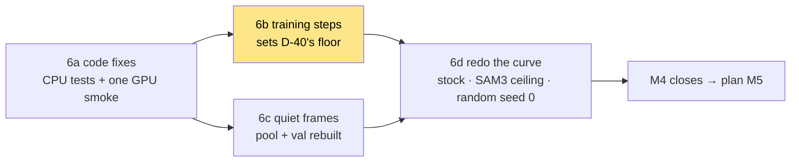

# M4: selection + student (reopened)

> Steps 1–5 are done and written up: [m4_selection](../../research/m4_selection/README.md), [m4_training_labels](../../research/m4_training_labels/README.md), [m4_first_curve](../../research/m4_first_curve/README.md). The outside audit after them ([2026-11-27](../../audits/2026-11-27.md), triage at its end) found faults in the curve's training and scoring, and an empty-frame gap in pool and val. The user's call (2026-11-27): reopen M4 and fix them here, so M5 only runs the experiment on numbers that hold.

**Done when** (unchanged): three ranked selection methods; SAM3 on every candidate; YOLO export and training; COCO scoring of the test set; one student per budget with a test mAP. Now also: every budget trains enough steps (D-40), pool and val hold quiet frames (D-41, D-31), and the stock baseline and SAM3's ceiling are measured correctly.

## Step 6a: code fixes (done)

All in, 186 CPU tests (each fix has one that fails without it); [docs/core.md](../../../docs/core.md) updated. `yolo.train` states its optimizer: AdamW, `lr0` 0.002, momentum 0.9, no bias warm-up (what `auto` picked for M4; `auto` changed all four, not only the optimizer) and `accumulate` batches per step. `curate.select(..., method="random")` takes `emb=None`.

**GPU smoke:** stock yolo26s with `classes=["person"]` handed to Ultralytics, run `20261127-175045-yolo.predict-c01e`: the 60-person test frame gets 100 person boxes (M4's run `aef6`: 44); 12,102 person boxes on the 300 frames (`aef6`: 5,507). It is the N = 0 prediction 6d scores.

## Step 6b: training steps (current)

**The constraint found in 6a:** Ultralytics validates after every epoch or only after the last; there is no interval. Val is about 4.5 s per pass, so giving 25 frames more steps by more epochs is mostly val: 1,000 epochs would be about 75 min of val for 10 min of training.

**So repeat, don't lengthen:** `yolo.train(..., epoch_images=K)` hard-links each training frame enough times that one epoch shows at least K images. Every budget then runs the same 50 epochs, learning-rate schedule, warm-up, mosaic switch-off and val passes; only the frames differ. Steps per run = 50 × ⌈max(N, K) / 8⌉.

**The measurement** (per-camera random, seed 0, on M4's candidates; 6c rebuilds the pool, but the step question doesn't depend on it):

| N | K = N (no repeat) | K = 250 | K = 1,000 |
|---|---|---|---|
| 25 | 200 steps | 1,600 | 6,250 |
| 100 | 650 | 1,600 | 6,250 |
| 1,000 | 6,250 (reference) | | |

Read v1's explicit settings first (`dev/rin_v1/src/rin/services/ground/yolo/engine.py:324-326`). Seven trainings, about 1.5 h; each scored on the test set (mAP50-95, mAP_small, false positives per empty frame).

**Pass:** the smallest K beyond which N = 25 and N = 100 stop gaining is D-40's floor (one seed, so a gain of a point or two is not read as real; parked debt, temporal clustering), with its time per run, so M5's cost is known. **Fail:** still rising at K = 1,000, so even 6,250 steps aren't enough; then the schedule itself (epochs, learning rate) is the question, and it comes back to the user.

## Later steps (detailed when reached)

- **6c · Quiet frames.** Pull the 17:00 clips; rebuild the pool chain so dedupe, not the motion filter, thins quiet stretches (D-41); val gains 17:00 frames (D-31); DINOv3 and SAM3 on the new candidates; the nine selections again. The user looks at a sample of quiet candidates.
- **6d · Redo the curve.** Stock yolo26s with the fixed `predict` (the N = 0 point); SAM3 scored on the test set (the teacher's ceiling); random seed 0 at 100 / 250 / 500 / 1,000 under D-40. The three write-ups rewritten in place, including the reading of ghosts on empty frames. Then M4 closes and M5 is planned from parked debt.
