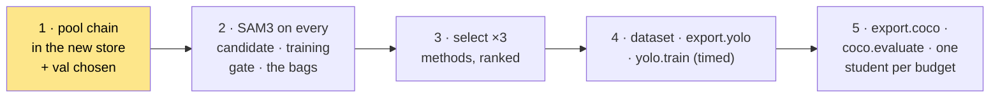

# M4 · Selection + student

> The running milestone ([README](README.md)). Started 2026-11-27.

**Done when:** three ranked selection methods run on the pool's candidates; SAM3 has labelled every candidate; `export.yolo` and `yolo.train` turn a selection and a budget into a student; the test set is scored with COCO's evaluation (crowds ignored, D-34); and one student per budget (random, seed 0, budgets 100 / 250 / 500 / 1000) has a test mAP. That shows whether the curve rises with the budget at all before M5 spends 36 trainings.

**The user's calls at the start (2026-11-27):**
- **Testbed:** the gym stays for M4 and M5. The doubt stays in [parked debt](README.md#parked-debt), triggered by M5's verdict; step 3 gives an early warning.
- **SAM3 labels every candidate once** (D-37), not only the union of the selections.
- **Scoring moves from M5 into M4** (step 5), so M5 is the full grid and the verdict.

## Step 1 · The pool chain in the new store, val chosen

**Fixes first** (parked triggers that fired):
- **DINOv3 job:** one image processor per worker thread (a shared one isn't documented as thread-safe); `revision` pinned in the spec and loaded with `local_files_only=True`, so a run never quietly fetches a newer model.
- **`curate.dedupe` and `curate.center` group by site, camera, split and day**, not camera alone: a camera's val clips must not continue its pool stream, and a stream restarts each day. Without camera and start time, each media is its own group, as now.

**Val (D-31):** two 5-minute clips per camera from 03-07 hour 17 (evening, hours after the pool's 09:55–10:55); if that gym is mostly empty (most frames with motion below 0.002), clips from 11:30 onwards instead. Ingested as `split="val"`, run through the same chain.

**Re-run in `workspace/store`** (the pool ingest `20261126-113143-core.ingest-7de8` exists): sample 2 fps → score → keep `motion >= 0.002` → DINOv3 (pinned) → dedupe at 0.99. Same for val.

**User check:**
1. Pool counts: 14,424 sampled, 14,198 kept, 4,453 candidates (M2's numbers; same files and same rules, so a difference is a bug). Pass: equal. Fail: any difference, explained before going on.
2. Val: the clips chosen, their candidate count, and a contact sheet of val frames. Pass: people in the gym, a scene like the pool's. Fail: an empty or unlike gym; pick another hour.
3. Decide whether `workspace/store_m2/` can be deleted (its 11 GB frame cache at least); [m2_filters_dedupe](../../research/m2_filters_dedupe/README.md) keeps its run ids as a record.

## Step 2 · SAM3 on every candidate, the training gate, the bags

`sam3.concept` on every pool and val candidate (one GPU run, timed). The training gate is chosen from SAM3's precision and recall against the checked test set, per score gate, outside crowd regions (SAM3 run `20261126-205940-sam3.concept-11ee` against `20261127-094340-human.annotate-64f9`). Choosing it on the test set favours no method: every method gets the same gate. The gate can use `w`, `h`, `area`. `human.suspects` on the pool labels counts same-spot boxes; the user looks at the flagged frames and decides: drop them from training labels, or accept them as teacher noise.

## Step 3 · Three ranked selection methods

`curate.select(m, cands, emb, method=..., n_max=1000, seed=...)`: `random`, `kcenter`, `kmeans_stratified`, geometry per D-38. `kcenter` starts from a frame drawn by the seed. `kmeans_stratified`: K = 50 per camera (100 in all, no more than the smallest budget, so every prefix is stratified), round-robin over clusters, random within a cluster. Measured per method: people per frame, box sizes, spread in time. The user looks at the first 50 of each. If kcenter picks look like random's, that is noted for M5's testbed decision.

## Step 4 · Dataset, YOLO export, `yolo.train`

`m.dataset` (labels, frames, top N, gate) → `export.yolo` (an empty `.txt` per empty frame, symlinked JPEGs, a relative `data.yaml`, val from step 1; v1's `yolo/writer.py` read first) → servant `yolo.train` (own environment, `ultralytics`; weights as an artifact). One training timed; model size and `imgsz` chosen from that measurement.

## Step 5 · Scoring, one student per budget

`export.coco` of the test set (`crowd` → `person` with `iscrowd = 1`, D-34) and `coco.evaluate` with pycocotools (students predict at confidence 0.001, at most 100 boxes per frame); results in the `metrics` table. One student per budget (random, seed 0), each scored. Pass: mAP rises with N. The training times feed M5's budgets and epochs.

## To fix before M4 closes

From [parked debt](README.md#parked-debt), triggers fired by planning M4 (each row's audit link is kept here):

| What | Where | Step |
|---|---|---|
| `curate.center` and `curate.dedupe` group by camera only ([audit §1.2](../../audits/2026-11-26.md#12-curatecenter-and-curatededupe-group-by-camera-while-ignoring-site-and-split-high)) | `src/rin/curate/` | 1 |
| DINOv3 job shares one processor across threads, loads online, pins no revision ([audit §1.9](../../audits/2026-11-26.md#19-thread-safety-and-unpinnedonline-hf-loading-in-dinov3jobpy-lowmedium)) | `src/rin/servants/dinov3/` | 1 |
| Unchecked SAM3 training labels include static objects boxed as people ([m3_checked_test_set](../../research/m3_checked_test_set/README.md)) | step 2's measurement and decision | 2 |
| `usage.md`'s `gate` uses `area`, which is not a column ([audit §5.3](../../audits/2026-11-26.md#53-usagemd-gate-references-area-which-is-not-a-column-of-instances)) | `m.dataset` | 2, 4 |
| Centred vectors: cosine blows up near the mean; per-camera centring mixes cameras ([audit §3.8](../../audits/2026-11-26.md#38-geometric-trap-in-curatecenter-for-m4-selection)) | D-38 | 3 |
| `kmeans_stratified` needs K at most the smallest budget; `kcenter`'s seed spread is mostly training noise ([audit §3.9](../../audits/2026-11-26.md#39-kmeans_stratified-vs-d-28s-nested-prefix-budgets-kcenter-seed-variance)) | `curate.select` | 3 |
| COCO evaluation, not Ultralytics': `crowd` → `iscrowd = 1`, confidence 0.001, 100 boxes per frame ([audit §3.1](../../audits/2026-11-26-m3.md#31-d-34-crowd-ignore-regions-breaks-the-usagemd-b4c3-yolo-evaluation-design)) | `export.coco`, `coco.evaluate` | 5 |

## Measurements

None yet.
