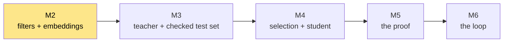

# Milestones

> Planned **one ahead** (D-19): the running milestone gets a folder, `M<n>/`, holding its README (scope, open points, debt) and its working drafts. The rest stay one line each and are reshaped by what we learn. When a milestone is done, what lasts moves out of its folder (into `dev/notes/`, or `docs/` for user-facing docs) and the folder is deleted.

| ID | Milestone | Done when | Status |
|---|---|---|---|
| M2 | Cheap filters + embeddings | We know how many frames survive each filter and the de-duplication, and the cost per frame; DINOv3 runs as a servant ([M2/](M2/README.md)) | scoping |
| M3 | Teacher + checked test set | SAM3 labels the test day; the user checks them in FiftyOne (D-16) and the judgments are stored; SAM3's cost and misses are measured | — |
| M4 | Selection + student | Three selection methods; YOLO export; one student per budget | — |
| M5 | The proof | mAP against label budget per method, 3 seeds; an honest verdict (D-17) | — |
| M6 | The loop | Uncertainty mining for round 2 | — |

What is built so far is described in [docs/](../../../docs/core.md). The API every milestone builds towards is [usage.md](../usage.md), on the data model in [data_model.md](../data_model.md). Both stay in `dev/notes/` as the design target, because they describe parts not built yet. Root `docs/` only describes what exists: each milestone adds what it built there (install, the calls and tables that now work).
