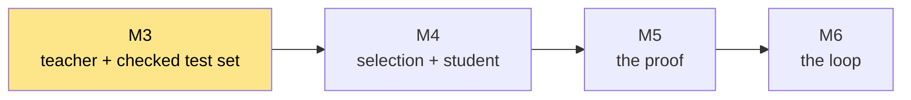

# Milestones

> Planned **one ahead** (D-19). The running milestone gets one file, `M<n>.md`: scope, open points, measurements, and its debt to fix. When it is done, what lasts is folded out of it (into `dev/notes/`, or `docs/` for user-facing docs), parked debt moves into the table below, and the file is deleted. The rest stay one line each and are reshaped by what we learn.

**Steps inside a milestone.** A milestone file splits its work into numbered steps, each ending with something the user can check (what pass and fail look like). Only the current step is planned in detail; later steps stay a line or two and are detailed when reached, since each step's result reshapes the next. Work that shares code or data, or that would be checked together anyway, stays one step: splitting is for clear checkpoints, not for its own sake.

**At each milestone start,** read the parked-debt triggers below and the findings marked *kept* for that milestone in the triage of each report in [dev/audits/](../../audits/).

| ID | Milestone | Done when | Status |
|---|---|---|---|
| M3 | Teacher + checked test set | The store is safe for human work; SAM3 labels the test day; the user checks them (D-16) and the judgments are stored; SAM3's cost and misses are measured ([M3.md](M3.md)) | running |
| M4 | Selection + student | Three selection methods; YOLO export; one student per budget | — |
| M5 | The proof | mAP against label budget per method, 3 seeds; an honest verdict (D-17) | — |
| M6 | The loop | Uncertainty mining for round 2 | — |

What is built so far is described in [docs/](../../../docs/core.md). The API every milestone builds towards is [usage.md](../usage.md), on the data model in [data_model.md](../data_model.md). Both stay in `dev/notes/` as the design target, because they describe parts not built yet. Root `docs/` only describes what exists: each milestone adds what it built there (install, the calls and tables that now work).

## Parked debt

Shortcuts that are fine to leave until their trigger happens. Each milestone start reads this table; a trigger that has fired turns its row into work for that milestone. Debt that the work will hit anyway is not parked: it goes in the milestone file as "to fix" and is fixed before the milestone closes.

| Shortcut | Trigger: do it when | Cost of doing it |
|---|---|---|
| Every run records Rin's git commit, so Rin must run from a git checkout | Rin is installed as a package somewhere | A version string as the commit's stand-in |
| Ingest decodes every frame to count it (about 4.3 s per 5-minute 1080p clip) | Ingest of a new dataset takes long enough to hurt | Reading packets is faster but can miscount; needs a check against decoding |
| Progress is plain `print` lines | Rin runs as a background job, not in a notebook | Switch to `logging` |
| Two `ingest` calls at once can both pass the "already ingested" check | Two processes write the store at the same time | A lock file around ingest |
| A truncated MKV isn't caught (MKV states no frame count) | MKV footage arrives | Compare against the container's duration instead |
| The frame cache stores full-resolution JPEGs at quality 95: about 0.78 MB per 1080p frame (11 GB for the 2 fps pool) | Disk runs short, or footage grows to many hours | Lower quality, or cache at the largest size a servant reads |
| `curate.score_frames`' motion is the change between consecutive sampled frames, not scaled by the time between them | Footage with variable frame rate is filtered, or two sampling rates are compared on one motion threshold | Divide by the time gap; re-pick the threshold |
| `probe` sorts every video's timestamps (needed for MEVA's AVI with B-frames), which could hide a timestamp reset in an MP4 | MP4 or MKV footage arrives | Sort only AVI, or refuse jumps larger than a B-frame reorder |
| The frame reader decodes from the start of the file, no seeking | Hour-long recordings arrive | Seek to the nearest keyframe before the first wanted frame |
| FiftyOne's `mongod` is copied into `src/rin/viewer/.venv` by `dev/scripts/fiftyone_mongod.sh` (MongoDB 8.0.17, Ubuntu 24.04 build): `fiftyone-db` 1.4.1 knows no Ubuntu past 24.x and installs without it | `fiftyone-db` ships a Linux wheel or knows Ubuntu 26.04; or the binary stops starting after a system upgrade | Drop the script; `uv sync` alone sets up the viewer |
