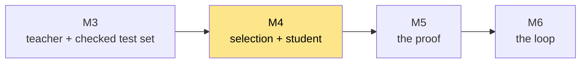

# Milestones

> Planned **one ahead** (D-19). The running milestone gets one file, `M<n>.md`: scope, open points, measurements, and its debt to fix. When its steps are done and the outside audit is triaged ([CLAUDE.md](../../../CLAUDE.md#how-we-iterate)), what lasts is folded out of it (into `dev/notes/`, or `docs/` for user-facing docs), parked debt moves into the table below, and the file is deleted. The rest stay one line each and are reshaped by what we learn.

**Steps inside a milestone.** A milestone file splits its work into numbered steps, each ending with something the user can check (what pass and fail look like). Only the current step is planned in detail; later steps stay a line or two and are detailed when reached, since each step's result reshapes the next. Work that shares code or data, or that would be checked together anyway, stays one step: splitting is for clear checkpoints, not for its own sake.

**At each milestone start,** read the parked-debt triggers below. Audit findings kept for later are rows there too (D-35), so the reports in [dev/audits/](../../audits/) need not be reopened.

| ID | Milestone | Done when | Status |
|---|---|---|---|
| M3 | Teacher + checked test set | The store is safe for human work; SAM3 labels the test footage; the user checks every frame and the result is stored; SAM3's cost and misses are measured | closed 2026-11-26: test set `20261127-094340-human.annotate-64f9` ([research](../../research/m3_checked_test_set/README.md)) |
| M4 | Selection + student | Three ranked selection methods; SAM3 on every candidate; YOLO export and training; COCO scoring of the test set; one student per budget with a test mAP | reopened 2026-11-27 for the audit's fixes: [M4.md](M4.md) step 6 |
| M5 | The proof | mAP against label budget per method, 3 seeds; an honest verdict (D-17) | next, once M4 closes |
| M6 | The loop | Uncertainty mining for round 2 | — |

What is built so far is described in [docs/](../../../docs/core.md). The API every milestone builds towards is [usage.md](../usage.md), on the data model in [data_model.md](../data_model.md). Both stay in `dev/notes/` as the design target, because they describe parts not built yet. Root `docs/` only describes what exists: each milestone adds what it built there (install, the calls and tables that now work).

## Parked debt

Shortcuts that are fine to leave until their trigger happens. Each milestone start reads this table; a trigger that has fired turns its row into work for that milestone. Debt that the work will hit anyway is not parked: it goes in the milestone file as "to fix" and is fixed before the milestone closes.

| Shortcut | Trigger: do it when | Cost of doing it |
|---|---|---|
| Every run records Rin's git commit, so Rin must run from a git checkout | Rin is installed as a package somewhere | A version string as the commit's stand-in |
| Ingest decodes every frame to count it (about 4.3 s per 5-minute 1080p clip) | Ingest of a new dataset takes long enough to hurt | Reading packets is faster but can miscount; needs a check against decoding |
| Progress is plain `print` lines | Rin runs as a background job, not in a notebook | Switch to `logging` |
| Two `ingest` calls at once can both pass the "already ingested" check | Two processes write the store at the same time | A lock file around ingest |
| A truncated MKV isn't caught (MKV states no frame count) | MKV footage arrives | Compare against the container's duration instead |
| The frame cache stores full-resolution JPEGs at quality 95: about 0.78 MB per 1080p frame (11 GB for the 2 fps pool) | Disk runs short, or footage grows to many hours | Lower quality, or cache at the largest size a servant reads |
| `curate.score_frames`' motion is the change between consecutive sampled frames, not scaled by the time between them | Footage with variable frame rate is filtered, or two sampling rates are compared on one motion threshold | Divide by the time gap; re-pick the threshold |
| `probe` sorts every video's timestamps (needed for MEVA's AVI with B-frames), which could hide a timestamp reset in an MP4 | MP4 or MKV footage arrives | Sort only AVI, or refuse jumps larger than a B-frame reorder |
| The frame reader decodes from the start of the file, no seeking | Hour-long recordings arrive | Seek to the nearest keyframe before the first wanted frame |
| FiftyOne's `mongod` is copied into `src/rin/viewer/.venv` by `dev/scripts/fiftyone_mongod.sh` (MongoDB 8.0.17, Ubuntu 24.04 build): `fiftyone-db` 1.4.1 knows no Ubuntu past 24.x and installs without it | `fiftyone-db` ships a Linux wheel or knows Ubuntu 26.04; or the binary stops starting after a system upgrade | Drop the script; `uv sync` alone sets up the viewer |
| Test frames cluster in time: 21 pairs of frames from one camera at most 2 s apart, crowded frames from three 15-minute windows ([audit §3.3](../../audits/2026-11-26-m3.md#33-test-set-temporal-clustering-reduces-effective-sample-size-below-300)) | M5 is planned | Report spread (seeds, and frames resampled by window) and don't read 1–2 point differences as real. Worse than it looks ([audit 2026-11-27 §4.1](../../audits/2026-11-27.md#41-statistical-power-986-of-test-gt-people-sit-in-3-crowded-clips-and-overall-map50-95-headroom-may-be-smaller-than-the-noise-floor)): 98.6% of test people sit in three crowded windows, so overall mAP has little room to move; lead with mAP_small and false positives per empty frame |
| `human.annotate` stores no masks, even for boxes kept from SAM3 ([audit §1.4](../../audits/2026-11-26-m3.md#14-humanannotate-discards-all-mask_rles-medium)) | A segmentation student is scored on the test set | Carry SAM3's mask over for boxes kept unchanged (exact match) |
| The write-time check covers boxes only, not polygons or keypoints ([audit §4.4](../../audits/2026-11-26-m3.md#4-lessons-from-rin_v1-worth-carrying-into-m4m5)) | Sapiens2 or another servant writes keypoints | Extend `conform()` with v1's checks (`rin_v1/src/rin/data/core/recorder.py:76-88`) |
| One busy indoor gym may be a weak testbed for D-17: a win is strong evidence, a loss weak ([audit §3.1](../../audits/2026-11-26.md#31-the-meva-slice-2-cameras-of-one-continuously-busy-indoor-gym-is-a-poor-testbed-for-d-17s-half-the-labels-bar)) | M5's verdict: curation fails on the gym, or the result is too close to call (the user's call, 2026-11-27: the gym stays for M4 and M5) | A second pool and a second checked test set on a clearer scene (other cameras, sites or hours) before calling the idea failed; otherwise state the limit in the verdict. The user's doubt (2026-11-26, while checking the test set): the gym's difficulty is partly in the truth itself (crowds nobody can box), so a clearer domain, people a person can check, may test curation better |
| A student may learn better with crowds as ignore regions in training too (the user's doubt, 2026-11-26); YOLO has no ignore regions, and SAM3 marks no crowds | M5 shows the students' errors gather in crowded frames | Find crowds in training frames (no teacher marks them) and grey them out of the image, or drop those frames |
| The verdict holds for one student, yolo26s (D-40); the user would like larger YOLO sizes (their GPU fits up to x) and RF-DETR tried too (2026-11-27) | M5's verdict exists (or YOLO hits a dead end, D-17) | Repeat the curve for one larger YOLO and RF-DETR (a `rfdetr.train` servant; RF-DETR wants `train/ valid/ test/` with `_annotations.coco.json`, [lessons](../lessons/rin_v1.md)). Read the user's own RF-DETR engine first: `~/projects/vision_pipeline/src/avp/ai/engines/rfdetr.py` |
| Random runs on filtered, deduped candidates, not raw frames ([audit §3.2](../../audits/2026-11-26.md#32-random-on-cands-is-not-a-raw-video-random-baseline)) | M5 is planned | Random over raw sampled frames as the main baseline |
| No uniform-in-time or top-motion baselines ([audit §3.3](../../audits/2026-11-26.md#33-missing-n--0-zero-shot-pretrained-yolo-and-cheap-non-embedding-baselines)); stock yolo26s, the N = 0 point, is measured ([m4_first_curve](../../research/m4_first_curve/README.md)) | M5 is planned | Two CPU selection methods |
| A frame budget can hide a box-count difference between methods ([audit §3.4](../../audits/2026-11-26.md#34-frame-budget-vs-box-count-confound)) | M5 is planned | Log boxes per method; plot mAP against boxes as well as frames |
| `kcenter` picks the outlier frames where SAM3's unchecked labels are worst ([audit §3.6](../../audits/2026-11-26.md#36-outlier--pseudo-label-noise-trap-kcenter-on-unchecked-sam3-labels)) | M5 is planned | Compare SAM3 scores per method; spot-check about 20 frames each. Also check whether a kcenter win comes only from the rare sparse frames ([audit 2026-11-27 §4.3](../../audits/2026-11-27.md#43-watch-for-a-misleading-kcenter-win-at-low-budgets-confounded-by-sparse-frames--cleaner-sam3-boxes)): the raw-frame and uniform-in-time baselines separate the two |
| One mAP number hides where methods differ ([audit §3.7](../../audits/2026-11-26.md#37-single-scalar-map50-95-can-hide-or-distort-the-m5-verdict)) | M5 is planned | `evaluate.coco` already stores mAP50, by size, AR and false positives per empty frame; M5 reports them per method |
| M4's budgets (100–1,000) sit where random's curve is flat: +0.015 mAP from 250 to 1,000, within noise ([m4_first_curve](../../research/m4_first_curve/README.md)) | M5 is planned | Lower budgets, e.g. 25 / 50 / 100 / 250 / 500 (cheaper too). kmeans_stratified's clusters per camera at most the smallest budget per camera, or most clusters go unsampled ([audit 2026-11-27 §1.4](../../audits/2026-11-27.md#14-kmeans_stratified-with-clusters50-per-camera-breaks-d-28-when-m5-lowers-budgets-to-n--25--50-mediumhigh)) |
| `yolo.train` changes into the checkpoint's folder so Ultralytics finds `yolo26n.pt`; from another run's `best.pt` it would download into that finished run ([audit 2026-11-27 §2.4](../../audits/2026-11-27.md#24-yolotrains-oschdirpathspecmodelparent-will-write-yolo26npt-into-an-immutable-run-folder-if-fine-tuning-from-a-student-medium)) | A student is trained from another `yolo.train` run (M6) | Run in the job's temporary folder with a link to `yolo26n.pt` |
| `export.yolo` writes train and val into one frame set and one instances table, with no split column ([audit 2026-11-27 §2.6](../../audits/2026-11-27.md#26-exportyolo-mixes-train-and-val-into-one-frame_sets-and-one-instances-table-lowmedium)) | Something reads an export's frames or boxes by split | A split column, or two frame sets |
