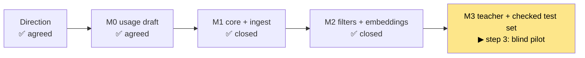

# State: where we are now

> The handoff between sessions. The agent rewrites this file at the end of every session ([CLAUDE.md, "How we iterate"](../../CLAUDE.md#how-we-iterate)). Current truth only.

**Updated:** 2026-11-26

## Phase

## Done
- **Direction and decisions:** D-01 … D-31 agreed ([decisions.md](decisions.md)). Design target: [usage.md](usage.md) on [data_model.md](data_model.md).
- **Data:** MEVA slice, sample media and v1 checkpoints in `workspace/` ([heavy_data.md](heavy_data.md)); Sapiens2 1B and DINOv3 ViT-L/16, ViT-H+/16 in the HF cache ([models/](models/README.md)).
- **M1 and M2 closed** (2026-11-25, user checked). What exists and its rules: [docs/core.md](../../docs/core.md); setup: [docs/install.md](../../docs/install.md). Store, ingest, sampling, the frame reader, `curate.score_frames` / `keep` / `center` / `dedupe`, the frame cache, and the first servant, `dinov3.embed`. 60 CPU tests.
- **M2's result** ([research/m2_filters_dedupe](../research/m2_filters_dedupe/README.md)): on the 2 fps pool, `motion >= 0.002` keeps 98%; `dedupe` at 0.99 leaves 4,453 candidates. Whole-frame vectors are dominated by the fixed background; centring by camera spreads them, and is for M4's selection.
- **Working rules** ([CLAUDE.md](../../CLAUDE.md)): the agent may run GPU work; debt is "to fix" (milestone file) or "parked" (with a trigger, [milestones/](milestones/README.md#parked-debt)); a running milestone is one file, `milestones/M<n>.md`; after a milestone the user may give [dev/audit.md](../audit.md) to an outside agent (another model); its report goes to `dev/audits/` and the agent triages it (process redesigned 2026-11-26 after the first audit).
- The inbox [brainstorms/brainstorm.md](brainstorms/brainstorm.md) is empty.

## Next
**M3 is running** ([milestones/M3.md](milestones/M3.md)).
- **Steps 1 and 2:** done, and you checked them.
- **Test set (D-32):** 300 frames from five days, labelled by SAM3 (`20261126-130121-sam3.concept-7efc`), from empty frames to 69 people ([research/m3_sam3_test_day](../research/m3_sam3_test_day/README.md)).
- **Next, step 3, the blind pilot:**
  1. Build a FiftyOne environment and an export script.
  2. You draw every person on 20 test frames, with SAM3's boxes hidden.
  3. Compare SAM3 with your boxes by box size.

The first audit is triaged ([dev/audits/2026-11-26.md](../audits/2026-11-26.md#triage)); kept items wait for M4 and M5.

## Waiting on the user
- **Go on step 3** as planned in M3.md, with FiftyOne for drawing boxes (the open question in [decisions.md](decisions.md#open)).
- **Commit steps 1 and 2:**
  - `src/`, `dev/tests/`, `docs/`, `dev/notes/`, `dev/research/`, `dev/audits/`, `dev/scripts/pull_meva.sh`;
  - the `vendors/sam3_engine` pointer (now `bb14ef1`).

## Vendor feature requests (to the user)
None open.

## Repo facts a new session needs
- Gitignored: `dev/rin_v1/`, `workspace/`, `.venv/`.
- To re-download MEVA: `bash dev/scripts/pull_meva.sh` (skips files already on disk).
- Core environment: `uv sync`; tests: `uv run pytest`. DINOv3 job environment: `uv sync --locked --project src/rin/servants/dinov3`.
- `workspace/store` holds a person's work from M3 on: never delete it to start over. Only its frame cache, `store/frames/`, is safe to delete. `workspace/store_m2/` is the M2 store, kept for the runs M2's research cites (its `frames/` is 11 GB).
