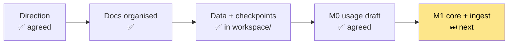

# State: where we are now

> The handoff between sessions. The agent rewrites this file at the end of every session ([CLAUDE.md, "How we iterate"](../../CLAUDE.md#how-we-iterate)). Current truth only.

**Updated:** 2026-11-24

## Phase

## Done
- Read all of v1. Postmortem and salvage list: [lessons/rin_v1.md](lessons/rin_v1.md).
- **All decisions D-01 … D-21 are agreed**, including: `uv` for environments (D-20), and one gitignored `workspace/` for media, checkpoints and, later, the store (D-21). See [decisions.md](decisions.md).
- MEVA slice, sample media and v1 checkpoints (SAM3, YOLO) are in `workspace/` ([data.md](data.md)).
- Sapiens2 1B (pretrain, pose, seg) is in the HF cache. It loads natively with `transformers` ≥ 5.24, so the `vendors/sapiens2` submodule is no longer needed ([models](models/README.md)).
- Ingested the first brainstorm ([brainstorms/processed_2026-11-23.md](brainstorms/processed_2026-11-23.md)). The inbox [brainstorms/brainstorm.md](brainstorms/brainstorm.md) is empty.
- The working loop, inbox vs chat, the vendor feature-request rule and the rules for using rin_v1 are in [CLAUDE.md](../../CLAUDE.md).
- **Repo reorganised** (2026-11-24, the user's call): working notes moved from `docs/` to `dev/notes/`; `rin_v1/` to `dev/rin_v1/` (still gitignored); `dev/` also holds `research/`, `scripts/`, `tests/`. Root `docs/` is kept free for the repo's real docs, starting with `docs/install.md` in M1. Layout table: [CLAUDE.md](../../CLAUDE.md#where-things-live). `pull_meva.sh` now finds the repo root from `dev/scripts/`.
- **M0 done** (2026-11-24): the user agreed the usage draft and D-22 … D-30. The core's reference docs are [usage.md](usage.md) (the notebook the code must read like) and [data_model.md](data_model.md) (the tables). DINOv3 first for selection (D-17). Still open: the annotation tool (decisions, Open), for M3.

## Next
1. **M1, core + ingest** ([milestones](milestones/README.md)): confirm its scope with the user, then create `milestones/M1/`. First read v1's `codecs/timecoder.py` and VFR/CFR fixtures (salvage table, [lessons/rin_v1.md](lessons/rin_v1.md)); copying them needs the user's OK.

## Waiting on the user
- Confirm M1's scope, and whether v1's timecoder and test fixtures may be salvaged.
- Commit with `git add -A` (records the moves as renames): `dev/`, the deleted `docs/` and `scripts/` paths, `CLAUDE.md`, `.gitignore`.

## Vendor feature requests (to the user)
None open.

## Repo facts a new session needs
- Gitignored: `dev/rin_v1/`, `workspace/`.
- To re-download MEVA: `bash dev/scripts/pull_meva.sh` (skips files already on disk).
