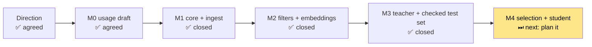

# State: where we are now

> The handoff between sessions. The agent rewrites this file at the end of every session ([CLAUDE.md, "How we iterate"](../../CLAUDE.md#how-we-iterate)). Current truth only.

**Updated:** 2026-11-27

## Phase

## Done
- **Direction and decisions:** D-01 … D-36 agreed ([decisions.md](decisions.md)); nothing Proposed or Open. Design target: [usage.md](usage.md) on [data_model.md](data_model.md).
- **M1, M2, M3 closed.** What exists and its rules: [docs/core.md](../../docs/core.md); setup, including the SAM3 and FiftyOne environments and the backup recipe: [docs/install.md](../../docs/install.md). 135 CPU tests.
- **M3 (closed 2026-11-26, after a reopening):**
  - **The test set:** run **`20261127-094340-human.annotate-64f9`**: 300 frames from five days (D-32), 3,432 people, 48 `crowd` boxes (ignore regions, D-34), 110 empty frames; checked by the user from SAM3's detector boxes with suspect frames flagged (D-33). About 4 known errors left ([m3_checked_test_set](../research/m3_checked_test_set/README.md)); a crowd box the follow-up audit found left as `person` is corrected (the first filing, 9c6c, is deleted). Frame set `20261126-130121-curate.random-0187`, SAM3 run `20261126-205940-sam3.concept-11ee`.
  - **Labelling:** `sam3.concept` stores SAM3's detector box (D-36): the box around the mask spanned two people when the mask was split. 0.78 s per frame, 6.8 GiB.
  - **Checking:** `viewer.show` (hints, flags as frame tags), `human.suspects`, `human.annotate` (partial saves, crowd boxes).
  - **What SAM3 gets wrong here:** objects (bags, coats) on the bleachers, boxed above 0.5 on the same spot all window; its precision above 0.5 is 0.934 outside crowds. The blind pilot ([m3_pilot](../research/m3_pilot/README.md)) is the honest measure of its misses: 94% found.
  - **Why reopened:** the outside audit ([dev/audits/2026-11-26-m3.md](../audits/2026-11-26-m3.md#triage)) showed the first check had passed SAM3's errors (99.4% of its boxes unchanged). That check, the first SAM3 run and the retired 03-09 runs are deleted; the store holds 11 runs.
  - **Review by exception** has a first, optimistic measurement ([idea](ideas/review_by_exception.md)).
- **Audits:** deferred findings go into [parked debt](milestones/README.md#parked-debt) at triage (D-35); both audits' kept findings are there. The follow-up audit ([2026-11-27-m3-followup](../audits/2026-11-27-m3-followup.md#triage)): backup script and viewer guard fixed, pilot counts labelled, the crowd box corrected, three nits rejected; nothing parked.
- **Backup:** `bash dev/scripts/backup_human_runs.sh` archives the human runs into `workspace/backups/` (the user's call, 2026-11-27: same WSL disk, so it survives a deleted store, not a broken disk). Latest: 2026-11-27, the pilot and the test set.

## Next
1. **Plan M4** (selection + student) in a fresh session, one file `milestones/M4.md`, split into steps. Start from:
   - the parked-debt triggers marked "M4 is planned" ([milestones/](milestones/README.md#parked-debt)), including the user's doubt about this gym as a testbed and the bags in unchecked SAM3 labels;
   - D-31: val is whole recordings from another hour of the pool day (03-07 has hours 09, 11 and 17 on the bucket, [heavy_data.md](heavy_data.md));
   - the M4 rows of [lessons/rin_v1.md](lessons/rin_v1.md) (YOLO export, RLE to polygon).
   `store_m2` retires when M4 re-runs the pool chain in the new store.

## Waiting on the user
- **Commit:** the follow-up audit and its triage (`dev/audits/2026-11-27-m3-followup.md`), the viewer `marks_` guard and its test, the backup script (relative folders, default `workspace/backups/`) and install.md, the pilot README labels, the test set pointing at 64f9 (research, holy_grail, milestones, this file). 9c6c, the view `check_fix` and the backups are deleted (not in git).

## Vendor feature requests (to the user)
None open.

## Repo facts a new session needs
- Gitignored: `dev/rin_v1/`, `workspace/`, `.venv/`.
- To re-download MEVA: `bash dev/scripts/pull_meva.sh` (skips files already on disk).
- Core environment: `uv sync`; tests: `uv run pytest`. DINOv3 job environment: `uv sync --locked --project src/rin/servants/dinov3`.
- `workspace/store` holds a person's work (the test set, the pilot): never delete it to start over; back it up with `dev/scripts/backup_human_runs.sh`. Only its frame cache, `store/frames/`, is safe to delete. `workspace/store_m2/` is the M2 store, kept for the runs M2's research cites (its `frames/` is 11 GB).
