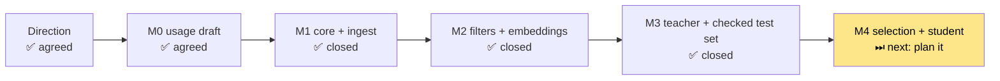

# State: where we are now

> The handoff between sessions. The agent rewrites this file at the end of every session ([CLAUDE.md, "How we iterate"](../../CLAUDE.md#how-we-iterate)). Current truth only.

**Updated:** 2026-11-26

## Phase

## Done
- **Direction and decisions:** D-01 … D-34 agreed ([decisions.md](decisions.md)); nothing Proposed or Open. Design target: [usage.md](usage.md) on [data_model.md](data_model.md).
- **M1, M2, M3 closed.** What exists and its rules: [docs/core.md](../../docs/core.md); setup, including the SAM3 and FiftyOne environments: [docs/install.md](../../docs/install.md). 119 CPU tests.
- **M3 (2026-11-26):**
  - **The store is safe for a person's work:** `media_id` comes from file content, writes are forced to disk, and uncommitted code is kept with each run as `src.diff`.
  - **Labelling:** `sam3.concept` labels frames; FiftyOne is the viewer, where a person also draws (`viewer.show`, `human.annotate`).
  - **The test set:** 300 frames from five days (D-32), checked by the user starting from SAM3's boxes above 0.5 (D-33). It is run **`20261126-164727-human.annotate-71ed`**: 4,884 people, 55 empty frames. Frame set `20261126-130121-curate.random-0187`, SAM3 run `20261126-130121-sam3.concept-7efc`.
  - **Findings** ([m3_sam3_test_day](../research/m3_sam3_test_day/README.md), [m3_pilot](../research/m3_pilot/README.md), [m3_checked_test_set](../research/m3_checked_test_set/README.md)):
    - SAM3 costs 0.78 s per frame and 6.8 GiB.
    - Checking from SAM3 took about 5 s per frame; 272 of 300 frames needed no edit.
    - SAM3's one systematic error is a box around a group of people.
    - Crowds are noisy: two passes by the same person disagree on about a fifth of the people (parked debt for M5).
  - **A new idea, raw, with a first measurement:** [review by exception](ideas/review_by_exception.md).
- The first audit is triaged ([dev/audits/2026-11-26.md](../audits/2026-11-26.md#triage)): items kept for M4 and M5 are listed in its triage.

## Next
1. **Plan M4** (selection + student) in a fresh session, one file `milestones/M4.md`, split into steps. Start from:
   - the audit findings kept for M4 (§1.2, §1.9, §3.1, §3.8, §3.9, §5.3);
   - the parked-debt triggers ([milestones/](milestones/README.md#parked-debt)). `store_m2` retires when M4 re-runs the pool chain (sample, score, embed, dedupe) in the new store, and M2's research note then points at the new run ids;
   - D-31: val is whole recordings from another hour of the pool day (03-07 has hours 09, 11 and 17 on the bucket, [heavy_data.md](heavy_data.md));
   - the M4 rows of [lessons/rin_v1.md](lessons/rin_v1.md) (YOLO export, RLE to polygon).
2. Optional, the user's call: an outside audit of M3 ([dev/audit.md](../audit.md)).

## Waiting on the user
- **Commit:** M3's last work:
  - code and tests: `src/rin/viewer/`, `src/rin/human/`, `dev/tests/`;
  - `dev/scripts/fiftyone_mongod.sh`, `docs/`, `dev/notes/` (with `milestones/M3.md` deleted), `dev/research/m3_*`.
- **Optional:** delete the FiftyOne datasets `pilot` and `test-check`. Both are filed as runs, so the copies aren't needed: `uv run --project src/rin/viewer fiftyone datasets delete pilot` (and the same for `test-check`).

## Vendor feature requests (to the user)
None open.

## Repo facts a new session needs
- Gitignored: `dev/rin_v1/`, `workspace/`, `.venv/`.
- To re-download MEVA: `bash dev/scripts/pull_meva.sh` (skips files already on disk).
- Core environment: `uv sync`; tests: `uv run pytest`. DINOv3 job environment: `uv sync --locked --project src/rin/servants/dinov3`.
- `workspace/store` holds a person's work (the checked test set): never delete it to start over; back it up. Only its frame cache, `store/frames/`, is safe to delete. `workspace/store_m2/` is the M2 store, kept for the runs M2's research cites (its `frames/` is 11 GB).
