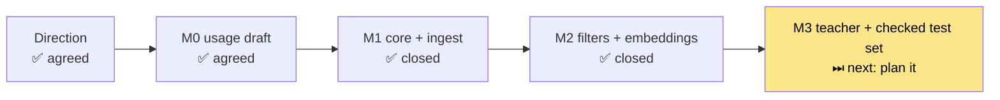

# State: where we are now

> The handoff between sessions. The agent rewrites this file at the end of every session ([CLAUDE.md, "How we iterate"](../../CLAUDE.md#how-we-iterate)). Current truth only.

**Updated:** 2026-11-25

## Phase

## Done
- **Direction and decisions:** D-01 … D-31 agreed ([decisions.md](decisions.md)). Design target: [usage.md](usage.md) on [data_model.md](data_model.md).
- **Data:** MEVA slice, sample media and v1 checkpoints in `workspace/` ([heavy_data.md](heavy_data.md)); Sapiens2 1B and DINOv3 ViT-L/16, ViT-H+/16 in the HF cache ([models/](models/README.md)).
- **M1 and M2 closed** (2026-11-25, user checked). What exists and its rules: [docs/core.md](../../docs/core.md); setup: [docs/install.md](../../docs/install.md). Store, ingest, sampling, the frame reader, `curate.score_frames` / `keep` / `center` / `dedupe`, the frame cache, and the first servant, `dinov3.embed`. 60 CPU tests.
- **M2's result** ([research/m2_filters_dedupe](../research/m2_filters_dedupe/README.md)): on the 2 fps pool, `motion >= 0.002` keeps 98%; `dedupe` at 0.99 leaves 4,453 candidates. Whole-frame vectors are dominated by the fixed background; centring by camera spreads them, and is for M4's selection.
- **Working rules** ([CLAUDE.md](../../CLAUDE.md)): the agent may run GPU work; debt is "to fix" (milestone file) or "parked" (with a trigger, [milestones/](milestones/README.md#parked-debt)); a running milestone is one file, `milestones/M<n>.md`; after a milestone the user may give [dev/audit.md](../audit.md) to an outside agent (another model).
- The inbox [brainstorms/brainstorm.md](brainstorms/brainstorm.md) is empty.

## Next
1. **Plan M3** (teacher + checked test set), in a fresh session, one file `milestones/M3.md`. Start from:
   - the two open questions in [decisions.md](decisions.md#open): where a person's clicks and drawn boxes are collected; which judgment makes a fixed frame complete;
   - the parked-debt triggers: "a second servant is built" fires in M3 (move the job launch beside `frame_cache.py`);
   - v1's SAM3 notes ([models/](models/README.md#v1-notes-worth-reading-before-writing-a-servant)) and the M3 rows of [lessons/rin_v1.md](lessons/rin_v1.md) (geometry check, RLE to polygon);
   - `who` can already be passed to a run (`RunWriter(who=...)`).
2. Optional, before M3: an outside audit with [dev/audit.md](../audit.md).

## Waiting on the user
- Commit: `src/` (new: `curate/`, `media/reader.py`, `servants/`), `dev/` (new: `research/m2_filters_dedupe/`, `tests/test_curate.py`; deleted: `notes/milestones/M2/`), `docs/`, `dev/audit.md`, `pyproject.toml`, `uv.lock`, `CLAUDE.md`.

## Vendor feature requests (to the user)
None open.

## Repo facts a new session needs
- Gitignored: `dev/rin_v1/`, `workspace/`, `.venv/`.
- To re-download MEVA: `bash dev/scripts/pull_meva.sh` (skips files already on disk).
- Core environment: `uv sync`; tests: `uv run pytest`. DINOv3 job environment: `uv sync --locked --project src/rin/servants/dinov3`.
- `workspace/store` is derived data: delete it and re-run (ingest about 130 s; scoring 100 s; caching 3 min; embedding 8 min). The frame cache, `workspace/store/frames/`, is 11 GB.
