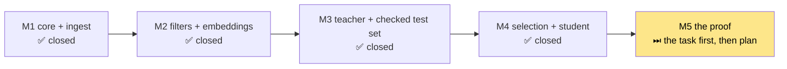

# State: where we are now

> The handoff between sessions. The agent rewrites this file at the end of every session ([CLAUDE.md, "How we iterate"](../../CLAUDE.md#how-we-iterate)). Current truth only.

**Updated:** 2026-11-27

## Phase

## Done
- **Direction and decisions:** D-01 … D-41 agreed ([decisions.md](decisions.md)); nothing Proposed or Open. Design target: [usage.md](usage.md) on [data_model.md](data_model.md).
- **M1 to M4 closed.** What exists and its rules: [docs/core.md](../../docs/core.md); setup: [docs/install.md](../../docs/install.md). 190 CPU tests.
- **The test set** (M3): run `20261127-094340-human.annotate-64f9`, 300 checked frames from five days; as COCO truth: `20261127-152506-export.coco-8bc8`.
- **M4 (closed 2026-11-27, after the audit's fixes in step 6):**
  - [m4_selection](../research/m4_selection/README.md): the pool is the busy 09:55–10:55 plus a quiet 17:10–17:40 (D-41), no motion filter: 4,683 candidates, 230 quiet, 3 empty; val 321 (D-31). With two kinds of scene, kcenter and kmeans_stratified pick quiet, sparse frames above random's rate.
  - [m4_training_labels](../research/m4_training_labels/README.md): SAM3 on every candidate (two runs; `curate.difference` labels only new ones); D-39's gate.
  - [m4_first_curve](../research/m4_first_curve/README.md): corrected stock yolo26s scores 0.629; students gain at most 0.03 (0.661 at 1,000 frames), mostly on small people, and add boxes on empty frames. More optimizer steps made students worse at every budget, so D-40 keeps M4's setting, now stated.
- **The audit of M4** ([report](../audits/2026-11-27.md), triage at its end): code fixes in (class filtering before `max_det`, split guards, stated optimizer, per-camera random, and more); its starvation worry was measured and rejected.
- **New rule:** the outside audit runs before a milestone closes ([CLAUDE.md](../../CLAUDE.md), "Audits").
- **`m.delete(run)`** exists (refuses a run others depend on, and a person's work); superseded M4 runs deleted with the user's yes.

## Next
1. **Choose M5's task** with the user: the agent recommends the proof on a rare concept COCO lacks, in long fixed-camera footage ([where_distillation_pays](ideas/where_distillation_pays.md)): screen concepts on MEVA first, then a sparse checked test set, then the curve. Changes D-17's "class person first".
2. **Then plan M5** from the parked-debt rows triggered by "M5 is planned" ([milestones/](milestones/README.md#parked-debt)); some (lower budgets, cluster counts, empty frames) belong to the gym and are re-read against the new task.

## Waiting on the user
- **M5's direction:** yes or no to the rare-concept proof (and the gym closing as a finding).
- **Commit:** everything since `981723f`: the audit and its triage; M4 step 6 (code and tests: `yolo` class filtering, stated optimizer, clamping, dropped no-area boxes; `curate.select` per-camera random; split guards; `curate.difference`; `m.delete`); the 6b and 6c scripts and rewritten write-ups; decisions D-31/38/40/41; `CLAUDE.md`'s audit rule; ideas `where_distillation_pays` and `crowd_labelling`; `docs/core.md`, `usage`, `heavy_data`, `pull_meva.sh`, `superseded_runs.py`; milestones (M4 closed, `M4.md` deleted); this file.

## Vendor feature requests (to the user)
None open.

## Repo facts a new session needs
- Gitignored: `dev/rin_v1/`, `workspace/`, `.venv/`.
- To re-download MEVA (pool, val, test): `bash dev/scripts/pull_meva.sh` (skips files already on disk).
- Core environment: `uv sync`; tests: `uv run pytest`. Job environments: `uv sync --locked --project src/rin/servants/<dinov3|sam3|yolo>`. DINOv3's model commit: `ea8dc2863c51be0a264bab82070e3e8836b02d51`.
- Key runs: pool candidates `20261127-105927-curate.dedupe-6b65`, their embeddings `20261127-104644-dinov3.embed-32fd`, val candidates `20261127-110156-curate.dedupe-f05d`, SAM3 labels for both `20261127-111139-sam3.concept-5477`; the nine selections are listed in [m4_selection](../research/m4_selection/README.md).
- `workspace/store` holds a person's work (the test set, the pilot): never delete it to start over; back it up with `dev/scripts/backup_human_runs.sh`. Only its frame cache, `store/frames/`, is safe to delete.
