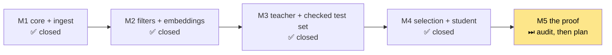

# State: where we are now

> The handoff between sessions. The agent rewrites this file at the end of every session ([CLAUDE.md, "How we iterate"](../../CLAUDE.md#how-we-iterate)). Current truth only.

**Updated:** 2026-11-27

## Phase

## Done
- **Direction and decisions:** D-01 … D-40 agreed ([decisions.md](decisions.md)); nothing Proposed or Open. Design target: [usage.md](usage.md) on [data_model.md](data_model.md).
- **M1 to M4 closed.** What exists and its rules: [docs/core.md](../../docs/core.md); setup: [docs/install.md](../../docs/install.md) (core, DINOv3, SAM3, viewer, YOLO environments). 171 CPU tests.
- **The test set** (M3): run `20261127-094340-human.annotate-64f9`, 300 checked frames from five days; as COCO truth: `20261127-152506-export.coco-8bc8`.
- **M4 (closed 2026-11-27)**, three write-ups:
  - [m4_selection](../research/m4_selection/README.md): the pool chain rebuilt (4,453 candidates, the same frames as M2's; val 03-07 11:30–11:40, 308 candidates, D-31); `curate.select` (D-38), nine selections. kcenter halves the worst-case distance and picks outliers (near-empty gym, close-ups); kmeans_stratified can't be told from random.
  - [m4_training_labels](../research/m4_training_labels/README.md): SAM3 on every candidate (D-37, 1.36 s/frame); training labels per D-39 (score ≥ 0.5, no size gate, same-spot boxes kept: in the pool they are seated people).
  - [m4_first_curve](../research/m4_first_curve/README.md): student per D-40 (yolo26s, 1280, batch 8, 50 epochs). Random, seed 0: test mAP50-95 0.599 (stock) → 0.619 / 0.646 / 0.651 / 0.661 at 100 / 250 / 500 / 1,000 frames. Flat above 250; small people gain most; small students box ghosts on empty frames.
- **The user's calls this milestone:** the gym stays for M4 and M5 (doubt parked until M5's verdict); larger YOLO sizes and RF-DETR parked until the verdict; per-task workflows by measured teacher reliability filed in [review_by_exception](ideas/review_by_exception.md).

## Next
1. **Outside audit of M4** (the user runs [dev/audit.md](../audit.md) with another model, in a fresh session).
2. **Triage it**, then **plan M5** in a fresh session: start from the parked-debt rows triggered by "M5 is planned" ([milestones/](milestones/README.md#parked-debt)), which carry M4's findings: lower budgets, false positives on empty frames per method, the empty-frame gap in the pool, random over raw frames, the cheap baselines, the box-count confound, the temporal clustering of test frames. Estimated cost at D-40: about 5 min per student at 100 frames, 22 min at 1,000.

## Waiting on the user
- **Commit:** the M4 close (research write-ups `m4_training_labels/`, `m4_selection/`, `m4_first_curve/` with their scripts and images; `M4.md` deleted; decisions, milestones, parked debt, models, holy_grail, usage, ideas, this file).
- **Audit:** when ready, start the outside audit of M4.

## Vendor feature requests (to the user)
None open.

## Repo facts a new session needs
- Gitignored: `dev/rin_v1/`, `workspace/`, `.venv/`.
- To re-download MEVA (pool, val, test): `bash dev/scripts/pull_meva.sh` (skips files already on disk).
- Core environment: `uv sync`; tests: `uv run pytest`. Job environments: `uv sync --locked --project src/rin/servants/<dinov3|sam3|yolo>`. DINOv3's model commit: `ea8dc2863c51be0a264bab82070e3e8836b02d51`.
- Key runs: pool candidates `20261127-105927-curate.dedupe-6b65`, their embeddings `20261127-104644-dinov3.embed-32fd`, val candidates `20261127-110156-curate.dedupe-f05d`, SAM3 labels for both `20261127-111139-sam3.concept-5477`; the nine selections are listed in [m4_selection](../research/m4_selection/README.md).
- `workspace/store` holds a person's work (the test set, the pilot): never delete it to start over; back it up with `dev/scripts/backup_human_runs.sh`. Only its frame cache, `store/frames/`, is safe to delete.
