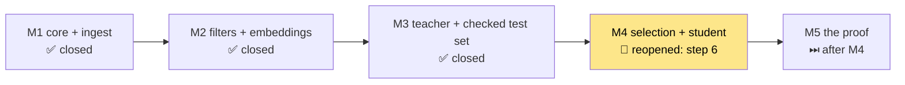

# State: where we are now

> The handoff between sessions. The agent rewrites this file at the end of every session ([CLAUDE.md, "How we iterate"](../../CLAUDE.md#how-we-iterate)). Current truth only.

**Updated:** 2026-11-27

## Phase

## Done
- **Direction and decisions:** D-01 … D-41 agreed ([decisions.md](decisions.md)); nothing Proposed or Open. Design target: [usage.md](usage.md) on [data_model.md](data_model.md).
- **M1 to M3 closed; M4 steps 1–5 done.** What exists and its rules: [docs/core.md](../../docs/core.md); setup: [docs/install.md](../../docs/install.md). 171 CPU tests.
- **The test set** (M3): run `20261127-094340-human.annotate-64f9`, 300 checked frames from five days; as COCO truth: `20261127-152506-export.coco-8bc8`.
- **M4's write-ups:** [m4_selection](../research/m4_selection/README.md), [m4_training_labels](../research/m4_training_labels/README.md), [m4_first_curve](../research/m4_first_curve/README.md) (its numbers carry known faults, stated there).
- **Audit of M4 triaged with the user** (2026-11-27, [report](../audits/2026-11-27.md), triage at its end). Checked: Ultralytics stepped once per 8 batches with an unrecorded optimizer, so small budgets trained far less; `yolo.predict` capped the stock baseline's person boxes; val holds no empty frame. The user's calls: reopen M4 rather than carry the fixes into M5; D-40 (explicit optimizer, a step per batch, a step floor), D-41 (quiet frames stay in the pool), D-31 (val gains 17:00 empty-gym clips), D-38 (random per camera).

## Next
1. **M4 step 6b, training steps** ([M4.md](milestones/M4.md)): 6a is done (fixes, 186 tests, GPU smoke). 6b repeats small training sets rather than lengthening them (Ultralytics validates every epoch); confirm with the user, then run (about 1.5 h GPU). Then 6c (quiet frames), 6d (redo the curve), and M4 closes.
2. **Plan M5** from the parked-debt rows triggered by "M5 is planned" ([milestones/](milestones/README.md#parked-debt)).

## Waiting on the user
- **6b's plan:** a yes to repeating small training sets (`epoch_images`) and to the seven-run measurement.
- **Commit:** step 6a's code and tests, the audit-before-close rule in `CLAUDE.md`, and the triage (audit report with its triage, decisions D-31/38/40/41, `M4.md`, milestones and parked debt, `m4_first_curve` faults note, `holy_grail`, `models/README`, `usage`, this file).

## Vendor feature requests (to the user)
None open.

## Repo facts a new session needs
- Gitignored: `dev/rin_v1/`, `workspace/`, `.venv/`.
- To re-download MEVA (pool, val, test): `bash dev/scripts/pull_meva.sh` (skips files already on disk).
- Core environment: `uv sync`; tests: `uv run pytest`. Job environments: `uv sync --locked --project src/rin/servants/<dinov3|sam3|yolo>`. DINOv3's model commit: `ea8dc2863c51be0a264bab82070e3e8836b02d51`.
- Key runs: pool candidates `20261127-105927-curate.dedupe-6b65`, their embeddings `20261127-104644-dinov3.embed-32fd`, val candidates `20261127-110156-curate.dedupe-f05d`, SAM3 labels for both `20261127-111139-sam3.concept-5477`; the nine selections are listed in [m4_selection](../research/m4_selection/README.md).
- `workspace/store` holds a person's work (the test set, the pilot): never delete it to start over; back it up with `dev/scripts/backup_human_runs.sh`. Only its frame cache, `store/frames/`, is safe to delete.
