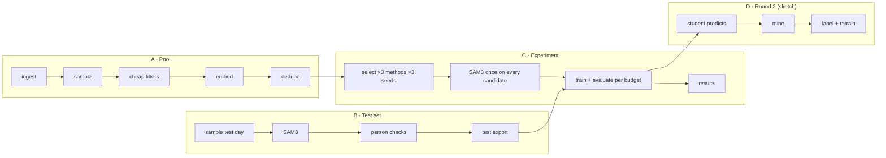
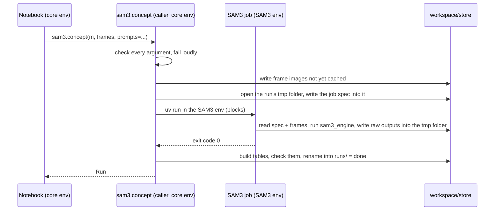

# Usage draft: the holy grail loop as a notebook

> **Agreed with the user in M0 (2026-11-24).** This is the notebook the holy grail loop *should* read like once M1–M6 are built; the code gets written to match it, not the other way round. Each milestone turns its part into a real notebook and updates this file where reality differed; changes to the API need the user's OK (D-15, [direction §6](direction.md#6-roles)). The tables it implies are in [data_model.md](data_model.md); its design calls are D-22 … D-30 in [decisions.md](decisions.md).

**How to read it.** Each cell is followed by three lines: what it does, why it is there, and what breaks without it. Numbers marked `# placeholder` are not measured yet; the milestone in the comment measures them. Parts A and B are close to what M1–M3 will build. Parts C3 and D are sketches that M4–M6 will reshape.



## The one pattern

Every step has the same shape (D-22):

```python
result = module.verb(m, inputs, **that_step's_own_arguments)   # -> a Run
```

- `m` is the **Master**: the store on disk. It finds runs and answers queries. It does no model work.
- `inputs` are earlier runs (a frame set, an embedding run, a labels run).
- The arguments belong to that step alone. `sam3.concept` has `prompts`; `yolo.train` has `epochs`. No shared request type (D-01).
- The result is a **Run**: a small handle (`run.id`, `run.config`, `run.instances()`, …). The data stays on disk.

**Servants** (`sam3`, `dinov3`, `yolo`) need their models' environments, which the notebook doesn't have. So each servant has two halves:



The caller has the real signature (so your editor autocompletes it and a typo fails before the GPU starts) but imports no model code. The job imports the vendor API and nothing from Rin (D-07). Rule steps (`core`, `curate`, `export`) run in the core environment directly.

---

## Part A · The pool

### A0 · Open the store

```python
from datetime import datetime
from rin import Master
from rin import core, curate, export, human, viewer
from rin.servants import dinov3, sam3, yolo

m = Master("workspace/store")        # creates the folder if new; never deletes anything
```

- **What:** a handle on `workspace/store/` ([data_model §4](data_model.md#4-on-disk)).
- **Why:** one object that knows where everything is, so no cell passes paths around.
- **Without it:** each step would find files on its own, and two steps could disagree about where the truth is (v1 had a catalog, staging and branches all holding parts of it).

### A1 · Ingest the pool and the test day

```python
# MEVA filenames carry camera and start time; core doesn't know that, so we tell it here.
# '2018-03-07.09-55-00.10-00-00.school.G299.r13.avi' -> {"site": "school", "camera": "G299", "started_at": ...}
def meva_name(path):
    day, start, _end, site, camera, _rest = path.name.split(".", 5)
    return {"site": site, "camera": camera,
            "started_at": datetime.strptime(f"{day} {start}", "%Y-%m-%d %H-%M-%S")}

pool = core.ingest(m, "workspace/media/meva/pool", split="pool", describe=meva_name)
test = core.ingest(m, "workspace/media/meva/test", split="test", describe=meva_name)

pool.media()          # 24 rows: one per 5-minute clip
pool.frames()         # about 216k rows: (media_id, frame_idx, pts)
```

- **What:** one row per file in `media`, one row per decoded frame in `frames`, with the container's own timestamps. Ingest only records what the file itself says (size, frames, pts). `describe` is optional: a small function *you* write that reads extra facts (site, camera, wall-clock start) from wherever your dataset keeps them, here the MEVA filename.
- **Why:** everything later joins on `(media_id, frame_idx)` (D-09). The split is set per file, so the test day can never leak into the pool (D-13). Camera and start time aren't needed to join anything; they let you group results by camera and put a real clock time on every frame. Core stays free of any dataset's naming rules: a new dataset means a new 4-line function in the notebook, not a change to Rin.
- **Without it:** v1 matched frames by float time and silently lost every frame of clips that didn't start at 0.0 (CR-30). Without `describe`, nothing breaks: camera and start time are just empty. Rin never guesses them from a filename on its own, because a guess that half-matches another dataset's names would put wrong cameras in the store without any error.

### A2 · Sample frames

```python
frames = core.sample(m, pool, fps=2)          # 2 fps keeps 28-39% more after dedupe than 1 fps (M2)
len(frames)                                   # 14,424: 24 clips × 601 (t = 0, 0.5, ..., 300 s of a 300.2 s clip)
```

- **What:** a frame set: the frame on screen every 0.5 s by timestamp. On MEVA's steady 30 fps that is every 15th frame; on variable-rate footage it is still the right frame.
- **Why:** consecutive frames at 30 fps are near-identical; nothing downstream needs all of them.
- **Without it:** every later step pays 15 times more for almost no new information.

### A3 · Cheap filters: score once, decide cheaply

```python
scores = curate.score_frames(m, frames, ["motion", "blur", "dark", "bright"])   # CPU, 320-wide copy
scores.frame_scores().df().groupby("name")["value"].describe()                  # look before choosing

kept = curate.keep(m, scores, where="motion >= 0.002")
len(kept)                                                                       # 14,198 of 14,424
```

- **What:** `score_frames` measures each frame (frame difference, variance of the Laplacian, clipped histogram ends; definitions in `curate.SCORES`) and stores the numbers. `keep` applies thresholds to the stored numbers and writes the survivors as a new frame set.
- **Why:** scoring decodes video and is slow; choosing a threshold is a query and takes no time. Splitting them means you can try five thresholds without decoding again (D-26). The `where` text is saved in the run, so the threshold is never lost.
- **Without it:** idle CCTV fills the selection with empty, identical frames, and farthest-point selection picks blurred glitches because they look "far" from everything ([holy_grail §3](ideas/holy_grail.md#3-selection-methods-to-compare)).

### A4 · Embed

```python
emb = dinov3.embed(
    m, kept,
    model="facebook/dinov3-vitl16-pretrain-lvd1689m",
    revision="ea8dc2863c51be0a264bab82070e3e8836b02d51",    # the cached commit; loaded offline
    size=(896, 512),              # (width, height), multiples of 16; keeps 16:9 (M2)
    what=["cls"],                 # D-14: no patch grids by default
    batch_size=32,
)
emb.vectors().shape               # (len(kept), 1024)
```

- **What:** a batch job in the DINOv3 environment: one vector per frame, saved as an array file plus an index table. The frames are resized to 896×512, not the preprocessor's default 224×224 square, so people stay about three patches tall ([models](models/README.md#known-gotchas)).
- **Why:** selection needs a sense of "how different are these two frames"; distance between embeddings is that sense.
- **Without it:** the only selection left is random. Note the risk: on a fixed camera whole-frame vectors may barely differ ([holy_grail §4](ideas/holy_grail.md#4-the-main-risk-fixed-cameras)). Then `what=["box_pooled"]` with person boxes is the next try, and the rest of the notebook doesn't change.
- **Why DINOv3 and not EmbeddingGemma 2:** they measure different kinds of "different". DINOv3 learned from images alone, so its distance tracks what the picture looks like: where people stand, how big, how lit, how occluded. That is what a person detector has to learn. EmbeddingGemma learned to match images to text, so its distance tracks what you would *say* about a frame. "A schoolyard with people" describes most of the pool, so many frames a detector would find different could come out close together. That is a reasoned guess, not a measurement. Gemma's real strength is text search ("people carrying boxes", [search.md](ideas/search.md)), which comes after the holy grail.
- **Both is cheap to test:** an embedding is just another run, so `gemma.embed(m, kept, task="clustering")` would slot into A5 and C1 unchanged. Recommendation: DINOv3 alone for the first curve; add a Gemma line only if DINOv3 whole-frame doesn't beat random, alongside the foreground features above.

### A5 · De-duplicate

```python
cands = curate.dedupe(m, kept, emb, cosine_max=0.99)
len(cands)                                              # 4,453
```

- **What:** walks each camera's frames in time order and drops a frame too similar to the last kept one. On MEVA, 0.99 drops near-copies; 0.98 already drops frames where people moved, because the gym dominates whole-frame vectors ([research](../research/m2_filters_dedupe/README.md)).
- **Why:** removes the remaining near-copies (a person standing still for a minute), so selection spends its budget on different moments.
- **Without it:** coverage methods still work, but random selection gets weaker for an uninteresting reason, and the comparison gets noisier.

---

## Part B · The test set (before any experiment)

The test set is what every student is scored on, so it must be **right**, not just labelled. It is chosen at random (never by a method under test), labelled by SAM3, then checked frame by frame by a person (D-30).

### B1 · Sample the test day

```python
test_frames = curate.random(m, core.sample(m, test, fps=2), n=300, seed=0)   # placeholder: M3 picks n
```

- **What:** 300 random frames from the other day, including empty ones.
- **Why:** random means the test set looks like real footage. Empty frames are kept on purpose: they are where false positives show up.
- **Without it:** a curated test set would reward the curation method that picked it.

### B2 · Label with SAM3

```python
test_labels = sam3.concept(
    m, test_frames,
    prompts={"person": "person"},            # class -> one prompt text (two texts would find each person twice)
    checkpoint="workspace/checkpoints/sam3/sam3.pt",
    score_floor=0.1,                         # keep nearly everything; gates come later (D-26)
    masks=True,
)
test_labels.instances().head()
```

- **What:** a batch job in the SAM3 environment. Each frame goes through `sam3_engine`'s `ImageSession.detect` (frames are 0.5 s apart, so each is labelled on its own, not tracked). Boxes are stored in [0, 1], masks as RLE.
- **Why:** a low `score_floor` stores almost everything SAM3 says; the real score gate is chosen later, in the dataset query, without running SAM3 again.
- **Without it:** a person would draw every box from scratch.

### B3 · A person checks it

```python
viewer.show(m, test_frames, name="check", draw="checked", classes=("person", "crowd"),
            start_from=test_labels, start_above=0.5,             # SAM3's boxes above 0.5, to edit (D-33)
            labels=[test_labels], label_scores=(0.3, 0.5),       # its 0.3-0.5 boxes, as read-only hints
            tags={"flagged": human.suspects(m, test_frames, test_labels, above=0.5)})
# In FiftyOne (uv run --project src/rin/viewer fiftyone app launch check): flagged frames first;
# delete wrong boxes, fix loose ones, draw missing people, a "crowd" box over people you can't
# tell apart; tag each finished frame "done". Save as often as you like:
checked = human.annotate(m, test_frames, view="check", field="checked", who="nic")
```

- **What:** the checked labels are one run of their own, with the person in `who` and SAM3's run among its `inputs`; SAM3's run is never edited (D-02). A frame is complete when it is in `checked`'s frame set: every person on it has a box, and an empty finished frame means nobody is there (D-27, D-33). The gate and hint band come from the blind pilot ([m3_pilot](../research/m3_pilot/README.md)): at 0.5 SAM3 found 94% of the people and 90–95% of its boxes were right; most of its misses are boxes scored 0.3–0.5. The flags point at SAM3's typical error, objects on the same spot of a fixed camera (bags, coats), which a quick check passes ([m3_checked_test_set](../research/m3_checked_test_set/README.md)).
- **The labelling rule** (from the pilot): box every person you can see, around the visible part; when unsure, box it if more likely yes; delete group boxes and box the people under them. Where people can't be told apart, one `crowd` box over the cluster: the boxes inside it are dropped and scoring ignores the region (D-34).
- **Why:** a test set labelled by SAM3 alone measures agreement with SAM3, not accuracy (D-13); a person boxing blind missed about a tenth of the people. Starting from SAM3 and correcting catches both, and turns the person's work into deleting and adding, not drawing everything.
- **Without it:** a missed person counts as background, so a student that finds that person is marked wrong.

### B4 · Freeze the test set

```python
test_exp = export.coco(m, checked, classes=["person"], crowd="crowd")   # crowd boxes -> iscrowd=1 (D-34)
```

- **What:** the export writes the checked run as COCO ground truth (D-12), as a run of its own, which freezes exactly which frames and boxes the test set holds. COCO, not YOLO, because scoring must ignore crowd regions and Ultralytics' validation can't (D-34; the details are parked debt for M5).
- **Why:** one fixed thing every experiment is scored on.
- **Without it:** students trained on Monday and Friday could be scored on different test sets without anyone noticing.

---

## Part C · The experiment

### C1 · Select: three methods, three seeds, ranked

```python
methods = ["random", "kcenter", "kmeans_stratified"]
seeds   = [0, 1, 2]
budgets = [100, 250, 500, 1000]                            # placeholder: limited by SAM3 cost, measured in M3

sel = {}
for meth in methods:
    for s in seeds:
        extra = {"clusters": 50} if meth == "kmeans_stratified" else {}   # 50 per camera (M4)
        sel[(meth, s)] = curate.select(m, cands, emb, method=meth, n_max=max(budgets), seed=s, **extra)
```

- **What:** each call writes a **ranked** list of up to 1000 frames. Budget 250 means the first 250 of that list (D-28). `kcenter` and `kmeans_stratified` rank each camera on its own, by Euclidean distance, and take the cameras in turns, so every budget is half from each camera (D-38).
- **Why:** ranked lists make the budgets nested: the 250-frame set contains the 100-frame set. That makes the mAP curve smoother and means SAM3 labels far fewer frames in total.
- **Without it:** each budget would be a separate selection, and the curve would jump between unrelated sets of frames.
- **Worth adding:** `random` over `frames` (before filters) as a fourth line. It tells us how much the cheap filters alone buy, separately from the embedding methods.

### C2 · Label every candidate once

```python
pool_labels = sam3.concept(m, cands, prompts={"person": "person"},
                           checkpoint="workspace/checkpoints/sam3/sam3.pt", score_floor=0.1, masks=True)
```

- **What:** one SAM3 job over every candidate frame, picked or not (D-37); val's candidates get the same (D-31).
- **Why:** each dataset later takes its own subset by query, so a frame picked by three methods is labelled once, a new selection method needs no new SAM3 run, and round 2 (Part D) finds SAM3's labels already there on the frames nobody picked.
- **Without it:** SAM3, the most expensive step, would run again each time the selections change.
- **Not checked by a person:** training labels stay pseudo-labels; that is the point of a teacher. Spot checks are possible with the same `viewer.show`.

### C3 · Train and evaluate every point on the curve

```python
for (meth, s), picks in sel.items():
    for n in budgets:
        tags = {"method": meth, "seed": s, "n": n}
        ds   = m.dataset(labels=[pool_labels], frames=picks, top=n,
                         gate="score >= 0.5")   # D-39: no size gate; near-duplicates keep the higher score
        exp     = export.yolo(m, ds, classes=["person"], val=val_labels, tags=tags)   # val: D-31, chosen in M4
        student = yolo.train(m, exp, model="yolo26s", epochs=100, imgsz=1280, seed=s, tags=tags)  # placeholders: M4
        coco.evaluate(m, student, test_exp, tags=tags)       # COCO scoring, crowd regions ignored (D-34)
```

- **What:** 3 methods × 3 seeds × 4 budgets = 36 exports, trainings and evaluations, each a run with tags.
- **Why:** one fixed student (D-17) and one fixed test set, so the only thing that changes is which frames went in.
- **Without it:** no proof, only a feeling that curation helped.
- **Cost:** 36 trainings. Time per training isn't measured yet; M4 measures one first and may cut budgets or epochs.

### C4 · The result is a query

```python
res = m.sql("""
    SELECT r.tags->>'method' AS method, (r.tags->>'n')::INT AS n,
           avg(x.value) AS map, stddev(x.value) AS spread
    FROM metrics x JOIN runs r USING (run_id)
    WHERE r.step = 'coco.evaluate' AND x.name = 'mAP50-95'
    GROUP BY method, n ORDER BY method, n
""")
res.plot_curve(x="n", y="map", group="method", band="spread")
```

- **What:** test mAP against label budget, one line per method, with the seed spread as a band.
- **Why:** every number has its provenance in `runs`, so the plot is a query, not a spreadsheet kept by hand.
- **The verdict (D-17):** curated selection wins if it reaches random's mAP with half the labels or fewer. If whole-frame DINOv3 doesn't, the next try is foreground features (A4), not giving up.

---

## Part D · Round 2 (sketch: M6 reshapes this)

```python
best       = m.best_run(step="yolo.train", where="tags->>'method' = 'kcenter' AND tags->>'n' = '500'")
picked     = m.dataset(labels=[pool_labels], frames=sel[("kcenter", 0)], top=500, ...).frames
unpicked   = curate.minus(m, cands, picked)
preds      = yolo.predict(m, best, unpicked, conf_floor=0.05)
hard       = curate.mine(m, preds, method="uncertain", band=(0.3, 0.6), n_max=250)        # placeholders: M6
# also possible: frames where preds and pool_labels disagree (SAM3 already labelled them, D-37)
ds2        = m.dataset(labels=[pool_labels], frames=curate.union(m, [picked, hard]), ...)
```

- **What:** the student predicts on frames its training set didn't hold; frames where it is unsure join the training set, with the SAM3 labels already stored for them (D-37), and it retrains.
- **Why:** this closes the loop: the student itself says where it is weak.
- **Without it:** selection is one-off coverage and never learns from the student's mistakes.

---

## What the draft leaves out on purpose

Actions, tracking and search aren't drafted (one milestone ahead, D-19). The data model only makes sure they won't need a rewrite: `track_id` on instances, `span` judgments, per-box embeddings.

## Debt this draft takes on

| Shortcut | Later cost |
|---|---|
| A servant call blocks the notebook until the job ends (SAM3 on thousands of frames could take hours) | If jobs must queue or run overnight unattended, the caller needs a submit-and-wait mode; the job half doesn't change |
| Frame images are cached as JPEG, a second lossy compression after H.264 | Every model sees the same pixels, so comparisons stay fair; a pixel-exact need would mean PNG (much larger) |
| `m.dataset` arguments (`gate`, `top`) are a guess at what queries are common | Expect them to change in M4; `m.sql` stays as the escape hatch |
| Every frame set, even a union, is a run on disk | Many tiny folders over time; harmless at this scale |
