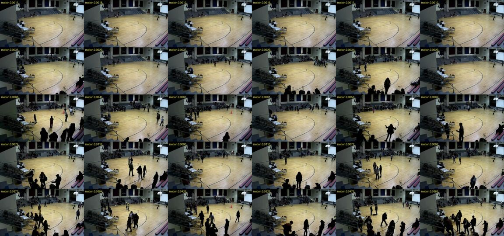

# What do cheap filters and DINOv3 de-duplication leave of the MEVA pool?

**Question.** Of the pool's frames sampled at 2 fps, how many survive the cheap filters, and then de-duplication on whole-frame DINOv3 vectors? Is 1 fps enough? The experiment needs at least 1,000 candidates (the largest label budget, usage C1).

**Setup** (M2, 2026-11-25). The run ids below were in `workspace/store_m2/`, deleted in M4 (2026-11-27) after M4 rebuilt the same chain in `workspace/store` and got the same 4,453 candidates, frame for frame ([M4 step 1](../../notes/milestones/M4.md#measurements)). MEVA pool: cameras G299 and G330, one hour, an indoor school gym ([heavy_data.md](../../notes/heavy_data.md)). DINOv3 ViT-L/16, CLS vector, 896×512 input, float32 weights under float16 autocast.

| Step | 2 fps run | 1 fps run |
|---|---|---|
| sample | `20261124-233803-core.sample-1691` | `20261125-205256-core.sample-5970` |
| score_frames | `20261125-204051-curate.score_frames-72a8` | `20261125-205436-curate.score_frames-2666` |
| keep `motion >= 0.002` | `20261125-204333-curate.keep-eed6` | `20261125-205436-curate.keep-ad03` |
| dinov3.embed | `20261125-210045-dinov3.embed-d62b` | `20261125-210819-dinov3.embed-4ca4` |
| dedupe | `20261125-211213-curate.dedupe-*` (0.90, 0.95, 0.98, both rates) and `20261125-211304-curate.dedupe-*` (0.99, 0.995, 2 fps); `cosine_max` is in each run's config | |

## Results

**Cost on the pool** (this machine): scoring 101 s for 14,424 frames (CPU; decoding every frame dominates); caching 14,198 frames 176 s, 11 GB; embedding 454 s (31.5 frames/s).

**Cheap filters remove almost nothing here.** Blur, dark and bright barely vary over the hour: no frame is blurred or badly exposed. Motion separates an empty gym (below about 0.002) from frames with people, including people standing still (0.002 to 0.004). `motion >= 0.002` keeps 14,198 of 14,424 frames (98%). This hour is busy; idle footage would lose far more.

| Motion band (G299) | What the frames show |
|---|---|
|  | Rows, top to bottom: motion < 0.002 (empty gym), 0.002–0.004 (still people, some empty), 0.004–0.007, 0.007–0.012, > 0.03. G330: [motion_bands_G330.jpg](motion_bands_G330.jpg) |

**Whole-frame vectors barely tell moments apart.** On one camera, the cosine similarity of two random frames from the hour has a median of 0.95 (1st percentile 0.83); frames 0.5 s apart have a median of 0.995. So survivors of de-duplication fall steeply as `cosine_max` drops:

| `cosine_max` | 2 fps: 14,198 → | 1 fps: 7,220 → |
|---|---|---|
| 0.90 | 64 | 52 |
| 0.95 | 366 | 278 |
| 0.98 | 1,790 | 1,287 |
| 0.99 | 4,453 | |
| 0.995 | 8,296 | |

At 0.98 the dropped frames are not copies: people have moved, arrived or left ([dropped_at_0.98.jpg](dropped_at_0.98.jpg), each row: last kept frame, dropped frame). At 0.99 they mostly are: the same people slightly rearranged ([dropped_at_0.99.jpg](dropped_at_0.99.jpg)).

**Subtracting each camera's mean vector spreads the vectors out** (`curate.center`, run `20261125-220754-curate.center-eec7`). Random pairs drop to a median cosine of about 0.0; frames 0.5 s apart, about 0.88. De-duplicating the centred vectors at 0.7 / 0.75 / 0.8 / 0.85 / 0.9 keeps 2,593 / 3,520 / 4,862 / 6,794 / 9,387. At a matching count (centred 0.8: 4,862 against raw 0.99: 4,453) only 2,683 frames are in both, yet the frames each keeps alone look alike: busy gym, people in new places. Neither is visibly better at de-duplication.

## Verdict

- **2 fps, not 1 fps.** After de-duplication 2 fps keeps 28–39% more frames, so the extra frames hold new moments.
- **De-duplicate at `cosine_max = 0.99`:** 4,453 candidates, enough for every budget, and what it drops are near-copies. 0.95, the usage draft's placeholder, would leave 366, too few to run the experiment.
- **The fixed-camera risk is real** ([holy_grail §4](../../notes/ideas/holy_grail.md#4-the-main-risk-fixed-cameras)): the shared background dominates whole-frame vectors.
- **Centring is for selection, not de-duplication.** It changes which frames survive but not visibly how good they are; de-duplication stays on raw vectors at 0.99. M4 runs selection on both raw and centred vectors, and the M5 curve decides.
