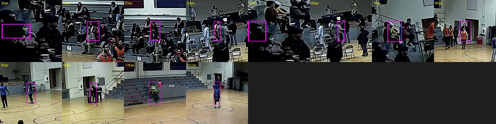
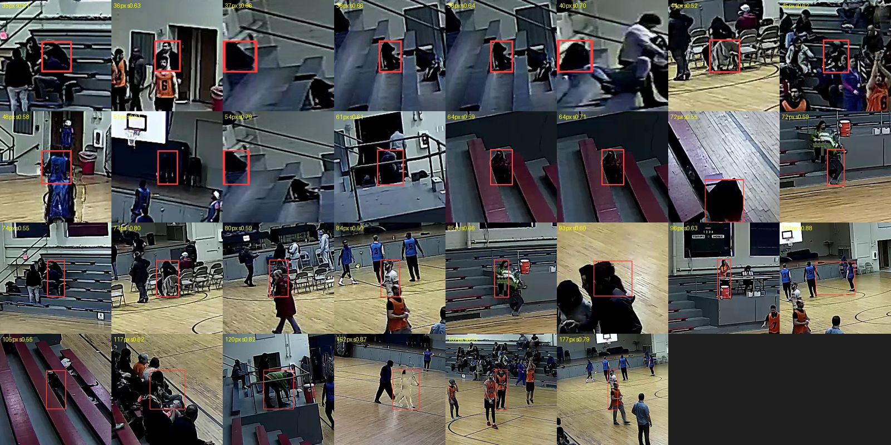

# Blind pilot: how good is SAM3 against a person's own boxes?

**Question.** On test frames boxed by a person who never saw SAM3's output, what share of people does SAM3 find, by size, and how many of its boxes are wrong? How long does a person take? The answer sets the labelling rule and the checking workflow for the 300 test frames (M3 step 4).

**Setup** (M3 step 3, 2026-11-26). 20 random test frames (`20261126-132616-curate.random-1ec0`, all five days of D-32), shown in FiftyOne without SAM3's boxes. The user boxed every person and tagged 18 frames finished; 2 crowded frames were skipped and are not counted. Filed as `20261126-151047-human.annotate-3bd2`: 180 boxes, 4 of them clipped where the drag ran past the image edge. SAM3: `20261126-205940-sam3.concept-11ee` on the same frames, SAM3's detector box (D-36). First scored against the box around the mask (the deleted run `7efc`, same detections); the detector box changes one frame (03-12 G330 7995: 5 missed and 5 wrong instead of 6 and 6), where the mask box had spanned two people. The two sheets below and the user's judgement of the wrong boxes were made on the mask boxes. A SAM3 box matches a person's box if their overlap (IoU) is at least the threshold; highest score first, each person matched once. IoU 0.3 is the main table because crowd boxes were drawn loosely (the user: "the count is accurate, the boxes not exactly").

**Time.** 22 minutes for the 18 frames, mostly on the crowded ones: about 7 s per box.

## Results

Every person the user drew is at least 32 px tall (median 97 px): none in the < 32 px band.

**Matched at IoU ≥ 0.3:**

| SAM3 score gate | recall 32–64 px | recall > 64 px | recall, all 180 | precision | SAM3 boxes | wrong boxes |
|---|---|---|---|---|---|---|
| > 0.1 | 0.94 (16/17) | 1.00 (163/163) | 0.99 (179) | 0.26 | 681 | 502 |
| > 0.3 | 0.88 (15/17) | 0.98 (160/163) | 0.97 (175) | 0.73 | 241 | 66 |
| > 0.5 | 0.82 (14/17) | 0.95 (155/163) | 0.94 (169) | 0.85 | 198 | 29 |

**Matched at IoU ≥ 0.5** (stricter; partly the looseness of hand boxes): at > 0.5, recall 0.89 (160/180), precision 0.81.

**Per frame** (people boxed by the user; SAM3 boxes above 0.3 and 0.5; misses and wrong boxes at > 0.5, IoU 0.3):

| day | camera | frame | user | SAM3 > 0.3 | SAM3 > 0.5 | missed | wrong |
|---|---|---|---|---|---|---|---|
| 03-12 | G330 | 7995 | 61 | 77 | 61 | 5 | 5 |
| 03-09 | G330 | 1800 | 28 | 37 | 32 | 2 | 6 |
| 03-11 | G330 | 1440 | 26 | 33 | 27 | 1 | 2 |
| 03-12 | G299 | 2700 | 23 | 29 | 25 | 1 | 3 |
| 03-09 | G330 | 4560 | 10 | 10 | 10 | 0 | 0 |
| 03-12 | G330 | 8040 | 9 | 11 | 10 | 0 | 1 |
| 03-12 | G299 | 4635 | 6 | 13 | 8 | 2 | 4 |
| 03-11 | G299 | 570 | 6 | 8 | 6 | 0 | 0 |
| 03-12 | G330 | 3045 | 5 | 5 | 5 | 0 | 0 |
| 03-15 | G330 | 6690 | 2 | 3 | 3 | 0 | 1 |
| 03-13 | G330 | 5715 | 1 | 6 | 4 | 0 | 3 |
| 03-13, 03-15 | | 4 frames | 1 each | | | 0 | 0 |
| 03-13, 03-09 | | 3 frames | 0 | 0 | 0 | 0 | 0 |
| 03-13 | G330 | 1680 | 0 | 5 | 4 | 0 | 4 |

**The 12 people SAM3 missed above 0.5, on the mask boxes** (11 on the detector boxes of the table): 11 of the 12 have a SAM3 box between 0.1 and 0.5. Mostly people half hidden in the crowd or behind others; two are heads in a dense crowd.

**The 30 SAM3 boxes above 0.5 with no person's box, on the mask boxes** (29 on the detector boxes). The user's judgement: only 10 are not people (bags and coats on the bleachers, a chair with a jacket, one camera artifact); the other 20 are people, mostly seated, which the user could tell only from the chair ("otherwise just a blob"), and SAM3 found them where the user didn't. By overlap, about 11 of those 20 lie apart from every user box (people the user missed) and about 9 lie mostly inside one (73–100%): some of these are a second box on an already-boxed person, still an error at checking time. So SAM3's precision at > 0.5 is **0.90–0.95**, not 0.85, and the person's blind boxes missed roughly a tenth of the people.

## Verdict

- **SAM3 is a good starting point at a 0.5 gate:** 94% of the people the user boxed, 90–95% of its boxes right, and people the user missed. Checking means deleting about 1 box in 10–20 and adding about 1 person in 15, not drawing from scratch.
- **Neither alone is the truth:** the blind person missed about a tenth of the people; SAM3 missed 6%. SAM3 first and a person correcting catches both (D-33). Automation bias still matters (a person may trust a wrong box), which is why the hint layer and the `done` tag ask for a look at every frame.
- **The misses are recoverable:** 11 of the 12 on the mask boxes are SAM3 boxes scored 0.1–0.5. Showing those as a second, optional layer lets the person accept them instead of drawing (D-27's cheapest fix).
- **Tiny people did not show up here:** nobody under 32 px was boxed on these 18 frames, so no ignore rule is needed for them yet. The 2 skipped crowded frames are where it could matter; step 4 checks every frame anyway.
- **Time:** 7 s per box from scratch. Correcting SAM3's boxes should cost a fraction of that; step 4 measures it.
