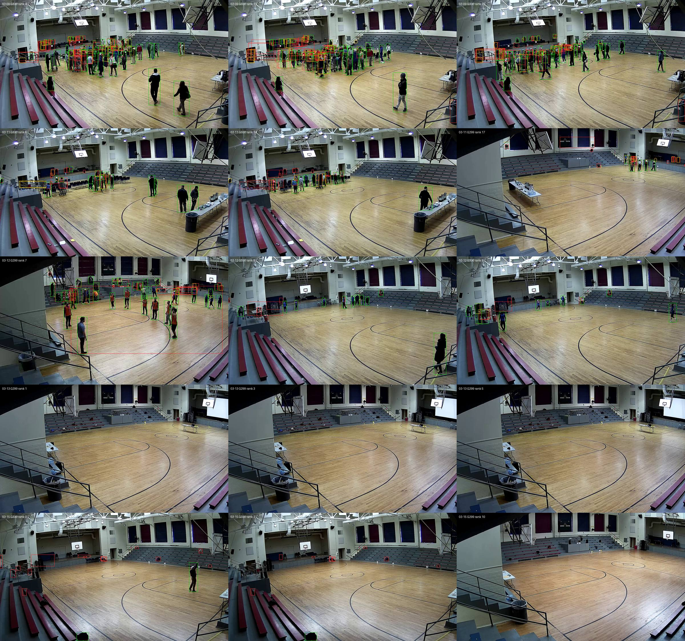

# What does SAM3 find on the test footage, and what does it cost?

**Question.** On the 300 test frames, how many people does SAM3 report, how big are they, and how long does labelling take on this machine? Do the boxes land on the people (geometry check of the new servant)?

**Setup** (M3 step 2, 2026-11-26). Cameras G299 and G330, five 15-minute windows on days other than the pool day (D-32): 2018-03-09 10:10, 03-11 11:15, 03-12 10:00, 03-13 15:55, 03-15 14:55 ([heavy_data.md](../../notes/heavy_data.md)). SAM3 image model (`sam3.pt`, `sam3_engine` `bb14ef1`), text prompt `person`, `score_floor` 0.1, masks on, 8 images per session; detections whose mask is empty at full size are dropped (none were, in this run).

| Step | Run |
|---|---|
| ingest 03-09 / the other four days | `20261126-113320-core.ingest-91b1` / `20261126-125951-core.ingest-8353` |
| sample 2 fps, union (18,030 frames) | `20261126-130121-curate.union-5a58` |
| random 300, seed 0 (G299 139, G330 161) | `20261126-130121-curate.random-0187` |
| sam3.concept | `20261126-130121-sam3.concept-7efc`, boxes around the mask (deleted 2026-11-26; `20261126-205940-sam3.concept-11ee` has the same detections, scores and masks, with SAM3's detector box (D-36)) |

## Results

**Cost.** Run 354 s for 300 frames; the job 234 s, i.e. **0.78 s per frame** including loading the model; peak VRAM **6.8 GiB**. Caching is about 4.4 s per clip (decoding the whole 5-min clip). The cost grows with the number of detections: each mask is upscaled to 1080p and RLE-encoded. On 300 frames of 03-09 alone (a crowd on every frame) the job took 1.28 s per frame.

**Each day is a different scene.** People per frame at score > 0.5:

| Day | Frames | Mean | Median | Max | Frames with none | What it shows |
|---|---|---|---|---|---|---|
| 03-09 | 57 | 34.7 | 43 | 60 | 2 | An event: a crowd standing and seated on chairs on the court |
| 03-11 | 57 | 17.8 | 13 | 47 | 0 | Groups by the stage and chairs, people walking |
| 03-12 | 54 | 31.3 | 36 | 69 | 2 | A team practice (orange vests), people on the far bleachers |
| 03-13 | 67 | 2.1 | 3 | 8 | 29 | Nearly empty |
| 03-15 | 65 | 1.1 | 1 | 3 | 21 | Nearly empty; low-score boxes on bags |
| all | 300 | 16.3 | 6 | 69 | 54 | |

Above 0.1: mean 55, max 194 per frame. The detector's 200-query cap was not reached: on 03-09's busiest frames the lowest score is still about 0.10, so the floor did the cutting.

**Box height (px, at 1080p) by score:**

| score | < 32 px | 32–64 px | > 64 px | total |
|---|---|---|---|---|
| 0.1–0.3 | 2,073 | 4,534 | 3,205 | 9,812 |
| 0.3–0.5 | 421 | 892 | 428 | 1,741 |
| > 0.5 | 195 | 1,564 | 3,138 | 4,897 |

Above 0.5, the median box is 79 px tall (5%: 34 px; 95%: 216 px).

**What the boxes mean** (the user's reading of the contact sheets): above 0.5 (green) they are correct; 0.3–0.5 (orange) ambiguous; 0.3 and below (red) mostly nothing: parts, pairs, duplicates in a crowd, bags.

| 3 test frames per day (green > 0.5, orange 0.3–0.5, red ≤ 0.3) |
|---|
|  |

## Why five days (D-32)

The first run labelled 300 frames of 03-09 alone (`20261126-114845-sam3.concept-35e5`, deleted 2026-11-26): a median of 42 people per frame, every frame the same event, nothing like the pool hour. A test set from one window measures that event. [12 of those frames](sheet_0309_only.jpg) and [the crowd at full resolution](far_side_0309_full_res.jpg), where the boxes still line up with the people.

## Verdict

- **The servant works:** boxes are where the people are; masks, checkpoint hash and engine commit are stored.
- **The five-day test set spans empty to crowded**, with 54 frames of 300 holding no confident person: false positives get measured (D-30).
- **Checking cost is uneven:** about 4,900 boxes above 0.5 in total, two thirds of them on 03-09 and 03-12 (111 frames). Step 3's pilot measures time per frame.
- **Tiny people are a detector limit, not an engine drop:** the user measured that almost no detection loses its mask at full size; SAM3 just doesn't score tiny people highly ([models/](../../notes/models/README.md#known-gotchas)). Recovering them would need detection on zoomed-in tiles; step 3 measures how many are missed.
