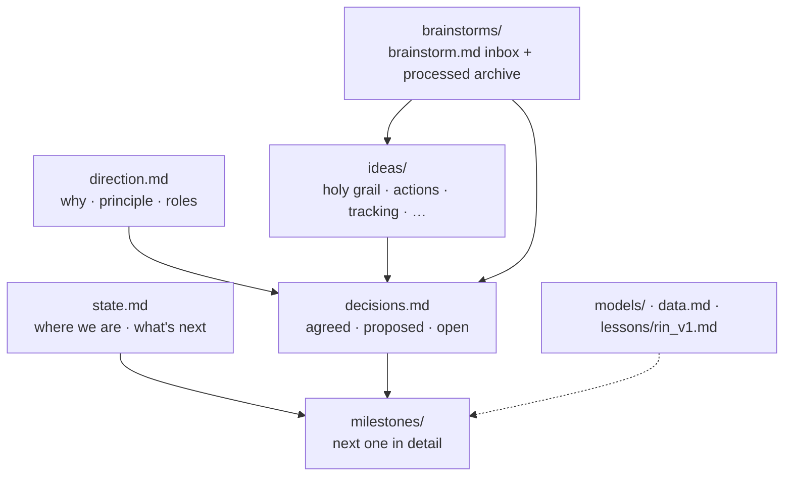

# Rin docs

Read in this order: [state.md](state.md) → [direction.md](direction.md) → [decisions.md](decisions.md) → [ideas/holy_grail.md](ideas/holy_grail.md) → [milestones/README.md](milestones/README.md).

Reference: [models/](models/README.md) · [data.md](data.md) · [lessons/rin_v1.md](lessons/rin_v1.md) · [ideas/](ideas/README.md) · [brainstorms/](brainstorms/README.md)
