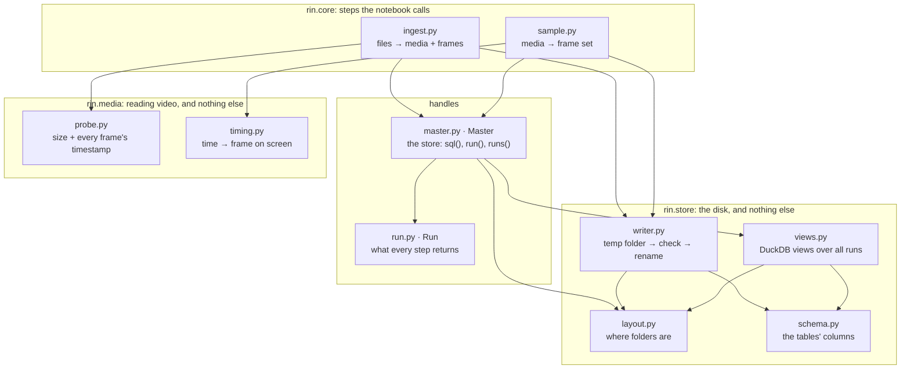

# The core: store, ingest, sample

What works today. Setup is in [install.md](install.md). The design for the parts not built yet is in [dev/notes/usage.md](../dev/notes/usage.md).

## The one pattern

Every step that produces data has the same shape, and returns a `Run`:

```python
result = module.verb(m, inputs, **that_step's_own_arguments)
```

`m` is the `Master`, a handle on the store. `inputs` are earlier runs. The data stays on disk; a `Run` only knows its id.

## Calls

| Call | What it does | Tables it writes |
|---|---|---|
| `Master(root)` | Opens the store at `root` (e.g. `workspace/store`), creating it if new. Warns if `tmp/` holds unfinished runs | |
| `m.sql(query, params=None)` | SQL over every table. Returns a DuckDB relation: print it, `.df()` for pandas, `.fetchall()` for tuples | |
| `m.runs()` | Every run, oldest first | |
| `m.run(run_id)` | The `Run` with that id | |
| `core.ingest(m, file_or_folder, split=..., describe=None)` | Adds a file, or every video and image directly inside a folder. `split` is set per file (`"pool"`, `"test"`, ...). `describe` is your function `path -> {"site", "camera", "started_at"}` for facts the file doesn't hold | `media`, `frames` |
| `core.sample(m, ingest_run, fps=...)` | The frame on screen at 0, 1/fps, 2/fps, ... seconds of each media, by real timestamps | `frame_sets` |

A `Run` has `.id`, `.step`, `.config`, `.inputs`, `.tags`, its tables as `.media()`, `.frames()`, `.frame_set()`, and `len(run)` for a frame set.

```python
pool = core.ingest(m, "workspace/media/meva/pool", split="pool", describe=meva_name)
frames = core.sample(m, pool, fps=2)
frames.frame_set().df().head()
```

## Rules worth knowing

- **`frame_idx` is the i-th frame the decoder returns.** Every table joins on `(media_id, frame_idx)`, never on time.
- **`pts` is seconds since frame 0**, read from every decoded frame. Some AVI files (MEVA's included) attach timestamps in storage order; Rin sorts them into display order. Two frames with the same timestamp are refused.
- **Time to frame:** time t is the latest frame that started at or before t, with 0.5 ms tolerance for rounding in the container.
- **Ingest refuses:** a file already ingested; a file outside `workspace/` (paths are stored relative to it, so store and media move together); a file whose header frame count differs from the decoded count (cut short or corrupt; AVI and MP4 only, MKV states no count); a `describe` result with unknown keys, wrong types, or a `started_at` with a timezone. All files are checked before any is decoded.
- **A run is all or nothing.** It is written into `tmp/`, checked against the table's columns, then moved into `runs/` in one step. A run that fails leaves nothing in `runs/`.

## The store on disk

```
workspace/store/
  runs/
    20261124-093000-core.ingest-p2x1/
      run.json                 # step, config, inputs, tags, who, code version, times
      media.parquet  frames.parquet
    20261124-093210-core.sample-a7c0/
      run.json  frame_sets.parquet
  tmp/                         # runs being written
```

Each table (`media`, `frames`, `frame_sets`, `runs`) is a DuckDB view over that table's files in every run folder. Columns: [src/rin/store/schema.py](../src/rin/store/schema.py). The store is derived from the media: delete `workspace/store/` and ingest again to start over.

## The code

One module, one job. Arrows show who uses whom; nothing points back up.



| Module | Knows about | Knows nothing about |
|---|---|---|
| `rin.media` | video files, timestamps | the store, runs |
| `rin.store` | folders, Parquet, the tables' columns | video, models, steps |
| `rin.master`, `rin.run` | how to find and query runs | how any step works |
| `rin.core` | its own step's logic | other steps |

Tests: `uv run pytest` (CPU only; they generate their own tiny videos).
