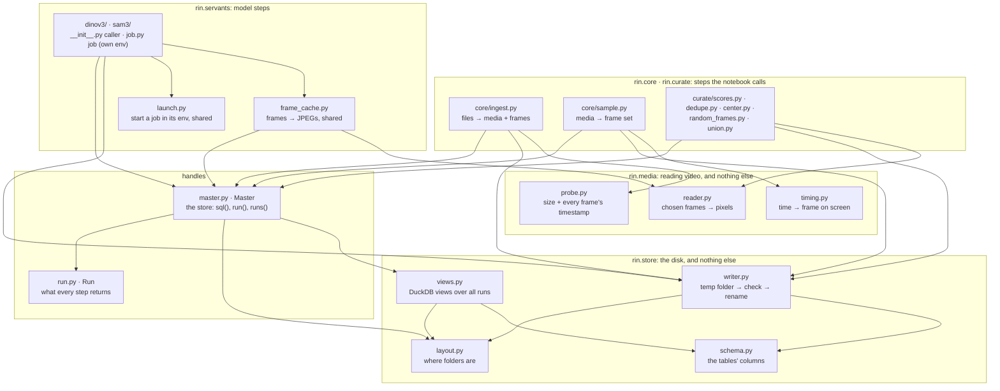

# The core: store, steps, servants

What works today. Setup is in [install.md](install.md). The design for the parts not built yet is in [dev/notes/usage.md](../dev/notes/usage.md).

## The one pattern

Every step that produces data has the same shape, and returns a `Run`:

```python
result = module.verb(m, inputs, **that_step's_own_arguments)
```

`m` is the `Master`, a handle on the store. `inputs` are earlier runs. The data stays on disk; a `Run` only knows its id.

## Calls

| Call | What it does | Tables it writes |
|---|---|---|
| `Master(root)` | Opens the store at `root` (e.g. `workspace/store`), creating it if new. Warns if `tmp/` holds unfinished runs | |
| `m.sql(query, params=None)` | SQL over every table. Returns a DuckDB relation: print it, `.df()` for pandas, `.fetchall()` for tuples | |
| `m.runs()` | Every run, oldest first | |
| `m.run(run_id)` | The `Run` with that id | |
| `core.ingest(m, file_folder_or_list, split=..., describe=None)` | Adds a file, a list of files, or every video and image directly inside a folder. `split` is set per file (`"pool"`, `"test"`, ...). `describe` is your function `path -> {"site", "camera", "started_at"}` for facts the file doesn't hold | `media`, `frames` |
| `core.sample(m, ingest_run, fps=...)` | The frame on screen at 0, 1/fps, 2/fps, ... seconds of each media, by real timestamps | `frame_sets` |
| `curate.score_frames(m, frames, names)` | Measures each frame of a frame set on a 320-wide copy (CPU). Names and meanings: `curate.SCORES` (`motion`, `blur`, `dark`, `bright`) | `frame_scores` |
| `curate.keep(m, scores, where=...)` | The frames whose stored scores pass an SQL condition, e.g. `"motion >= 0.002"`. Nothing is decoded; trying another threshold is another cheap run | `frame_sets` |
| `dinov3.embed(m, frames, model=..., size=(896, 512), what=("cls",), batch_size=32)` | One DINOv3 vector per frame and kind (`cls`, `mean_patch`), computed by a GPU job in its own environment. `size` is (width, height), multiples of 16 | `embeddings` + `embeddings.npy` |
| `sam3.concept(m, frames, prompts={"person": "person"}, checkpoint=..., score_floor=0.1, masks=True, images_per_session=8)` | Every instance of each class on each frame, from a text prompt (one per class), by a GPU job in SAM3's environment. Boxes in [0, 1], masks as COCO RLE counts at the media's full size. Records the checkpoint's SHA-256 and `sam3_engine`'s commit | `instances` |
| `curate.center(m, emb)` | A new embedding run: each vector minus its camera's mean vector (same kind), so the shared background drops out. Refuses a camera with a single frame (its centred vector would be zero) | `embeddings` + `embeddings.npy` |
| `curate.random(m, frames, n=..., seed=...)` | `n` frames drawn at random, `rank` = draw order (the first k are a random k). Same seed, same frames in any store with the same files | `frame_sets` |
| `curate.union(m, [frame_set, ...])` | Every frame of the given frame sets, once, unranked | `frame_sets` |
| `curate.dedupe(m, frames, emb, cosine_max=..., kind="cls")` | Walks each camera's frames in time order and drops a frame whose vector is more similar than `cosine_max` to the last kept one. Refuses all-zero vectors | `frame_sets` |

A `Run` has `.id`, `.step`, `.config`, `.inputs`, `.tags`, its tables as `.media()`, `.frames()`, `.frame_set()`, `.frame_scores()`, `.embeddings()`, `.instances()`, its vectors as `.vectors()` (row r belongs to the `embeddings` row whose `row` is r), and `len(run)` for a frame set.

```python
pool = core.ingest(m, "workspace/media/meva/pool", split="pool", describe=meva_name)
frames = core.sample(m, pool, fps=2)
scores = curate.score_frames(m, frames, ["motion", "blur", "dark", "bright"])
kept   = curate.keep(m, scores, where="motion >= 0.002")
emb    = dinov3.embed(m, kept, model="facebook/dinov3-vitl16-pretrain-lvd1689m")   # GPU
cands  = curate.dedupe(m, kept, emb, cosine_max=0.99)
```

Imports: `from rin import Master, core, curate` and `from rin.servants import dinov3, sam3`.

## Rules worth knowing

- **`frame_idx` is the i-th frame the decoder returns.** Every table joins on `(media_id, frame_idx)`, never on time.
- **`pts` is seconds since frame 0**, read from every decoded frame. Some AVI files (MEVA's included) attach timestamps in storage order; Rin sorts them into display order. Two frames with the same timestamp are refused.
- **Time to frame:** time t is the latest frame that started at or before t, with 0.5 ms tolerance for rounding in the container.
- **`media_id` comes from the file's content** (`m` + 16 hex characters of its SHA-256), so the same file gets the same id in any store.
- **Ingest refuses:** a file already ingested, by path or by content (a copy under another name); a file outside `workspace/` (paths are stored relative to it, so store and media move together); a file whose header frame count differs from the decoded count (cut short or corrupt; AVI and MP4 only, MKV states no count); a `describe` result with unknown keys, wrong types, or a `started_at` with a timezone. All files are checked before any is decoded.
- **Frames are decoded in one place.** `rin.media.read_frames` decodes front to back with the same decoding `probe` counts with, so frame k is always the same picture (checked on a MEVA clip: frame 4,500 is pixel-identical to ffmpeg's frame 4,500). It never seeks (seeking lands on a keyframe and counts from there, which B-frame AVIs get wrong).
- **Servants read the frame cache, never video.** Before a servant's job starts, the frames it needs are decoded once into `store/frames/<media_id>/<frame_idx>.jpg` (JPEG quality 95). Every model sees the same pixels. Derived data: safe to delete.
- **Boxes are checked when written:** inside [0, 1] with positive width and height, or the run is refused. Nothing is clamped, so a pixel-conversion bug fails loudly.
- **A servant is two halves** in one folder, e.g. `src/rin/servants/dinov3/`: the caller (`__init__.py`, core environment: checks arguments, caches frames, files the run) and the job (`job.py`, its own environment from the `pyproject.toml` beside it: imports nothing from Rin, writes raw arrays). If the job fails, no run is filed. The run records the job's model revision (`checkpoint`) and library versions (`code`).
- **A run is all or nothing.** It is written into `tmp/`, checked against the table's columns, pushed to disk (`fsync`), then moved into `runs/` in one step. A run that fails, or a hard crash, leaves nothing in `runs/`. Cached frames are written the same way.
- **A run records what made it:** Rin's git commit, and if `src/` had uncommitted changes, those changes as `src.diff` in the run folder. `started_at` to `finished_at` covers the step's work, frame caching included.

## The store on disk

```
workspace/store/
  runs/
    20261124-093000-core.ingest-p2x1/
      run.json                 # step, config, inputs, tags, who, code version, times
      src.diff                 # only if src/ had uncommitted changes: those changes
      media.parquet  frames.parquet
    20261124-093210-core.sample-a7c0/
      run.json  frame_sets.parquet
    20261125-204712-dinov3.embed-1c3e/
      run.json  embeddings.parquet  embeddings.npy   # vectors: float16, rows × dim
  tmp/                         # runs being written
  frames/<media_id>/<frame_idx>.jpg                  # the frame cache
```

Each table (`media`, `frames`, `frame_sets`, `frame_scores`, `embeddings`, `instances`, `runs`) is a DuckDB view over that table's files in every run folder, matched by column name (a column added later reads as null in older runs). Columns: [src/rin/store/schema.py](../src/rin/store/schema.py).

**Don't delete the store to start over.** It will hold a person's checks and drawn boxes, which nothing rebuilds; back it up. Only `frames/` (the cache) is safe to delete.

## The code

One module, one job. Arrows show who uses whom; nothing points back up.



| Module | Knows about | Knows nothing about |
|---|---|---|
| `rin.media` | video files, timestamps | the store, runs |
| `rin.store` | folders, Parquet, the tables' columns | video, models, steps |
| `rin.master`, `rin.run` | how to find and query runs | how any step works |
| `rin.core`, `rin.curate` | its own step's logic | other steps, models |
| `rin.servants.<model>` | one model: caller and job | other servants |
| `rin.servants.frame_cache`, `rin.servants.launch` | which frames are cached; how a job is started in its environment | any model's inputs or outputs |

Tests: `uv run pytest` (CPU only: they generate their own tiny videos and fake the servants' jobs). A test checks that importing Rin loads no model framework.
