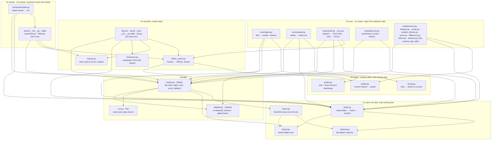

# The core: store, steps, servants

What works today. Setup is in [install.md](install.md). The design for the parts not built yet is in [dev/notes/usage.md](../dev/notes/usage.md).

## The one pattern

Every step that produces data has the same shape, and returns a `Run`:

```python
result = module.verb(m, inputs, **that_step's_own_arguments)
```

`m` is the `Master`, a handle on the store. `inputs` are earlier runs. The data stays on disk; a `Run` only knows its id.

## Calls

| Call | What it does | Tables it writes |
|---|---|---|
| `Master(root)` | Opens the store at `root` (e.g. `workspace/store`), creating it if new. Warns if `tmp/` holds unfinished runs | |
| `m.sql(query, params=None)` | SQL over every table. Returns a DuckDB relation: print it, `.df()` for pandas, `.fetchall()` for tuples | |
| `m.runs()` | Every run, oldest first | |
| `m.delete(run)` | Removes a run for good. Refused while another run takes it as input (delete that one first) and for a person's work (`human.*`). For superseded runs, never to start over | |
| `m.run(run_id)` | The `Run` with that id | |
| `core.ingest(m, file_folder_or_list, split=..., describe=None)` | Adds a file, a list of files, or every video and image directly inside a folder. `split` is set per file (`"pool"`, `"test"`, ...). `describe` is your function `path -> {"site", "camera", "started_at"}` for facts the file doesn't hold | `media`, `frames` |
| `core.sample(m, ingest_run, fps=...)` | The frame on screen at 0, 1/fps, 2/fps, ... seconds of each media, by real timestamps | `frame_sets` |
| `curate.score_frames(m, frames, names)` | Measures each frame of a frame set on a 320-wide copy (CPU). Names and meanings: `curate.SCORES` (`motion`, `blur`, `dark`, `bright`) | `frame_scores` |
| `curate.keep(m, scores, where=...)` | The frames whose stored scores pass an SQL condition, e.g. `"motion >= 0.002"`. Nothing is decoded; trying another threshold is another cheap run | `frame_sets` |
| `dinov3.embed(m, frames, model=..., revision=..., size=(896, 512), what=("cls",), batch_size=32)` | One DINOv3 vector per frame and kind (`cls`, `mean_patch`), computed by a GPU job in its own environment. `revision` is the model's 40-character commit, already in the Hugging Face cache (the folder name under `snapshots/`); the job loads offline at that commit, so a run never quietly uses a newer model. `size` is (width, height), multiples of 16 | `embeddings` + `embeddings.npy` |
| `sam3.concept(m, frames, prompts={"person": "person"}, checkpoint=..., score_floor=0.1, masks=True, box="detector", images_per_session=8)` | Every instance of each class on each frame, from a text prompt (one per class), by a GPU job in SAM3's environment. Boxes in [0, 1], masks as COCO RLE counts at the media's full size. `box="detector"` stores SAM3's own box (D-36); `box="mask"` the box around the mask, which spans both pieces when a mask is split. Records the checkpoint's SHA-256 and `sam3_engine`'s commit | `instances` |
| `viewer.show(m, frames, name=..., labels=[...], label_scores=None, draw=None, start_from=None, start_above=0.5, classes=("person",), replace=False)` | Builds a throwaway FiftyOne dataset (D-16) from a frame set, in `rank` order: each label run's boxes as a read-only field (only a score band with `label_scores=(low, high)`), and, with `draw`, a field to draw into: empty, or holding `start_from`'s boxes above `start_above` (D-33). `marks={"name": [box, ...]}` adds read-only layers of boxes that aren't a run (e.g. `human.suspects`), shown as `marks_<name>`; `tags={"flagged": [frame, ...]}` tags frames to filter on, without a layer. Open it with `uv run --project src/rin/viewer fiftyone app launch <name>`. Writes no run; the dataset remembers what it was built from | |
| `human.annotate(m, frames, view=..., field=..., who=..., done_tag="done")` | Files the frames of a viewer dataset tagged `done` (every object on them has a box) with the boxes on them; the run's inputs name the frame set and every run the view showed or started from. Boxes on untagged frames are refused, unless the view started from a run: then untagged frames are left out, so a check can be filed part-way. A `crowd` box removes every other box at least half inside it (D-34). A box dragged past the image edge is clipped to it. No score; the person in `who` | `frame_sets` (the finished frames), `instances` |
| `human.suspects(m, frames, boxes, masks=None)` | Boxes worth a second look while checking (D-33): the same spot on at least half of a camera's frames that day (bags, coats, chairs, people sitting still), near-duplicates on one frame, and, with `masks` (a SAM3 run), a box around a split mask, with SAM3's detector box as `suggested` when that run stored it. Returns a list of flags; writes no run | |
| `curate.center(m, emb)` | A new embedding run: each vector minus its stream's mean vector (same kind), so the shared background drops out. Refuses a stream with a single frame (its centred vector would be zero) | `embeddings` + `embeddings.npy` |
| `curate.random(m, frames, n=..., seed=...)` | `n` frames drawn at random, `rank` = draw order (the first k are a random k). Same seed, same frames in any store with the same files | `frame_sets` |
| `curate.union(m, [frame_set, ...])` | Every frame of the given frame sets, once, unranked | `frame_sets` |
| `curate.difference(m, frames, [frame_set, ...])` | The frames of `frames` that none of the others holds, unranked: e.g. the candidates a teacher hasn't labelled yet after the pool is rebuilt | `frame_sets` |
| `curate.dedupe(m, frames, emb, cosine_max=..., kind="cls")` | Walks each stream's frames in time order and drops a frame whose vector is more similar than `cosine_max` to the last kept one. Refuses all-zero vectors | `frame_sets` |
| `curate.select(m, frames, emb, method=..., n_max=..., seed=..., clusters=None, kind="cls")` | Up to `n_max` frames, ranked (`rank` 0, 1, …), so budget N is the first N (D-28). `method` is one of `curate.METHODS`: `random` (a random order; `emb` must be `None`), `kcenter` (farthest-point, first frame drawn by `seed`), `kmeans_stratified` (`clusters` groups per stream, one frame per cluster per round). Every method works per stream (`kcenter` and `kmeans_stratified` on Euclidean distance between raw vectors), and the streams take turns in the ranking, so every budget is even across cameras (D-38). Refuses frames that aren't `pool` | `frame_sets` |
| `m.dataset(labels=[...], frames=..., top=None, gate=..., duplicate_iou=None)` | A training set as a query; writes nothing. The first `top` frames of a ranked frame set (all when `None`), and the `labels` runs' boxes on them that pass `gate`, SQL on the instances columns plus `w`, `h`, `area` (e.g. `"score >= 0.5"`). With `duplicate_iou`, of two boxes on a frame overlapping that much, the lower-scored is dropped. Refuses a frame no label run was given, or two were (it would export as empty, or with both runs' boxes) | |
| `export.yolo(m, ds, classes=[...], val=val_ds, tags=None)` | Freezes a train and a val dataset in Ultralytics' format under the run's `files/`: `images/{train,val}/` hard links to the frame cache, `labels/{train,val}/` one `.txt` per frame (empty for a frame with nobody), `data.yaml` without a `path` key (the export can move). Refuses a box of a class not in `classes`, train frames that aren't `pool` and val frames that aren't `val` (D-13, D-31) | `frame_sets`, `instances` (the boxes exported), `artifacts` |
| `yolo.train(m, export, model=..., epochs=..., imgsz=..., batch=..., seed=..., workers=8, optimizer="AdamW", lr0=0.002, momentum=0.9, warmup_bias_lr=0.0, accumulate=8, tags=None)` | Trains a stock checkpoint file on the export, by a GPU job in its own environment; all epochs (no early stop), `best.pt` picked by the val score. The optimizer is always stated, never Ultralytics' `auto` (D-40); `accumulate` batches make one optimizer step. Trains on a hard-linked copy, since Ultralytics writes a labels cache beside the labels. Weights, `results.csv` and `args.yaml` under `files/`. Val metrics are against SAM3's unchecked val labels: they pick the checkpoint, they don't score the student (D-31) | `metrics` (val scores, time, peak VRAM), `artifacts` |
| `yolo.predict(m, model, frames, conf=0.001, max_det=100, imgsz=..., batch=16, classes=None, tags=None)` | The detector's boxes on a frame set, by a GPU job (the training environment). `model` is a `yolo.train` run (its `best.pt`) or a checkpoint file; `classes` keeps only those class names (e.g. `["person"]` from a stock COCO model), dropped inside Ultralytics before `max_det`, so other classes take no slots; an unknown name fails. Box edges within 1e-6 outside [0, 1] are clamped, farther fails; a box Ultralytics clipped to no width or height is dropped and counted (`boxes_dropped_no_area`). Confidence 0.001 and 100 boxes per frame suit COCO scoring | `instances`, `metrics` (boxes dropped) |
| `export.coco(m, truth, classes=[...], crowd=None, tags=None)` | A checked run (frame set + boxes, e.g. `human.annotate`) as COCO ground truth in `files/annotations.json`: every frame, empty ones too; boxes in pixels; `crowd={"crowd": "person"}` writes a crowd box as `person` with `iscrowd = 1` (D-34) | `artifacts` |
| `evaluate.coco(m, predictions, truth, tags=None)` | pycocotools' box evaluation of a predictions run against an `export.coco` run; a detection inside a crowd region is neither rewarded nor punished. Refuses predictions not made on every truth frame | `metrics`: `mAP50-95`, `mAP50`, `mAP75`, `mAP_small` / `_medium` / `_large`, `AR1`, `AR10`, `AR100`, AR by size, `fp_per_empty_frame` (boxes ≥ 0.5 on frames with nobody) |

A `Run` has `.id`, `.step`, `.config`, `.inputs`, `.tags`, its tables as `.media()`, `.frames()`, `.frame_set()`, `.frame_scores()`, `.embeddings()`, `.instances()`, any table by name with `.table("metrics")`, its vectors as `.vectors()` (row r belongs to the `embeddings` row whose `row` is r), and `len(run)` for a frame set.

```python
pool = core.ingest(m, "workspace/media/meva/pool", split="pool", describe=meva_name)
frames = core.sample(m, pool, fps=2)
emb    = dinov3.embed(m, frames, model="facebook/dinov3-vitl16-pretrain-lvd1689m",
                      revision="ea8dc2863c51be0a264bab82070e3e8836b02d51")   # GPU
cands  = curate.dedupe(m, frames, emb, cosine_max=0.99)    # no motion filter: it drops quiet frames (D-41)
```

Imports: `from rin import Master, core, curate, evaluate, export, human, viewer` and `from rin.servants import dinov3, sam3, yolo`.

## Rules worth knowing

- **A stream is one camera on one day in one split** (site included): `curate.center` and `curate.dedupe` never mix a camera's val clips into its pool, or one day into the next. Media without a camera are each their own stream; `dedupe` also needs the start time to walk clips in order, and otherwise walks each media alone.
- **`frame_idx` is the i-th frame the decoder returns.** Every table joins on `(media_id, frame_idx)`, never on time.
- **`pts` is seconds since frame 0**, read from every decoded frame. Some AVI files (MEVA's included) attach timestamps in storage order; Rin sorts them into display order. Two frames with the same timestamp are refused.
- **Time to frame:** time t is the latest frame that started at or before t, with 0.5 ms tolerance for rounding in the container.
- **`media_id` comes from the file's content** (`m` + 16 hex characters of its SHA-256), so the same file gets the same id in any store.
- **Ingest refuses:** a file already ingested, by path or by content (a copy under another name); a file outside `workspace/` (paths are stored relative to it, so store and media move together); a file whose header frame count differs from the decoded count (cut short or corrupt; AVI and MP4 only, MKV states no count); a `describe` result with unknown keys, wrong types, or a `started_at` with a timezone. All files are checked before any is decoded.
- **Frames are decoded in one place.** `rin.media.read_frames` decodes front to back with the same decoding `probe` counts with, so frame k is always the same picture (checked on a MEVA clip: frame 4,500 is pixel-identical to ffmpeg's frame 4,500). It never seeks (seeking lands on a keyframe and counts from there, which B-frame AVIs get wrong).
- **Servants read the frame cache, never video.** Before a servant's job starts, the frames it needs are decoded once into `store/frames/<media_id>/<frame_idx>.jpg` (JPEG quality 95). Every model sees the same pixels. Derived data: safe to delete.
- **Boxes are checked when written:** inside [0, 1] with positive width and height, or the run is refused. The store clamps nothing, so a pixel-conversion bug fails loudly; only `yolo.predict` moves edges within 1e-6 of [0, 1] onto it (float32 rounding) before writing.
- **A servant is two halves** in one folder, e.g. `src/rin/servants/dinov3/`: the caller (`__init__.py`, core environment: checks arguments, caches frames, files the run) and the job (`job.py`, its own environment from the `pyproject.toml` beside it: imports nothing from Rin, writes raw arrays). If the job fails, no run is filed. The run records the job's model revision (`checkpoint`) and library versions (`code`).
- **A run is all or nothing.** It is written into `tmp/`, checked against the table's columns, pushed to disk (`fsync`), then moved into `runs/` in one step. A run that fails, or a hard crash, leaves nothing in `runs/`. Cached frames are written the same way.
- **A run records what made it:** Rin's git commit, and if `src/` had uncommitted changes, those changes as `src.diff` in the run folder. `started_at` to `finished_at` covers the step's work, frame caching included.

## The store on disk

```
workspace/store/
  runs/
    20261124-093000-core.ingest-p2x1/
      run.json                 # step, config, inputs, tags, who, code version, times
      src.diff                 # only if src/ had uncommitted changes: those changes
      media.parquet  frames.parquet
    20261124-093210-core.sample-a7c0/
      run.json  frame_sets.parquet
    20261125-204712-dinov3.embed-1c3e/
      run.json  embeddings.parquet  embeddings.npy   # vectors: float16, rows × dim
  tmp/                         # runs being written
  frames/<media_id>/<frame_idx>.jpg                  # the frame cache
```

Each table (`media`, `frames`, `frame_sets`, `frame_scores`, `embeddings`, `instances`, `artifacts`, `metrics`, `runs`) is a DuckDB view over that table's files in every run folder, matched by column name (a column added later reads as null in older runs). Columns: [src/rin/store/schema.py](../src/rin/store/schema.py).

**Don't delete the store to start over.** It will hold a person's checks and drawn boxes, which nothing rebuilds; back it up. Only `frames/` (the cache) is safe to delete.

## The code

One module, one job. Arrows show who uses whom; nothing points back up.



| Module | Knows about | Knows nothing about |
|---|---|---|
| `rin.media` | video files, timestamps | the store, runs |
| `rin.store` | folders, Parquet, the tables' columns | video, models, steps |
| `rin.master`, `rin.run` | how to find and query runs | how any step works |
| `rin.core`, `rin.curate`, `rin.export`, `rin.evaluate` | its own step's logic | other steps, models |
| `rin.servants.<model>` | one model: caller and job | other servants |
| `rin.viewer`, `rin.human` | FiftyOne as a throwaway copy; turning what a person drew into a run | models |
| `rin.servants.frame_cache`, `rin.servants.launch` | which frames are cached; how a job is started in its environment | any model's inputs or outputs |

Tests: `uv run pytest` (CPU only: they generate their own tiny videos and fake the servants' jobs). A test checks that importing Rin loads no model framework.
