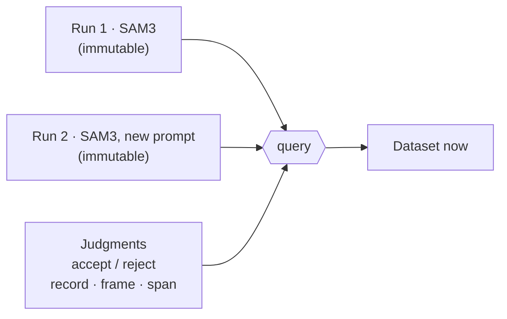

# Decisions

> Current truth only: rewrite an entry when it changes, delete it when it no longer holds. IDs stay stable once code cites them; gaps are fine.
> **Agreed** = the user said yes. **Proposed** = the agent recommends it and is waiting for a yes or no. **Open** = needs the user's call.

## Agreed

**D-01 · Standardise the data, not the models.** The core is the data model, the store and provenance. Servants are thin, separate adapters with no shared base class and no common request type. A model's special abilities stay in its own servant's arguments. *Why:* v1's three-pillar contracts were about 60% of the SDK and the source of most bugs ([lessons/rin_v1.md](lessons/rin_v1.md)).

**D-02 · Runs are immutable; judgments are separate; "what is true now" is a query.** Every servant call writes a new run (records plus model, checkpoint, config, inputs), and nothing is edited in place. Accept and reject go into a judgments table, per record, frame or time span. The training dataset is a query over runs and judgments. *Why:* this removes v1's branches, commit, fork, id remapping and shared nested objects, which together caused v1 CR-12, CR-32 and Studio debts A1–A5 and A8. Provenance comes for free.

**D-03 · Naming: Master and Servants**, as defined in [direction §3](direction.md#3-naming-master-and-servants).

**D-04 · The holy grail is the first goal.** Everything is built around it; actions, tracking and analysis come after ([direction §4](direction.md#4-scope-and-order)).

**D-05 · Actions are window classification.** We accept that action timing is only as precise as the window stride, and do not attempt VLM temporal localisation ([ideas/vlm_window_actions.md](ideas/vlm_window_actions.md)).

**D-06 · Mask2Former is parked.** Stuff classes (sky, road) come from YOLO semantic segmentation. Revisit for an in-house DINOv3-backbone model.

**D-15 · The toolkit is a Python library first.** Master and Servants are driven from notebooks and a small command line. No HTTP API or web app of our own until a concrete need forces one: the viewer can't do something review needs, or another machine or program must call Rin.

**D-16 · FiftyOne serves as a disposable viewer.** It reads a throwaway export (one script) and is never the data model.

**D-17 · Holy grail setup:**
- class "person" first;
- student YOLO, with RF-DETR as the fallback if YOLO hits a dead end;
- success means curated selection reaches random selection's test mAP with half the labels or fewer.

**D-18 · Servants are rewritten, not ported from v1.** v1's engines are shaped around its pillar contracts (`setup`, `categories`, `ground_*`, HTTP apps), and the user's vendor engines (`sam3_engine`, `gemma_emb_engine`) already are the clean API. v1 stays a source of *facts* (gotchas, working settings, label lists). Its pure helpers are salvaged one at a time, with the user's OK ([lessons §Salvage](lessons/rin_v1.md#salvage-code-worth-keeping)).

**D-19 · Milestones are planned one ahead.** Only the next milestone gets a detailed file; later ones stay one line each and are reshaped by what we learn. *Why:* v1's plans ballooned before the first loop ran.

**D-07 · Servants run as batch jobs, not daemons.** A job runs in its model's environment, reads inputs from disk, writes its run to disk and exits, which frees the VRAM. No ports, no PM2, no VRAM governor. A long-lived process only for an interactive need (e.g. SAM3 clicks, VLM chat), and only when that need arrives. *Why:* v1's stale SAM3 prompts (CR-25) and governor races came from long-lived services.

**D-08 · Records are stored as Parquet and queried with DuckDB; features go in plain array files.** *Why:* v1's JSON catalog took 2.35 s per commit at 250k records, and SQL replaces its five hand-written indexes.

**D-09 · The frame index is the join key; pts is stored beside it.** Frames are decoded with the container's real per-frame timestamps (v1 ADR 5; the node10 cameras run at 14.25 and 14.33 fps). *Why:* v1 matched float timestamps within a tolerance and silently lost frames (CR-30).

**D-10 · Geometry is normalised to [0, 1] in the store.** Pixels only at the edges (servant input and output, exporters, viewers). Media records carry width and height. *From v1 ADR 4.*

**D-11 · Keypoints are matched by name, never by position.** *From v1 ADR 16:* Goliath is not ordered like COCO (its wrists are points 62 and 41).

**D-12 · Exporters write each training framework's own format** (YOLO, COCO, RF-DETR, MOT). No generic dataloader. *From v1 ADR 2.*

**D-13 · Splits are made by recording, never by frame.** The holy grail's test set comes from a different day than its pool, and a person checks its labels. *Why:* frames of one video are near-duplicates, so splitting by frame leaks. And a test set labelled by SAM3 alone measures agreement with SAM3, not accuracy.

**D-14 · Feature storage is selective.** By default, store CLS vectors and per-box pooled vectors. Compute patch grids on demand, or cache them only for selected frames. *Why:* patch grids take megabytes per frame, so hours of video would take tens of GB.

**D-20 · `uv` manages every environment.** The core and each servant get their own `uv` venv; the user's engines are installed with `pip install -e vendors/<engine>`. System FFmpeg replaces what conda provided. *Why:* one fast tool with lockfiles, instead of conda plus pip.

**D-21 · One gitignored `workspace/` holds everything heavy and local:** `media/`, `checkpoints/` and, from M1, `store/`. The root stays small: `CLAUDE.md`, `docs/`, `scripts/`, `src/`, `tests/`, `vendors/`, `workspace/` (plus `rin_v1/` until it's deleted). *Why:* the user's v1 habit; it keeps the root standard and tidy.

## Proposed

None right now.

## Open

None right now.
