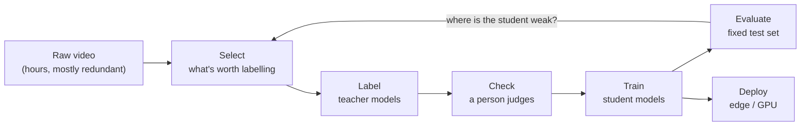
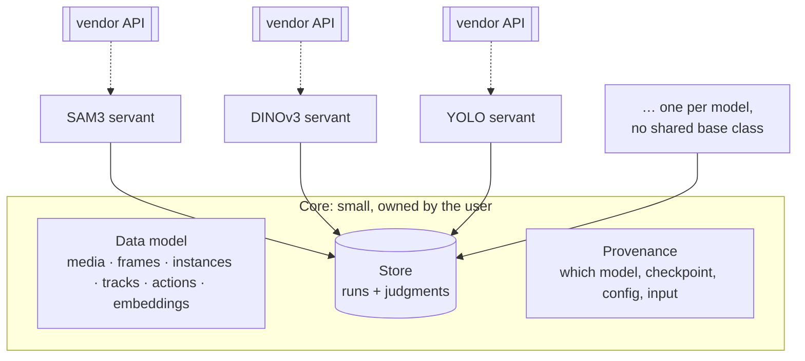
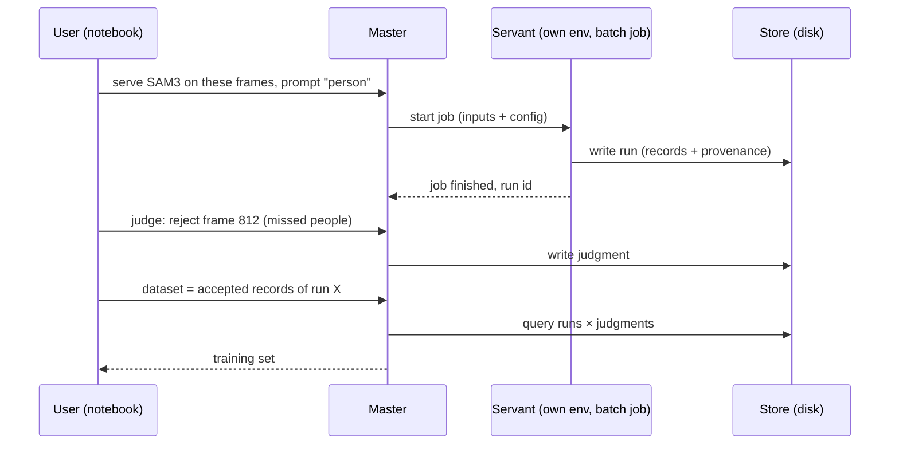
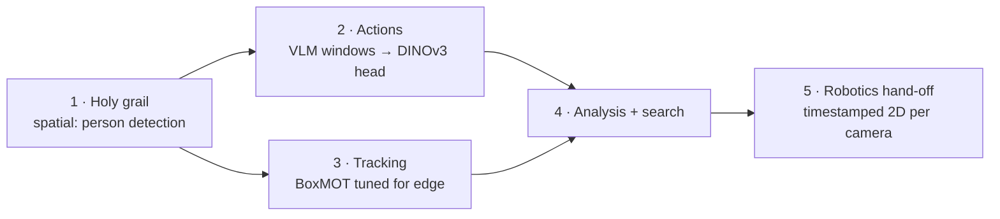
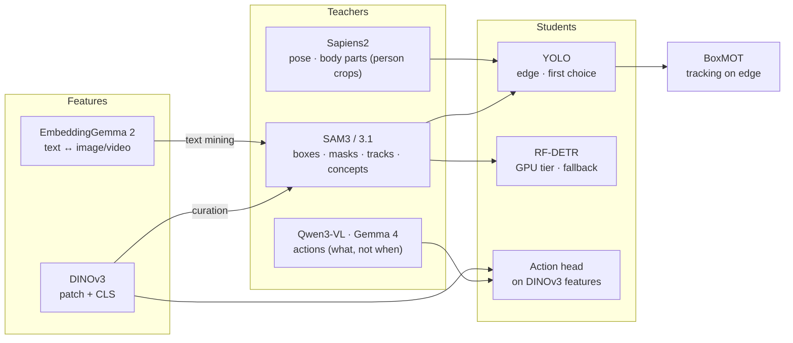

# Rin direction

> Living document. Changes only after the user agrees. Rewrite in place.

## 1. Intent

**Raw video in → curated, labelled, checked 2D data out → small models that run on cheap hardware.**

The hard, unsolved part is **Select**: choosing *which* frames of an endless stream to label, and proving the choice helped. That is the **holy grail** and the first goal ([ideas/holy_grail.md](ideas/holy_grail.md)).

Rin is a **proof of concept that must still be built properly**: one user, one machine, one 16 GB GPU. It grows into a toolkit later. Quality comes from a sound data model, not from infrastructure.

## 2. The core principle

**Standardise the data, not the models.**

The models differ in every way: inputs, prompts, outputs, environments, checkpoints, memory limits. Forcing them behind one interface made v1 bloated and buggy ([lessons/rin_v1.md](lessons/rin_v1.md)). The data does not vary: media, frames, boxes, masks, keypoints, tracks, action spans, embeddings, and where each came from.

## 3. Naming: Master and Servants

| Name | What it is |
|---|---|
| **Master** | Owns the store. Holds media, runs and judgments, answers "what is true now" as a query, and sends work to servants. The object the user holds in a notebook |
| **Servant** | One per model (e.g. the SAM3 servant). Runs its model as a batch job in that model's own environment, and returns a **run** |
| **Run** | One servant call: its records, plus the model, checkpoint, config and inputs used. Never edited after it is written |
| **Judgment** | A person's (or a rule's) accept or reject on a record, a frame or a time span. Stored apart from runs |

The names come from v1; the meaning is new. In v1 the Master was a mutable catalog with branches, and the Servant pushed requests to long-running HTTP services (D-02, D-07).

## 4. Scope and order

**In:** everything 2D in video and images. **Out:** 3D, depth, sensor fusion; a later project can consume Rin's outputs as long as each record carries its camera and time.

Ideas for each: [vlm_window_actions](ideas/vlm_window_actions.md) · [tracker_tuning](ideas/tracker_tuning.md) · [search](ideas/search.md) · [actors](ideas/actors.md).

## 5. Model roles

Mask2Former is parked (D-06). Details per model: [models/README.md](models/README.md).

## 6. Roles

| Level | Who | Owns |
|---|---|---|
| Executive | User | Intent, direction, what counts as success |
| Manager | User | The data model and the API. The agent drafts the usage code as a teaching document; the user reads, questions, edits and approves it |
| Execution | Agent | Servants, store, jobs, environments, milestones, tests. Large decisions go to the user with a recommendation |

## 7. How we work

See [CLAUDE.md, "How we iterate"](../CLAUDE.md#how-we-iterate): the user brainstorms, the agent ingests, the user answers decisions, then milestones run, with `state.md` as the handoff between sessions.
