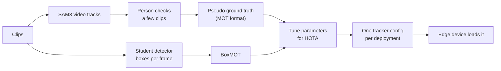

# Tracker tuning for edge

> Status: **raw.** After the holy grail.

## Idea

Tuning belongs to **deployment**. Labelling doesn't need BoxMOT, because SAM3 tracks on its own.

## Known traps (from v1)

- In v1, all 50 tuning trials scored 0.0. BotSort with camera-motion compensation needs the frame passed in, the call didn't pass it, and a bare `except` swallowed the error (v1 CR-29). Rule: fail loudly.
- The "hota" metric silently fell back to MOTA. Rule: compute HOTA with a known implementation (TrackEval, or BoxMOT's own evaluation), or refuse.
- Every BoxMOT tuning backend imports Ray Tune, and Ray broke on WSL2. Options: fix Ray on WSL2 (often local mode or the shared-memory settings), or drive Optuna ourselves against BoxMOT's evaluator.

## ReID

A variable to tune, not a design decision. Motion-only trackers (ByteTrack, OC-SORT) often suffice for one camera with short occlusions. ReID matters for long occlusions and people re-entering the view.
