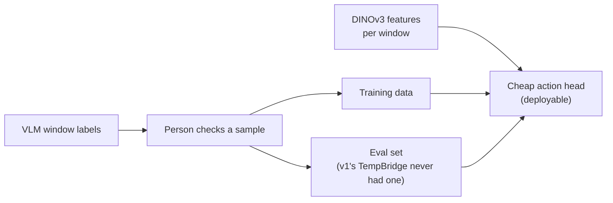

# Actions as window classification with VLMs

> Status: **explored; comes after the holy grail.** The principle is agreed (D-05).

## Idea

VLMs are good at "what is this person doing" and bad at "exactly when did it start". So we never ask for the "when".

- **Padding (v1 ADR 6):** a tight crop cuts off held tools and the objects being handled.
- **Window size per task:** fast actions (grabbing) need short windows and a higher sampling fps; slow ones (walking, waiting) need longer windows at a low fps. W, S and fps are settings of each run, not global constants.
- **Marked boxes (the user's v1 finding):** drawing numbered boxes on the full frame and asking "what does actor 2 do?" worked surprisingly well. It keeps scene context that crops lose. Compare it against crops on the same windows.

## Why it fits the hardware

- Qwen3-VL 8B FP8 handles about 10 s of video, 4B about 1 min ([../models/vlm.md](../models/vlm.md)). Short windows stay well inside both.
- Crops spend the visual token budget on the actor instead of a wide scene ("token dilution").

## Distillation

## Ground truth

MEVA ships activity annotations (37 types). They can measure the VLM windows themselves before anyone trusts them.

## Open

- Cost: actors × windows × prompts. Bound it by running only on windows where the actor moves.
- Gemma 4 vs Qwen3-VL: Gemma 4 is untested here.
- Video tubelet models (VideoMAE2 etc.): revisit only if the DINOv3 head clearly underperforms on the eval set. v1 design notes for a DINOv3 temporal head: `rin_v1/docs/notes/TAD/offlineTAD_opticalflow_dino.md` (motion from patch correlation) and `rin_v1/docs/notes/TAD/online_TAD_kvcache.md` (causal transformer head).
