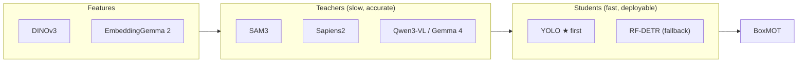

# Models

What each model is for in Rin, where it comes from, and what its model card doesn't say. A model gets its own file here only when it has enough notes to need one (today: [vlm.md](vlm.md)).

**Rules:**
- A servant calls the vendor's own API directly (D-01, D-18).
- Before writing one, read the model card and the vendor README.
- Record here only what they leave out. Never copy a model card: link it.

## Roles at a glance

## Table

| Model | Role | Code | Weights | Status |
|---|---|---|---|---|
| SAM3 / SAM3.1 | Spatial teacher: concept prompts, masks, video tracking | `vendors/sam3_engine` (the user's engine) | `sam3.pt`, `sam3.1_multiplex.pt`, BPE vocab, in `workspace/checkpoints/sam3/` (6.5 GB) | worked in v1 |
| DINOv3 | Features: curation, de-duplication, search, action-head input | HF `transformers` ([collection](https://huggingface.co/collections/facebook/dinov3)) | HF cache | worked in v1; variant for Rin not chosen |
| EmbeddingGemma 2 | Text ↔ image/video embeddings, search | `vendors/gemma_emb_engine` (the user's engine) | HF, pinned revision | worked in v1 |
| **YOLO** | **Holy grail student** (D-17), edge tier. Tasks: detect, segment, pose, [semantic segmentation](https://docs.ultralytics.com/tasks/semantic) (for stuff classes, D-06) | `ultralytics` package | stock: `yolo26*`, `yolov8*`, `yolo11n` in `workspace/checkpoints/yolo/` | worked in v1; semantic task untested |
| RF-DETR | Student, GPU tier; fallback if YOLO hits a dead end | `rfdetr` package | stock from the package | worked in v1 |
| Sapiens2 | Person specialist: pose (308 keypoints), body-part segmentation (29 parts), actor features | Native in `transformers` ≥ 5.24 (`AutoModel` / `AutoBackbone` for features, `AutoModelForPoseEstimation` with person boxes, `AutoModelForSemanticSegmentation`); [docs](https://huggingface.co/docs/transformers/main/model_doc/sapiens2), [collection](https://huggingface.co/collections/facebook/sapiens2). No submodule: the 308 keypoint names come from upstream [keypoints308.py](https://github.com/facebookresearch/sapiens2/blob/main/sapiens/pose/configs/_base_/keypoints308.py) | HF cache: `facebook/sapiens2-{pretrain,pose,seg}-1b` | downloaded, untested |
| BoxMOT | Tracker for edge, tuning | `vendors/boxmot` | ReID weights as needed. v1's tuned `botsort_best.yaml` is untrustworthy (tuning scored 0.0, v1 CR-29) | worked in v1; tuning broken |
| Qwen3-VL 4B / 8B FP8 | Actions (VLM teacher) | vLLM, own environment | HF | worked in v1 ([vlm.md](vlm.md)) |
| Gemma 4 | Actions (VLM teacher) | `transformers` or vLLM | HF | untested ([vlm.md](vlm.md)) |
| Mask2Former | Parked (D-06) | — | — | — |

## Environments

One environment per servant when dependencies clash, and they do: BoxMOT was on Python 3.11, EmbeddingGemma on 3.12, and vLLM needs its own. Managed with `uv`. The core library stays light and imports no model framework.

## Known gotchas (from v1)

- **Sapiens2 weights come twice per HF repo:** `model.safetensors` (for `transformers`) and `sapiens2_<size>_<task>.safetensors` (for the vendor repo's standalone loader), about 6 GB each at 1B. Download only the first (`--include config.json preprocessor_config.json model.safetensors`). Pose is top-down: pass person boxes as COCO `(x, y, w, h)` in pixels, and the processor crops. v1's Sapiens 1 `torch.export` problem doesn't apply.
- **SAM3 (v1 CR-25):** a long-lived SAM3 process kept the previous job's prompts. Batch jobs (D-07) avoid this by design.
- **vLLM on WSL2:** see [vlm.md](vlm.md).

## v1 notes worth reading before writing a servant

`rin_v1/docs/notes/services/`: `sam3/` (image and video usage), `gg_emb2/`, `qwen/` (install, prompting, 4B and 8B FP8 fits), `sapiens/install.md`, `boxmot/install.md`.
