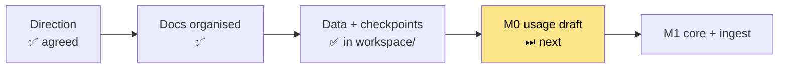

# State: where we are now

> The handoff between sessions. The agent rewrites this file at the end of every session ([CLAUDE.md, "How we iterate"](../CLAUDE.md#how-we-iterate)). Current truth only.

**Updated:** 2026-11-23

## Phase

## Done
- Read all of v1. Postmortem and salvage list: [lessons/rin_v1.md](lessons/rin_v1.md).
- **All decisions D-01 … D-21 are agreed**, including: `uv` for environments (D-20), and one gitignored `workspace/` for media, checkpoints and, later, the store (D-21). See [decisions.md](decisions.md).
- MEVA slice and v1 checkpoints moved into `workspace/` ([data.md](data.md)).
- Ingested the first brainstorm ([brainstorms/processed_2026-11-23.md](brainstorms/processed_2026-11-23.md)). The inbox [brainstorms/brainstorm.md](brainstorms/brainstorm.md) is empty.
- The working loop, inbox vs chat, the vendor feature-request rule and the rules for using rin_v1 are in [CLAUDE.md](../CLAUDE.md).

## Next
1. **M0, the usage draft** ([milestones/README.md](milestones/README.md)). The agent writes the notebook code the holy grail loop should read like, as a teaching document, and the data model it implies. The user reads, questions, edits and approves it.
2. Then M1 gets its own milestone file.

## Waiting on the user
- Commit this session's files: `CLAUDE.md`, `docs/`, `scripts/`, `.gitignore`. The repo has no commits and no remote yet.

## Vendor feature requests (to the user)
None open.

## Repo facts a new session needs
- Gitignored: `rin_v1/`, `workspace/`.
- To re-download MEVA: `bash scripts/pull_meva.sh` (skips files already on disk).
